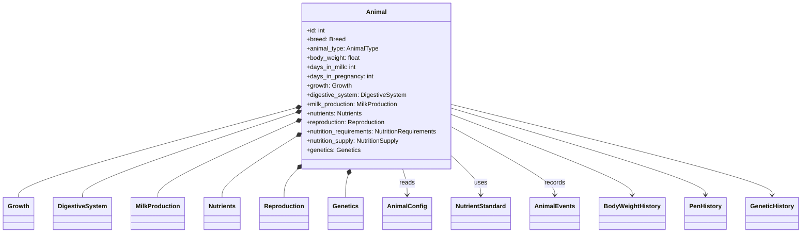
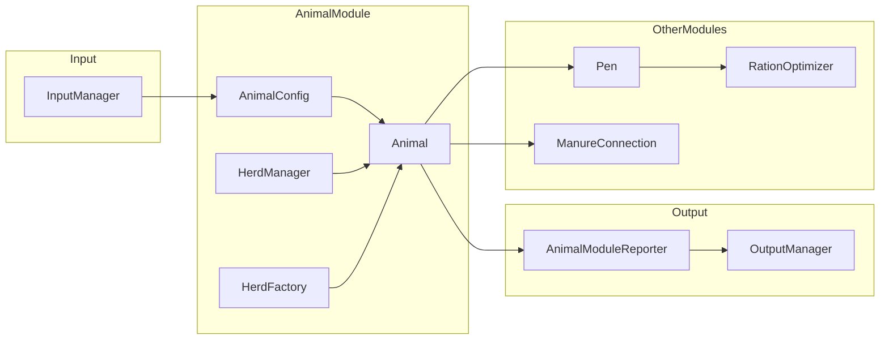

# Animal

# RUFAS Animal Module

## Module Overview

The `RUFAS.biophysical.animal` module is the core representation of individual animals within the Ruminant Farm Systems (RUFAS) simulation. It models the full lifecycle of dairy cattle — from newborn calf through heifer growth stages to lactating and dry cows — including growth, reproduction, milk production, nutrition, genetics, and mortality/culling events.

The module is organized as a package with the following structure:

```
biophysical/animal/
├── animal.py              # The Animal class (primary entity)
├── animal_config.py       # AnimalConfig: user-supplied simulation parameters
├── animal_module_constants.py
├── animal_genetics/       # Genetics simulation (TBV, EBV, phenotype)
├── data_types/            # Enums, TypedDicts, event/history records
├── digestive_system/      # Manure excretion modeling
├── growth/                # Body weight and growth curves
├── herd_factory.py        # Herd creation and animal updates
├── herd_manager.py        # Herd-level orchestration
├── milk/                  # Lactation curve and milk production
├── nutrients/             # Nutrient requirements (NASEM/NRC)
├── ration/                # Ration formulation and optimization
├── reproduction/          # Estrus, AI, pregnancy, calving
└── calf_retention_policy.py
```

## Core Architecture

The module centers on the `Animal` class, which composes several sub-systems. Each sub-system is a dedicated class responsible for a specific biological or management process.



## The Animal Class

### Initialization

The `Animal.__init__` method accepts a `TypedDict` of initialization values and a `RufasTime` object. The initialization path depends on the animal type:

| Animal Type | Initialization Method | Notes |
|---|---|---|
| `CALF` (newborn) | `_initialize_newborn_calf` | Special path; no `body_weight` key present |
| `CALF` / `HEIFER_I` | `_initialize_calf_or_heiferI` | Shared youngstock initialization |
| `HEIFER_II` / `HEIFER_III` | `_initialize_heiferII_or_heiferIII` | Includes reproduction program setup |
| `LAC_COW` / `DRY_COW` | `_initialize_cow` | Full reproductive and lactation state |

Newborn calves additionally receive genetics initialization via `_initialize_newborn_calf_genetics`, which uses dam true breeding values (TBV) for fat and protein when available.

### Key Properties

The `Animal` class exposes several properties that enforce type-specific invariants:

- **`days_in_milk`** — Returns 0 for non-cow animal types; only cows can have a positive value.
- **`days_in_pregnancy`** — Always 0 for `CALF` and `HEIFER_I`; setting a positive value on these types raises a `TypeError`.
- **`is_pregnant`** — True when `days_in_pregnancy > 0` and the animal is not a calf or heifer I.
- **`is_milking`** — True when the animal is a cow with `days_in_milk > 0`.
- **`future_cull_date`** — Returns `sys.maxsize` for non-cows (they are not culled via the cow culling mechanism).
- **`daily_horizontal_distance` / `daily_vertical_distance` / `daily_distance`** — Only valid for cows; accessing on other types raises `TypeError`.
- **`calves`** — Number of calves born; only meaningful for cows.
- **`calving_interval`** — Days between calvings; only for cows.

### Lifecycle Updates

The `Animal` class provides daily update methods invoked by the herd manager:

| Method | Purpose |
|---|---|
| `daily_growth_update` | Updates body weight based on growth curves |
| `_daily_digestive_system_update` | Computes manure excretion |
| `daily_milking_update` | Updates milk production for lactating cows |
| `daily_reproduction_update` | Advances estrus, AI, pregnancy state |
| `_daily_nutrients_update` | Updates nutrient supply and requirements |
| `_calf_life_stage_update` | Calf-specific daily logic (mortality, weaning) |
| `_heiferI_life_stage_update` | Heifer I logic, including transition to Heifer II |
| `_heiferII_life_stage_update` | Heifer II logic, including culling and transition |
| `_heiferIII_life_stage_update` | Heifer III logic, including transition to cow |
| `_cow_life_stage_update` | Cow logic (calving, drying off, culling) |

### Mortality and Culling

Two probabilistic methods determine when an animal leaves the herd:

**`determine_future_death_date()`** — Uses parity-specific death probabilities from `AnimalConfig.parity_death_probability`. If a death event occurs, a day is sampled from `AnimalConfig.death_day_probability` using linear interpolation. Returns `sys.maxsize` if no death is scheduled.

**`determine_future_cull_date()`** — Uses parity-specific cull probabilities and reason-specific probabilities (lameness, injury, mastitis, disease, udder, unknown). Returns a tuple of `(future_cull_date, cull_reason)`.

Both methods follow the pattern of:
1. Sample a uniform random number
2. Compare against cumulative probability thresholds
3. If triggered, sample a day from the corresponding day-distribution using inverse interpolation

## Nutrition System

The `Animal` class delegates nutrition calculations to either `NASEMRequirementsCalculator` or `NRCRequirementsCalculator`, selected by the class-level `nutrient_standard` attribute (set via `Animal.set_nutrient_standard`).

### `calculate_nutrition_requirements`

This method computes a `NutritionRequirements` object containing:

- Maintenance, growth, pregnancy, lactation, and activity energy
- Metabolizable protein
- Calcium and phosphorus (process-based)
- Dry matter intake
- Essential amino acids (histidine, isoleucine, leucine, lysine, methionine, phenylalanine, threonine, tryptophan, valine)

**Calf special case:** Calves use `CalfRationManager` for intake and requirement calculations, with dummy calcium/phosphorus values (noted as a TODO in the source).

**Cow/heifer path:** The method uses previous-day nutrition supply (dry matter intake, NDF%, TDN%, net energy concentration) as inputs to the NASEM or NRC equations. If no previous supply exists, defaults from `AnimalModuleConstants` are used.

### Nutrition Supply

The `nutrition_supply` attribute holds the actual nutrients provided by the formulated ration. The `previous_nutrition_supply` attribute stores the prior day's supply, enabling day-to-day continuity in requirement calculations.

## Reproduction System

The `Reproduction` class (accessed via the `reproduction` property) manages:

- Estrus detection and cycle tracking
- Artificial insemination (AI) scheduling
- Pregnancy checks and pregnancy loss
- Gestation length and calving
- Reproduction programs (heifer: TAI or SynchED; cow: Presynch/Ovsynch/Resynch)

The `reproduction` property setter raises a `TypeError` if assigned to a `CALF` or `HEIFER_I` animal, enforcing that only reproductively mature animals have reproduction state.

## Genetics

When `AnimalConfig.simulate_genetics` is enabled, each animal carries a `Genetics` object that models:

- **True breeding values (TBV)** — genetic merit for fat and protein
- **Estimated breeding values (EBV)** — predicted merit from phenotype
- **Phenotype values** — observed trait values
- **Ranking index** — selection index for management decisions

Newborn calves inherit dam TBV values when available; otherwise genetics are initialized without parental information. The `update_genetic_history` method records changes to an animal's genetics over time, appending a new `GeneticHistory` entry when the genetic representation changes.

## Configuration

`AnimalConfig` is a static class holding all user-supplied parameters. Key categories:

| Category | Example Parameters |
|---|---|
| **Weaning** | `wean_day`, `wean_length` |
| **Reproduction** | `heifer_reproduction_program`, `cow_reproduction_program`, `voluntary_waiting_period`, conception rates |
| **Calving** | `still_birth_rate`, `average_gestation_length`, `std_gestation_length` |
| **Growth** | `birth_weight_avg_ho`, `birth_weight_std_ho`, `average_mature_body_weight` |
| **Milk** | `milk_fat_percent`, `true_protein_percent`, `cow_times_milked_per_day` |
| **Culling** | `parity_cull_probability`, `parity_death_probability`, reason-specific probabilities |
| **Calf retention** | `calf_retention_method` (`"rate"` or `"count"`), `keep_female_calf_rate` |
| **Genetics** | `simulate_genetics` flag |

Configuration is loaded from user input via `InputManager.get_data` in `initialize_animal_config`.

## Integration with the Broader Codebase

The Animal module interacts with several other RUFAS subsystems:



- **HerdManager / HerdFactory** — Orchestrate daily updates across all animals, create new animals at calving, and manage pen assignments.
- **Pen** — Animals are assigned to pens; `update_pen_history` tracks pen changes. Pens handle manure stream splitting and bedding.
- **RationOptimizer** — Uses animal nutrition requirements to formulate rations; the resulting supply is stored back on the animal.
- **OutputManager / AnimalModuleReporter** — Report daily milk yield, reproduction statistics, manure excretions, genetic history, and sold/culled animal information.
- **InputManager** — Supplies configuration values and lactation curve data.

## Key Design Patterns

1. **Composition over inheritance** — The `Animal` class composes specialized sub-system objects rather than using deep inheritance hierarchies.

2. **TypedDict-based initialization** — Animal creation uses `TypedDict` variants (`NewBornCalfValuesTypedDict`, `CowValuesTypedDict`, etc.) that are type-checked at the interface boundary.

3. **Property-based invariant enforcement** — Properties like `days_in_milk` and `future_cull_date` enforce animal-type constraints, raising `TypeError` with descriptive messages when violated.

4. **Probabilistic event scheduling** — Death, culling, and reproduction events use random sampling against cumulative probability distributions, with linear interpolation for day selection.

5. **Class-level configuration** — `AnimalConfig` and `nutrient_standard` are class-level, ensuring all animals share consistent simulation parameters.

6. **Error reporting via OutputManager** — All invariant violations and warnings are routed through `OutputManager.add_error` / `add_warning`, centralizing diagnostic output.