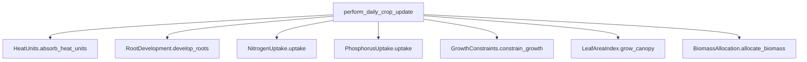

# Crop and Soil

# Crop Subsystem (`RUFAS/biophysical/field/crop`)

## Overview

The crop subsystem simulates the growth, development, and harvest of a single crop on a field. It is a component-based implementation of the plant-growth routines from the SWAT model, primarily following the Biomass Production (SWAT 5:2.1.1), Crop Yield (SWAT 5:2.4), and Growth Constraints (SWAT 5:3.1) sections.

The subsystem is organized around a single orchestrator class, `Crop`, which composes a set of process components. Each component owns one aspect of crop physiology — heat accumulation, canopy growth, nutrient uptake, water dynamics, biomass allocation, etc. — and operates on a shared `CropData` state object. This design keeps the individual processes isolated and testable while giving the `Crop` class a single, uniform interface for the rest of the simulation.

## Architecture

The `Crop` class is the public entry point. It is constructed with (or internally creates) a `CropData` instance, then instantiates each process component with a reference to that same `CropData`. Because every component mutates the shared `CropData`, the daily update sequence is order-dependent: each step consumes state produced by the previous step.

The daily update is skipped entirely if the crop is mature or dormant (`CropData.is_mature` / `is_dormant`).

### Component inventory

| Component | Responsibility |
|---|---|
| `Crop` | Orchestration; daily update, water cycling, dormancy, harvest dispatch |
| `CropData` | Dataclass holding all crop state and configuration |
| `CropDataFactory` | Builds validated `CropData` instances from user input |
| `HeatUnits` | Heat-unit accumulation and growing-season status |
| `RootDevelopment` | Root depth growth and root/shoot biomass fraction |
| `NitrogenUptake` / `PhosphorusUptake` | Nutrient uptake from soil layers |
| `GrowthConstraints` | Water/temperature/nutrient stress and the daily growth factor |
| `LeafAreaIndex` | Canopy development, senescence, and canopy height |
| `BiomassAllocation` | Radiation interception, photosynthesis, biomass partitioning |
| `WaterUptake` / `WaterDynamics` | Soil water extraction, transpiration, canopy evaporation |
| `CropManagement` | Harvest-index calculation, cutting, killing, residue transfer |
| `Dormancy` | Dormancy entry/exit and associated biomass loss |

## Core Data Model: `CropData`

`CropData` is a `@dataclass(kw_only=True)` that serves as both the configuration record and the runtime state for a crop. It is the single object passed between all process components.

Key state groups:

- **Identity and classification** — `name`, `id`, `plant_category` (a `PlantCategory` enum: `WARM_ANNUAL`, `COOL_ANNUAL`, `PERENNIAL`, `WARM_ANNUAL_LEGUME`, `COOL_ANNUAL_LEGUME`, `PERENNIAL_LEGUME`, `TREE`), `is_perennial`, `is_nitrogen_fixer`.
- **Planting/management** — `planting_year`, `planting_day`, `use_heat_scheduling`, `harvest_efficiency`, `harvest_heat_fraction`, `optimal_harvest_index`, `minimum_harvest_index`.
- **Growth parameters** — `minimum_temperature`, `optimal_temperature`, `potential_heat_units`, `max_leaf_area_index`, `light_use_efficiency`, leaf-development curve points (`first_heat_fraction_point`, `first_leaf_fraction_point`, etc.).
- **Live state** — `biomass`, `leaf_area_index`, `root_fraction`, `above_ground_biomass`, `root_biomass`, `accumulated_heat_units`, `growth_factor`, `root_depth`.
- **Nutrient state** — `nitrogen`, `phosphorus`, `optimal_nitrogen`, `optimal_phosphorus`, plus emergence/half-mature/mature nutrient fractions.
- **Water state** — `canopy_water`, `water_uptake`, `max_transpiration`, `water_deficiency`, and cumulative evaporation/transpiration/uptake totals.
- **Harvest quality attributes** — dry-matter percentage, crude protein, starch, ADF/NDF, lignin, ash, and yield nitrogen/phosphorus fractions. Defaults correspond to sorghum harvested as grain.

`__post_init__` derives several flags from `plant_category`: perennial status, nitrogen-fixer status, and the `dormancy_loss_fraction` (0.1 for perennials, 0.3 for trees).

### Computed properties

- `heat_fraction` — `accumulated_heat_units / potential_heat_units`; the master growth clock used by most components.
- `is_mature` — `heat_fraction >= 1.0`.
- `in_growing_season` — alive, growing, not mature, not dormant.
- `is_in_senescence` — `heat_fraction > senescent_heat_fraction`.
- `water_canopy_storage_capacity` — canopy interception capacity scaled by current LAI relative to max LAI (SWAT eqn. 2:2.1.1).
- `do_harvest_index_override` — true when a user-specified `user_harvest_index` is present.

## Crop Lifecycle

### Planting

`Crop.create_crop(crop_reference, use_heat_scheduled_harvesting, time)` is the factory entry point. It:

1. Delegates to `CropDataFactory.create_crop_data(crop_reference)` to build a configured `CropData`.
2. Constructs a `Crop` around it.
3. Calls `set_crop_planting_attributes(...)`, which records `use_heat_scheduling`, the crop `id`, `planting_year`, and `planting_day`.

The field layer subsequently calls `update_crop_max_root_depth(bottom_layer_depth)` to clamp the crop's `max_root_depth` to the bottom of the soil profile when the user-configured value is deeper.

### Daily growth update

`Crop.perform_daily_crop_update(current_conditions, field_data, soil_data, time)` runs the growth pipeline in a fixed order:

1. **Heat units** — `HeatUnits.absorb_heat_units(mean, min, max)` accumulates heat and sets `is_growing`. If `use_heat_unit_temperature` is enabled, min/max air temperatures are clamped to the crop's growth thresholds and averaged; otherwise the mean air temperature is used directly.
2. **Roots** — `RootDevelopment.develop_roots(time)` advances root depth and updates `root_fraction`.
3. **Nutrients** — `NitrogenUptake.uptake(soil_data)` and `PhosphorusUptake.uptake(soil_data)` extract nutrients from accessible soil layers and update plant nutrient stores.
4. **Stress** — `GrowthConstraints.constrain_growth(...)` computes water, temperature, nitrogen, and phosphorus stress (each independently toggleable via `FieldData` flags) and sets `CropData.growth_factor = 1 - max(stresses)`.
5. **Canopy** — `LeafAreaIndex.grow_canopy()` advances LAI toward the optimal leaf-area curve, applies senescence after `senescent_heat_fraction`, and updates canopy height.
6. **Biomass** — `BiomassAllocation.allocate_biomass(incoming_light)` converts intercepted radiation into biomass and partitions it into above- and below-ground pools.

### Water cycling

Water is handled separately from the growth update, in `Crop.cycle_water_for_crop(actual_evaporation, full_evapotranspirative_demand, soil_data)`:

- During the growing season, `WaterUptake.uptake(soil_data)` extracts water from soil layers, then `WaterDynamics.cycle_water(...)` computes transpiration, evaporation, and the day's `water_deficiency`.
- Outside the growing season, all cumulative water counters are reset to zero.

Canopy interception is managed by `Crop.handle_water_in_canopy(available_precipitation)`, which fills canopy storage up to `water_canopy_storage_capacity` and returns the precipitation remaining for the soil. `Crop.evaporate_from_canopy(evapotranspirative_demand)` delegates to `WaterDynamics.evaporate_from_canopy(...)`, and `Crop.set_maximum_transpiration(...)` wraps `WaterDynamics.set_maximum_transpiration(...)`.

### Dormancy

`Crop.assess_dormancy(daylength, dormancy_threshold_daylength, rainfall, soil_data, soil)` is called by the field layer. If daylength falls below the threshold, the crop enters dormancy; otherwise it exits.

`enter_dormancy` performs three operations:

1. `Dormancy.enter_dormancy(soil_data)` — sets `is_dormant = True`. Warm annuals are exempt. Trees and perennials lose a fraction of biomass (`dormancy_loss_fraction`), convert it to surface residue, and clamp LAI to `minimum_lai_during_dormancy`.
2. `BiomassAllocation.partition_biomass()` — re-partitions the (possibly reduced) biomass into above/below-ground pools.
3. `soil.carbon_cycling.residue_partition.add_residue_to_pools(rainfall)` — passes residue into the soil carbon cycle.

The `Dormancy` class also provides two static helpers used during field setup: `find_threshold_daylength(minimum_daylength, dormancy_threshold)` and `find_dormancy_threshold(abs_latitude)`, which implements the SWAT latitude-based dormancy threshold equations (5:1.2.2–5:1.2.4).

### Harvest

Harvest is driven by the field manager through `Crop.manage_crop_harvest(harvest_operation, field_name, field_size, time, soil_data)`, which delegates to `CropManagement.manage_harvest(...)`. The supported operations are defined in the `HarvestOperation` enum:

- `HARVEST_KILL` — cut, collect yield, then kill the plant.
- `HARVEST_ONLY` — cut and collect yield; the plant continues growing.
- `KILL_ONLY` — kill the plant without collecting yield; all biomass becomes residue.

`CropManagement.manage_harvest` follows this sequence:

1. `determine_harvest_index()` — uses the user override if present; otherwise computes the potential harvest index from heat fraction (`_determine_potential_harvest_index`) and adjusts it for water deficiency (`_adjust_harvest_index`).
2. `cut_crop(collected_fraction=self.data.harvest_efficiency)` — removes `harvest_index × above_ground_biomass` from the plant (or from whole-plant biomass when the harvest index exceeds 1.0), updates LAI and heat units proportionally, and splits the cut material into collected yield vs. residue. Nutrient contents are assigned using either yield-nutrient fractions or optimal-nutrient fractions depending on whether the harvest index is overridden.
3. `kill()` for kill operations — sets `is_alive = False` and converts remaining biomass to residue.
4. `_record_yield(...)` — emits a `harvest_yield` variable through the `OutputManager` with mass, nutrient, and timing data.
5. `_transfer_residue(soil_data, killed)` — deposits residue into the soil profile. A non-kill harvest adds residue only to the surface layer; a kill distributes both surface and root residue across soil layers using the root-mass distribution function `_calculate_root_mass_distribution` (Fan et al. 2016, eqn. 2).

For `HARVEST_KILL` and `HARVEST_ONLY`, `_get_harvested_crop(...)` packages the yield into a `HarvestedCrop` structure (with dry-matter mass scaled by `field_size`) for the feed storage system. It returns `None` for `KILL_ONLY`.

Heat-scheduled harvesting is supported via `Crop.should_harvest_based_on_heat()`, which returns true when `use_heat_scheduling` is set and `heat_fraction >= harvest_heat_fraction`.

## Process Components

### `BiomassAllocation`

Implements the SWAT biomass production routine. The public flow is:

- `allocate_biomass(light)` → `photosynthesize(light)` then `partition_biomass()`.
- `photosynthesize` computes intercepted radiation (`_intercept_radiation`, using the Beer–Lambert law with `light_extinction`), the daily biomass ceiling (`_determine_max_accumulation`, radiation × light-use efficiency), and the actual growth (`_determine_accumulated_biomass`, scaled by `growth_factor`), then adds it to `CropData.biomass`.
- `partition_biomass` splits total biomass into `above_ground_biomass` and `root_biomass` using `root_fraction`.

### `GrowthConstraints`

Computes the four SWAT stress factors and combines them into `growth_factor`:

- `_determine_water_stress(water_uptake, max_transpiration)` — SWAT 5:3.1.1.
- `_determine_temperature_stress(air_temp, min_temp, optimal_temp)` — SWAT 5:3.1.2; a piecewise function around the optimal temperature.
- `_determine_nutrient_stress(stored, optimal)` — SWAT 5:3.1.3/5:3.1.4; a sigmoidal function of the stored-to-optimal nutrient ratio.
- `_determine_growth_factor(...)` — `1 - max(water, temp, nitrogen, phosphorus stress)`.

Each stressor can be disabled via the `simulate_*_stress` flags on `FieldData`, in which case it is set to 0.

### `HeatUnits`

Accumulates daily heat units and maintains `is_growing`. The standard method computes `max(air_temp - minimum_temperature, 0)`; the alternative method (`use_heat_unit_temperature`) clamps daily min/max temperatures to the crop's growth thresholds and averages them. `accumulate_heat_units` → `assign_current_heat_units` → `add_heat_units` updates `CropData.accumulated_heat_units`.

### `LeafAreaIndex`

Grows the canopy along a two-point optimal LAI curve defined by the crop's heat-fraction/LAI-fraction pairs. `grow_canopy()`:

1. Computes curve shape coefficients (`_determine_lai_shapes`).
2. Looks up the optimal LAI fraction for the current heat fraction (`_determine_optimal_leaf_area_fraction`).
3. Updates canopy height (`determine_canopy_height`).
4. Branches: senescence for annuals (`_determine_senescent_leaf_area_index`), a time-shift only for perennials in senescence, or normal growth — where the actual LAI addition is constrained by `growth_factor` (`determine_leaf_area_added`, `add_leaf_area`).

`shift_leaf_area_time()` maintains the previous-day LAI values needed by the growth increment calculation.

### Nutrient uptake (`NitrogenUptake`, `PhosphorusUptake`)

Both nutrient classes extend `NonWaterUptake`, which in turn extends `NutrientUptake`. They share the same stratified soil-extraction machinery:

- `uptake(soil_data)` — the public entry point; determines stored nutrient, computes potential uptake per soil layer, and extracts what is available.
- `uptake_main_process` / `determine_nutrient_shape_parameters` — build the nutrient-demand curve using shape parameters derived from emergence/half-mature/mature nutrient fractions.
- Layer-level helpers (`determine_layer_nutrient_uptake`, `_determine_nutrient_uptake_to_depth`, `determine_layer_nutrient_uptake_potential`, `_determine_deepest_accessible_layer`, `determine_layer_extracted_resource`) handle per-layer demand and extraction, reporting errors through the `OutputManager`.

`NitrogenUptake` additionally implements biological fixation via `fix_nitrogen()` / `_determine_fixed_nitrogen()` for legume categories.

### `RootDevelopment`

`develop_roots(time)` advances `root_depth` toward `max_root_depth` and updates `root_fraction` via `_determine_root_fraction`. The root distribution parameters (`root_distribution_param_da`, `root_distribution_param_c`) come from Fan et al. (2016) and are also used by `CropManagement._calculate_root_mass_distribution` to place root residue into soil layers at harvest.

### `WaterDynamics` / `WaterUptake`

`WaterUptake.uptake(soil_data)` extracts water from accessible soil layers, using `_find_stratified_max_water_uptakes` and `_determine_max_water_uptake_to_depth` to compute the depth-wise extraction profile. `WaterDynamics` then:

- `set_maximum_transpiration(evapotranspirative_demand)` — sets the day's transpiration ceiling (`_determine_maximum_transpiration`).
- `cycle_water(actual_evaporation, water_uptake, full_evapotranspirative_demand)` — partitions water between evaporation and transpiration and computes `water_deficiency` (`_determine_water_deficiency`).
- `evaporate_from_canopy(evapotranspirative_demand)` — removes intercepted canopy water.

## Crop Configuration System

`CropDataFactory` manages user-defined crop configurations. At simulation startup, `setup_crop_configurations()` reads `crop_configurations.crop_configurations` from the `InputManager`, validates each entry, and stores them in a name-keyed dictionary. Duplicate names raise a `ValueError` and are reported through the `OutputManager`.

Each configuration is validated by `_manufacture_crop_configuration`, which coerces the `plant_category` string into a `PlantCategory` enum and builds a `CropConfiguration` TypedDict. `create_crop_data(crop_type)` then instantiates a `CropData` from the stored configuration, raising `ValueError` for unknown crop types.

The field manager queries available crops via `get_available_crop_configurations()` and can inspect full configurations via `get_full_crop_configurations()`.

## Integration with the Rest of RUFAS

- **Field layer** — `Field` owns `Crop` instances, calls `perform_daily_crop_update`, `cycle_water_for_crop`, `handle_water_in_canopy`, `assess_dormancy`, and `manage_crop_harvest`, and passes `FieldData` / `SoilData` / `CurrentDayConditions` into the crop.
- **Soil layer** — the crop reads nutrients and water from `SoilData` soil layers and writes residue back via `CropManagement._transfer_residue` and `Dormancy.enter_dormancy`. Root residue is distributed across layers using the same root-distribution function used for live root growth.
- **Input/Output** — `CropDataFactory` consumes user input through `InputManager`; `CropManagement` and the process components report errors, warnings, and harvest-yield variables through `OutputManager`.
- **Feed storage** — harvested material is packaged as `HarvestedCrop` and passed to the feed storage system, with dry-matter mass converted from per-hectare to field-total using `field_size`.
- **Time** — `RufasTime` supplies planting dates, harvest dates, and the current Julian day for root development.

## References

The module cites the following sources in its docstrings:

- SWAT Theoretical Documentation, sections 5:1.1–5:3.3 (plant growth, heat units, dormancy, biomass, harvest, stress).
- Fan, Jianling, et al. "Root distribution by depth for temperate agricultural crops." *Field Crops Research* 189 (2016): 68–74.
- SWAT Appendix A — Model Databases (crop parameter tables).