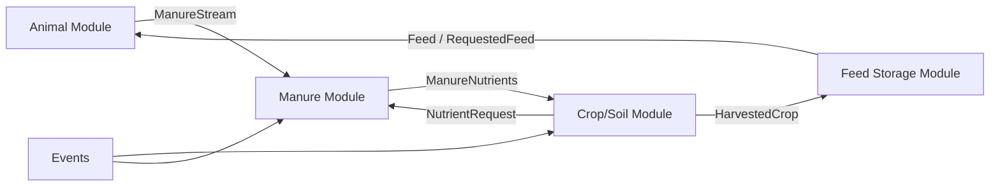

# Data Structures

# Data Structures Module

## Overview

The `RUFAS/data_structures` module defines the data contracts that carry information between the major simulation modules of the RUFAS (Ruminant Farm Systems) model. It contains no simulation logic itself; instead, it provides the dataclasses, enums, and helper classes that the Animal, Manure, Crop/Soil, and Feed Storage modules use to exchange data.

The module is organized around **connection points** — each file (or group of files) defines the structures that cross a specific module boundary:

| File | Purpose |
|------|---------|
| `animal_to_manure_connection.py` | Manure streams produced by animals and passed to manure processing |
| `manure_to_crop_soil_connection.py` | Nutrient requests from fields and the manure module's response |
| `crop_soil_to_feed_storage_connection.py` | Harvested crop data passed to feed storage |
| `feed_storage_to_animal_connection.py` | Feed definitions, inventories, and purchase requests |
| `events.py` | Scheduled field management events (planting, harvest, tillage, manure, fertilizer) |
| `manure_nutrients.py` | Accumulated manure nutrient summaries for crop/soil application |
| `manure_types.py`, `manure_supplement_methods.py`, `tillage_implements.py` | Shared enums |

## Manure Streams (Animal → Manure)

### `StreamType`

An enum distinguishing manure that originates in the milking parlor (`PARLOR`) from all other manure (`GENERAL`). This distinction matters because parlor manure follows a different processing path.

### `PenManureData`

A dataclass describing the pen context in which manure was produced. It tracks:

- **Animal context**: `num_animals`, `animal_combination`, `pen_type`
- **Manure quantities**: `manure_urine_mass`, `manure_urine_nitrogen`
- **Deposition area**: `manure_deposition_surface_area` (m²)
- **Stream classification**: `stream_type` (`StreamType`)
- **Processing metadata**: `first_processor`, `total_bedding_mass`, `total_bedding_volume`

Validation in `__post_init__` enforces a domain rule: parlor manure can only come from lactating cows (`AnimalCombination.LAC_COW`).

Two mutators are provided:

- `set_first_processor(processor_name)` — records which manure processor first handles the stream.
- `set_bedding_mass_and_volume(mass, volume)` — records bedding added to the stream.

`__add__` combines two `PenManureData` instances, but only under strict conditions:

- Neither may be `StreamType.GENERAL`.
- The `animal_combination` values must match.
- The `first_processor` values must match.

The combined instance has `pen_type=None` and sums all numeric fields.

### `ManureStream`

The primary data carrier between the Animal and Manure modules, and between successive manure processors. It holds mass balances for:

- **Nutrients**: `water`, `ammoniacal_nitrogen`, `nitrogen`, `phosphorus`, `potassium`, `ash`
- **Solids**: `degradable_volatile_solids`, `non_degradable_volatile_solids`, `bedding_non_degradable_volatile_solids`, `total_solids`
- **Physical properties**: `volume`, `methane_production_potential`
- **Context**: `pen_manure_data` (optional `PenManureData`)

#### Computed properties

- `total_volatile_solids` — sum of all three volatile solids components.
- `mass` — `water + total_solids`.
- `is_empty` — `True` when all mass/volume fields are zero and `pen_manure_data` is `None`.

#### Operations

- **`__add__`** — Combines two streams by summing all mass fields. `methane_production_potential` is combined as a **volatile-solids-weighted average**, not a simple sum, because it is an intensive property (m³ CH₄ per kg VS). `pen_manure_data` is combined only if both operands have it.
- **`split_stream(split_ratio, stream_type=None, manure_stream_deposition_split=None)`** — Produces a new stream containing `split_ratio` of each mass component. The split ratio must be in `(0, 1]`; invalid values raise `ValueError` and log an error via `OutputManager`. When splitting, the new stream's `pen_manure_data` (if any) receives the same `num_animals` but a scaled `manure_deposition_surface_area` — scaled by `manure_stream_deposition_split` if provided, otherwise by `split_ratio`. The `stream_type` argument overrides the type on the new stream's pen data.
- **`make_empty_manure_stream()`** — Class factory returning a zeroed stream with `pen_manure_data=None`. Widely used by manure storage and digester code to initialize accumulators.
- **`clear_pen_manure_data()`** — Drops the pen context from a stream.

## Manure ↔ Crop/Soil Connection

### `NutrientRequest`

A frozen, keyword-only dataclass representing a field's request for manure nutrients. Fields:

- `nitrogen`, `phosphorus` — requested masses (kg).
- `manure_type` — `ManureType.LIQUID` or `ManureType.SOLID`.
- `use_supplemental_manure` — whether off-farm manure may be used if on-farm supply is insufficient.
- `use_daily_spread_source` — whether to draw first from `DailySpread` processors.
- `spread_all_available_manure` — if `True`, take all available daily-spread manure regardless of nutrient targets.

Validation in `__post_init__` requires at least one positive nutrient mass unless one of the three boolean flags is set.

### `NutrientRequestResults`

A frozen dataclass describing the manure that can actually be supplied. In addition to `nitrogen`, `phosphorus`, `total_manure_mass`, and `dry_matter`, it carries composition fractions:

- `organic_nitrogen_fraction` / `inorganic_nitrogen_fraction` (must sum to 1)
- `ammonium_nitrogen_fraction` (fraction of inorganic N that is ammonium)
- `organic_phosphorus_fraction` / `inorganic_phosphorus_fraction` (must sum to 1)
- `dry_matter_fraction`

`__add__` combines two result sets, computing **mass-weighted averages** for all fraction fields rather than simple sums. All fractions are clamped to `[0, 1]` via `Utility.clamp`.

### `FieldManureSupplier`

A static utility that converts a `NutrientRequest` into a `NutrientRequestResults` using fixed conversion ratios defined at module level. The ratios (dry-mass-to-wet-mass, nitrogen-to-dry-mass, phosphorus-to-dry-mass) are derived from the ManureDB dataset and differ for liquid vs. solid manure (see `TYPE_TO_CONSTANTS_MAP`).

The logic in `request_nutrients`:

1. Project the dry mass implied by each requested nutrient (`N × ratio_N`, `P × ratio_P`).
2. Take the **minimum** of the two projected dry masses as the limiting factor.
3. Back-calculate the actual N and P masses from that limiting dry mass.
4. Convert dry mass to wet mass and compute the dry matter fraction.

This ensures the response never exceeds the requested amount of either nutrient.

### Named tuples

- `ManureEventNutrientRequest` — couples a `ManureEvent` with its `NutrientRequest` for a given field.
- `ManureEventNutrientRequestResults` — couples a `ManureEvent` with the resulting `NutrientRequestResults`.

## Manure Nutrients (Manure → Crop/Soil)

### `ManureNutrients`

A frozen, keyword-only dataclass summarizing accumulated manure nutrients for field application. Unlike `ManureStream` (which tracks detailed solids fractions), this is a simplified aggregate: `nitrogen`, `phosphorus`, `potassium`, `dry_matter`, `total_manure_mass`, plus a `manure_type`.

Each field has a paired `*_unit` field (e.g., `nitrogen_unit`) holding a `MeasurementUnits` value. The `units_dict` property collects these into a dictionary.

Validation in `__post_init__` rejects negative numeric values and non-`ManureType` manure types.

#### Arithmetic operations

- **`__add__`** — Sums all numeric fields. Both operands must have the same `manure_type`; otherwise `TypeError` is raised.
- **`__sub__`** — Subtracts field-by-field. Raises `ValueError` if any field in the subtrahend exceeds the corresponding field in the minuend.
- **`__mul__` / `__rmul__`** — Scales all numeric fields by a non-negative scalar.
- **`reset_values()`** — Returns a new instance with all numeric fields zeroed but `manure_type` and units preserved.

Composition properties (`dry_matter_fraction`, `nitrogen_composition`, `phosphorus_composition`) return 0.0 when `total_manure_mass` is zero.

## Harvested Crop (Crop/Soil → Feed Storage)

### `HarvestedCrop`

A dataclass representing a crop cut from a field and delivered to feed storage. It carries:

- **Identity**: `config_name`, `field_name`
- **Timing**: `harvest_time`, `storage_time`, `last_time_degraded`
- **Mass**: `dry_matter_mass`, `dry_matter_percentage`, plus initial values (`initial_dry_matter_mass`, `initial_dry_matter_percentage`) captured at storage time
- **Quality**: `dry_matter_digestibility`, `crude_protein_percent`, `non_protein_nitrogen`, `starch`, `adf`, `ndf`, `lignin`, `sugar`, `ash`
- **Storage-specific values**: `estimated_maximum_effluent` (silage), `bale_density` and `total_sensible_heat_generated` (hay)
- **Bookkeeping**: `recorded_days` (set of simulation days on which the crop was recorded)

`__post_init__` computes the storage-specific values via private methods and converts any `RufasTime` inputs to `date` objects.

#### Key methods

- **`fresh_mass`** (property) — `dry_matter_mass / dry_matter_fraction`.
- **`is_alfalfa`** (property) — `True` if `"alfalfa"` appears in `config_name` (case-insensitive).
- **`remove_dry_matter_mass(mass_to_remove)`** — Removes dry matter while keeping the dry matter percentage unchanged (recomputes it from the new fresh mass). Clamps at zero.
- **`remove_feed_mass(dm_to_remove)`** — Removes dry matter, raising `ValueError` if the requested amount exceeds what is available.
- **`estimate_maximum_effluent()`** — Computes the total effluent loss for ensiled crops. The calculation uses `EFFLUENT_MAXIMUM_DRY_MATTER_FRACTION` (0.3) as a cap: crops drier than 30% DM experience no effluent loss.
- **`_calculate_bale_density()`** — Empirical formula for hay bale density (kg/m³) as a function of dry matter percentage.
- **`_calculate_total_sensible_heat_generated()`** — Empirical formula for heat generation (kJ/kg) from moisture fraction and bale density.

## Feed Storage ↔ Animal Connection

### Feed definitions

- **`Feed`** — Base dataclass with the full set of nutritional attributes (DM, CP, ADF, NDF, starch, minerals, etc.), plus economic fields (`on_farm_cost`, `purchase_cost`, `buffer`) and usage limits (`limit`, `lower_limit`).
- **`NASEMFeed(Feed)`** — Extends `Feed` with NASEM-specific attributes (amino acids, fatty acid profiles, vitamin and mineral details, digestibility values).
- **`NRCFeed(Feed)`** — Extends `Feed` with NRC-specific attributes (`non_fiber_carb`, `PAF`).

The `FeedCategorization`, `FeedComponentType`, and `NutrientStandard` enums classify feeds and select the nutrient standard.

### `AvailableFeedsBuilder`

A static utility that constructs the list of feeds available in a simulation. The pipeline in `setup_available_feeds`:

1. Load the feed library (`NASEM_Comp` or `NRC_Comp`) from `InputManager`.
2. Convert the library from a dict-of-lists to a list-of-dicts via `Utility.convert_dict_of_lists_to_list_of_dicts`.
3. Translate string enum values into `FeedComponentType`, `FeedCategorization`, and `MeasurementUnits` instances.
4. Validate the user's feed configuration against the library.
5. Build `NASEMFeed` or `NRCFeed` instances, computing `on_farm_cost` as 1% of the purchase price (`ON_FARM_TO_PURCHASED_PRICE_RATIO`).
6. Return the feeds sorted by `rufas_id`.

`_validate_feed_config` enforces four rules:

- Every configured feed type must exist in the selected library.
- No duplicate feed types in the top-level `feeds` section.
- No duplicate feed types within any individual ration.
- Every ration feed must be defined in the top-level `feeds` section.

### Inventory and purchase structures

- **`TotalInventory`** — Maps `RUFAS_ID` → available mass (kg) at a given `inventory_date`.
- **`IdealFeeds`** — Maps `RUFAS_ID` → ideal purchase amount before the next harvest.
- **`RequestedFeed`** — Maps `RUFAS_ID` → feed amount needed by the herd. Supports `__add__` (combines two requests) and `__mul__`/`__rmul__` (scales all amounts).
- **`FeedFulfillmentResults`** — Tracks how much feed was deducted from `purchased` vs. `farmgrown` sources. Provides class factories (`fulfill_feed_request_as_purchased`, `empty`) and mutators (`add_purchased`, `add_farmgrown`, `total_deducted_for_feed`).

### Purchase allowances

`PurchaseAllowance` is a base class that parses feed-config data into a `{feed_id: max_amount}` dictionary. Three subclasses differ only in which config key they read:

- `PlanningCycleAllowance` — `"planning_cycle_allowance"` (between harvests)
- `AdvancePurchaseAllowance` — `"advance_purchase_allowance"` (start of ration interval)
- `RuntimePurchaseAllowance` — `"runtime_purchase_allowance"` (daily)

## Field Management Events

`BaseFieldManagementEvent` is the base class for scheduled operations. Each event is identified by a `(year, day)` pair (simulation year and Julian day). The base class provides:

- `occurs_today(time)` — checks against a `RufasTime` object.
- `date_occurs` — converts `(year, day)` to a `date`.
- `__eq__` and `__hash__` based on `(year, day)`.

Five concrete event types extend the base:

| Event | Purpose | Distinguishing fields |
|-------|---------|----------------------|
| `PlantingEvent` | Schedule a crop planting | `crop_reference`, `use_heat_scheduled_harvest` |
| `HarvestEvent` | Schedule a harvest operation | `crop_reference`, `operation` (`HarvestOperation` enum) |
| `TillageEvent` | Schedule tillage | `tillage_depth`, `incorporation_fraction`, `mixing_fraction`, `implement` (`TillageImplement`) |
| `ManureEvent` | Request manure application | `nitrogen_mass`, `phosphorus_mass`, `manure_type`, `manure_supplement_method`, `field_coverage`, `application_depth`, `surface_remainder_fraction`, plus daily-spread flags |
| `FertilizerEvent` | Schedule fertilizer application | `mix_name`, `nitrogen_mass`, `phosphorus_mass`, `potassium_mass`, `depth`, `surface_remainder_fraction` |

Each subclass overrides `__eq__` and `__hash__` to include its specific fields, so events with identical timing but different parameters are distinct.

## Shared Enums

- **`ManureType`** — `LIQUID`, `SOLID`.
- **`ManureSupplementMethod`** — `NONE`, `SYNTHETIC_FERTILIZER`, `MANURE`, `SYNTHETIC_FERTILIZER_AND_MANURE`.
- **`TillageImplement`** — `SUBSOILER`, `MOLDBOARD_PLOW`, `COULTER_CHISEL_PLOW`, `DISK_HARROW`, `CULTIVATOR`, `SEEDBED_CONDITIONER`.
- **`TractorSize`** — `SMALL`, `MEDIUM`, `LARGE`.
- **`OperationType`** — Field operation types (planting, tilling, manure/fertilizer application, mowing, collection, windrowing).
- **`FieldOperationEvent`** — Event categories (harvest, fertilizer, manure, planting, tilling).

`EnumWithStrOverride` is a small base class making `str(enum_member)` return the member's value rather than the default `EnumName.MEMBER` representation.

## Design Patterns

Several conventions recur throughout this module:

- **Dataclasses with unit dictionaries** — `PenManureData`, `ManureStream`, and `ManureNutrients` each expose a `*_UNITS` class attribute or paired `*_unit` fields, allowing downstream code to report values with correct units.
- **Arithmetic operators on data carriers** — `__add__`, `__sub__`, `__mul__` are implemented on the stream and nutrient types so that combining or splitting manure is expressed naturally. Intensive properties (fractions, methane potential) are combined as weighted averages, not sums.
- **Frozen dataclasses for requests/results** — `NutrientRequest`, `NutrientRequestResults`, and `ManureNutrients` are frozen to prevent accidental mutation after construction.
- **Validation in `__post_init__`** — Domain invariants (non-negative masses, matching manure types, valid enum values, fraction sums equal to 1) are enforced at construction time.
- **Class factories** — `make_empty_manure_stream()` and `FeedFulfillmentResults.empty()` provide canonical zero-value instances used throughout the manure and feed modules.