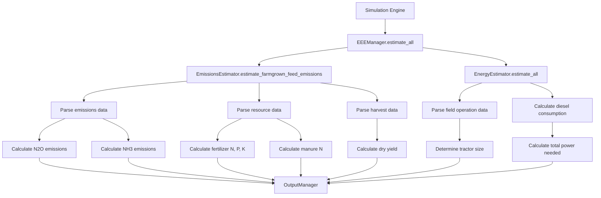

# EEE

# EEE Module Documentation

## Overview

The EEE module estimates the environmental and energy impacts of farm operations. It coordinates three primary estimation workflows:

- **Emissions estimation** — Estimates nitrous oxide (N₂O) and ammonia (NH₃) emissions from purchased and farmgrown feeds, plus the resources (fertilizer N, P, K, and manure N) used in their production.
- **Energy estimation** — Estimates diesel fuel consumption for tractor-implement operations across planting, harvesting, tillage, and fertilizer/manure applications.

The module is designed to be called once per simulation day, accumulating daily values and reporting them as daily variables to the `OutputManager`.

---

## How It Works

The EEE module is structured as a pipeline that processes field operation data from the simulation's `OutputManager`, calculates per-hectare emissions and resource use, and reports the results back to the `OutputManager` as daily variables.

### Execution Flow

1. **`EEEManager.estimate_all()`** is the entry point. It calls:
   - `EmissionsEstimator.estimate_farmgrown_feed_emissions()` — for emissions and resource estimation.
   - `EnergyEstimator.estimate_all()` — for diesel consumption estimation.

2. **`EmissionsEstimator`** parses the `OutputManager` variables pool to extract:
   - N₂O and NH₃ emissions data.
   - Manure and fertilizer application data.
   - Harvest data (crop yield, harvest type).
   - Farmgrown feed deductions and inventory data.

3. **`EnergyEstimator`** parses the `OutputManager` variables pool to extract:
   - Field operation events (planting, harvesting, tillage, fertilizer/manure application).
   - Tractor and implement specifications.
   - Diesel consumption rates.

4. **`Tractor` and `TractorImplement`** encapsulate the physical specifications needed for the energy calculations, including tractor size, PTO power, mass, speed, and implement-specific coefficients.

---

## Key Components

### 1. `EEEManager`

The main entry point for the EEE module. It coordinates the emissions and energy estimation pipelines.

| Method | Description |
|------|-------------|
| `estimate_all(simulate_animals, simulate_feed, simulate_fields, simulate_manure)` | Runs all emissions and energy estimations and records the results to the `OutputManager`. |

### 2. `EmissionsEstimator`

Handles the estimation of emissions and resources associated with feed production.

| Method | Description |
|------|-------------|
| `estimate_farmgrown_feed_emissions()` | Estimates N₂O and NH₃ emissions and resources for farmgrown feeds. |
| `calculate_purchased_feed_emissions(purchased_feeds)` | Calculates emissions from purchased feeds and land use changes. |
| `check_available_purchased_feed_data(available_feed_ids)` | Validates that all feed IDs have emissions data available. |

### 3. `EnergyEstimator`

Handles the estimation of diesel consumption for field operations.

| Method | Description |
|------|-------------|
| `estimate_all(simulate_animals, simulate_feed, simulate_fields, simulate_manure)` | Runs the diesel consumption estimation for all field operations. |
| `calculate_diesel_consumption(crop_yield, field_production_size, tractor, clay_percent, application_mass, application_dm_content)` | Calculates diesel consumption for a single tractor-implement operation. |
| `report_diesel_consumption(...)` | Reports diesel consumption data for a specific tractor-implement operation. |

### 4. `Tractor`

Represents the specifications of a tractor for a given field operation.

| Property | Description |
|---------|-------------|
| `operation_event` | The type of field operation (e.g., `HARVEST`, `PLANTING`, `TILLING`). |
| `crop_type` | The type of crop for which the tractor is intended. |
| `tractor_size` | The size of the tractor (`SMALL`, `MEDIUM`, `LARGE`). |
| `PTO_kW` | Power take-off power available from the tractor (kW). |
| `power_available_kW` | Power available from the tractor (kW). |
| `mass_kg` | Mass of the tractor (kg). |
| `speed_km_hr` | Travel speed of the tractor (km/hr). |
| `calculate_axel_power(implement)` | Calculates the total axle power required to move the tractor and implement (kW). |

### 5. `TractorImplement`

Represents the specifications of a tractor implement.

| Property | Description |
|---------|-------------|
| `field_speed_km_per_hr` | The field speed of the implement (km/hr). |
| `field_efficiency` | The field efficiency of the implement (unitless). |
| `field_capacity_ha_per_hr(...)` | Calculates the field capacity for a specific crop, field operation, and tractor implement (ha/hr). |
| `calculate_operation_time_hr(...)` | Calculates the number of hours taken by a tractor to perform the operation (hr). |
| `calculate_drawbar_power(clay_percent)` | Calculates the drawbar power required by the implement for forward propulsion (kW). |
| `calculate_needed_PTO(...)` | Calculates the power take-off (PTO) power needed to power the implement's operation (kW). |

---

## Data Flow

The following diagram illustrates the flow of data through the EEE module:



---

## Integration with the Rest of the Codebase

The EEE module is called from the simulation engine after all other modules have been processed. It relies on:

- **`InputManager`** — to retrieve configuration data such as the simulation start date, FIPS county code, and EEE constants.
- **`OutputManager`** — to filter the variables pool and report results as daily variables.
- **`RufasTime`** — to convert event dates to simulation day offsets.
- **`MeasurementUnits`** — to define the units for the reported variables.
- **`RUFAS_ID`** — to identify feed IDs in the simulation.

### Dependencies

| Dependency | Purpose |
|-----------|---------|
| `RUFAS.input_manager.InputManager` | Retrieves configuration data. |
| `RUFAS.output_manager.OutputManager` | Filters variables and reports results. |
| `RUFAS.rufas_time.RufasTime` | Converts dates to simulation days. |
| `RUFAS.units.MeasurementUnits` | Defines units for reported variables. |
| `RUFAS.data_structures.tillage_implements` | Defines enums for field operations, tillage implements, tractor sizes, and operation types. |
| `RUFAS.biophysical.field.crop.harvest_operations.HarvestOperation` | Defines harvest operation types. |
| `RUFAS.util.Utility` | Provides utility functions for key generation and data conversion. |

---

## Usage

The EEE module is invoked once per simulation day. The simulation engine calls `EEEManager.estimate_all()` after all other modules have been processed.

```python
# Inside the simulation engine:
from RUFAS.EEE.EEE_manager import EEEManager

# ... after all other modules have been processed:
EEEManager.estimate_all(
    simulate_animals=simulate_animals,
    simulate_feed=simulate_feed,
    simulate_fields=simulate_fields,
    simulate_manure=simulate_manure,
)
```

The `simulate_*` flags control whether the corresponding modules were initialized and used during the simulation. If a module was not simulated, its corresponding calculations are skipped.