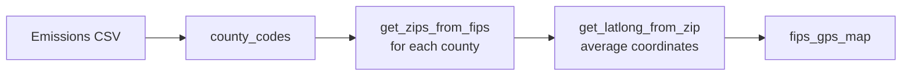

# Helpful Scripts

# Emissions Interpolation Script

## Overview

The emissions interpolation script fills gaps in county-level feed emissions data. When a county reports a zero value for a feed's emissions—interpreted as missing data rather than a true zero—the script replaces it with the average of non-zero values from neighboring counties in the same state. The search radius expands iteratively until non-zero neighbors are found, with a hard cap of 5,000 km.

The script operates on emissions spreadsheets in `input/data/EEE/`, keyed by FIPS county codes, and writes interpolated results back to the `helpful_scripts/emissions_interpolation/` directory. It also has an optional post-processing step that fills residual zeros for two wheat feed IDs using USDA regional averages.

## Configuration

Four user-defined settings at the top of the script control its behavior:

| Setting | Purpose |
|---|---|
| `EEEname` | Base name of the emissions dataset to process (must correspond to a file at `input/data/EEE/{EEEname}.csv`). The script is designed to be run once per dataset—the comment notes it must be run twice, reordering the assignment, if the algorithm should be applied to both the land-use-change and base emissions files. |
| `km_radius_start` | Starting search radius (in km) for neighbor discovery. Defaults to 50. |
| `feed_source_choice` | Filters which feeds to interpolate, matching one of the options in the `EF_Source` column of the feed library CSV (e.g., `"Foods3"`). Only feeds whose `RuFaS ID` falls under this source are eligible for interpolation. |
| `use_wheat_regional_average` | When `True`, applies regional averages for wheat feed IDs `193` and `197` to counties that still have zero values after neighbor interpolation. Output filenames use the `_regional_average` suffix. |

## Input Data Files

All reference data is loaded from `helpful_scripts/emissions_interpolation/` unless otherwise noted:

| File | Contents |
|---|---|
| `geonames_US.csv` | Zip code → latitude/longitude mapping. |
| `COUNTY_ZIP_032010.csv` | FIPS county code → Zip code mapping. |
| `Feed Emissions Source RuFaS_Feed_Library_Combined_Final.csv` | Feed metadata; the `EF_Source` and `RuFaS ID` columns drive the source filter. |
| `fips_to_region.csv` | FIPS county code → USDA region mapping (used only for the wheat fallback). |
| `{EEEname}_wheat_regional_averages.csv` | Regional wheat emissions averages (loaded from `input/data/EEE/`). |
| `input/data/EEE/{EEEname}.csv` | The target emissions dataset: one row per county (`county_code` column), one column per feed (identified by `RuFaS ID`). |

## Core Helper Functions

### `get_statecode(county_code)`
Extracts the two-digit state FIPS prefix from a five-digit county FIPS code (zero-padded).

### `get_zips_from_fips(fips_to_county_sheet, fips_code)`
Returns the list of Zip codes belonging to a county, looked up in `COUNTY_ZIP_032010.csv`.

### `get_latlong_from_zip(zip_to_latlong_sheet, zipcodes)`
Computes the average latitude/longitude of a list of Zip codes. If a Zip code is not found in the geonames sheet, it is skipped with a console message. Returns `(0.0, 0.0)` and `[(0.0, 0.0)]` if no Zip codes resolve.

### `haversine(lat1, lon1, lat2, lon2)`
Great-circle distance between two GPS points in kilometers (Earth radius = 6371 km).

### `points_within_radius(reference_point, points, radius)`
Returns `(close_points, close_distances)` — all points strictly within `radius` km of `reference_point`. Points at distance exactly 0.0 are excluded (the reference point itself or duplicate coordinates).

### `get_neighbors(fips_code, fips_code_list)`
A stub that currently returns `[fips_code]` — unused by the main algorithm, likely a placeholder for a future neighbor-search strategy.

## Interpolation Algorithm

The pipeline proceeds in four stages.

### 1. Build a GPS map for every county

For each `county_code` in the emissions dataset, the script looks up Zip codes via `get_zips_from_fips`, then averages their coordinates via `get_latlong_from_zip`. The resulting `fips_gps_map` is a parallel list to `county_codes`, one averaged coordinate per row.



### 2. Identify feeds eligible for interpolation

The eligible feed IDs are collected from the feed library:

```python
feed_ids_to_check = feed_source[feed_source["EF_Source"] == feed_source_choice]["RuFaS ID"].tolist()
```

Only rows where the feed column value is `0.0` *and* the feed ID is in this list are processed.

### 3. Neighbor search and value replacement

For each county and eligible feed with a zero value:

1. Build a list of GPS points for counties in the **same state**, excluding the target county.
2. Call `points_within_radius` with the current radius (starting at `km_radius_start`).
3. While no points were found within the radius **or** no non-zero neighbor values have been accumulated:
   - Iterate over the found neighbor points; convert each back to a county index via `fips_gps_map.index(gps)`.
   - If the neighbor's value for this feed is non-zero, append it (and its distance) to `neighbor_values` / `neighbor_distances`.
   - Expand the radius by 50 km and re-run `points_within_radius`.
   - Abort if the radius exceeds 5,000 km.
4. If any neighbor values were found, replace the county's zero with `np.mean(neighbor_values)` in `emissions_copy`; otherwise record a "could not find neighbor within state" entry.

**Notes on the loop semantics:** `neighbor_values` accumulates across radius expansions rather than being reset each iteration, so the final average reflects all non-zero neighbors found at or below the final radius. Neighbor values are not distance-weighted. The lookup `fips_gps_map.index(gps)` returns the *first* county with matching coordinates; duplicate coordinates across counties could therefore alias to the wrong neighbor.

### 4. Wheat regional average fallback (optional)

When `use_wheat_regional_average` is `True`, after neighbor interpolation the script scans feed columns `"193"` and `"197"` (wheat middlings) for remaining zeros. For each such county:

- Look up its region in `fips_to_region.csv`.
- Map non-standard region names: `New.England` and `Great.Lakes` → `Northeast`; `Upper.Midwest` → `Northern.Plains`.
- Look up the region's wheat average in `{EEEname}_wheat_regional_averages.csv` and write it in.

## Outputs

The script writes two files per run:

| `use_wheat_regional_average` | Emissions output | Detailed diagnostics |
|---|---|---|
| `True` | `{EEEname}_interpolated_regional_average.csv` | `{EEEname}_interpolated_regionalavg_detailed.csv` |
| `False` | `{EEEname}_interpolated.csv` | `{EEEname}_interpolated_detailed.csv` |

All outputs go to `helpful_scripts/emissions_interpolation/`.

The detailed file contains one row per (county, feed) replacement event with columns:

- `county_code` — target county
- `gps_county` — target county's average GPS coordinate
- `feed_id` — feed column identifier
- `neighbor_values` — list of non-zero neighbor values used in the average
- `neighbor_distances` — corresponding distances (km) of those neighbors

If a county never found neighbors within the state, the row records the string `"could not find neighbor within state"` in the `neighbor_values` column and the final search radius in `neighbor_distances`.

## Known Caveats

- **Duplicate GPS lookup**: `fips_gps_map.index(gps)` picks the first matching county, so duplicate coordinates between counties in the same state will silently resolve to the first occurrence rather than the actual neighbor. Uniqueness of county coordinates is implicitly assumed.
- **Zero values are always treated as missing**: the script cannot distinguish a true zero emissions value from a missing-data placeholder; every zero for an eligible feed is overwritten.
- **State boundary constraint**: neighbors are restricted to the same state, so border counties with no in-state non-zero neighbors may remain zero despite nearby out-of-state data.
- **Unused variable**: `neighbor_county_code` is assigned inside the neighbor loop but never used; likely intended for diagnostics.
- **Stub function**: `get_neighbors` is a placeholder returning `[fips_code]` and is not called anywhere in the pipeline.
- **FIPS increment loop**: the county-to-GPS mapping loop mutates `fips_code` locally (increments it) when a county has no Zip codes, retrying with the next integer. This handles FIPS code gaps in the Zip mapping but relies on the increment staying within the same state, as enforced by the `while` condition.