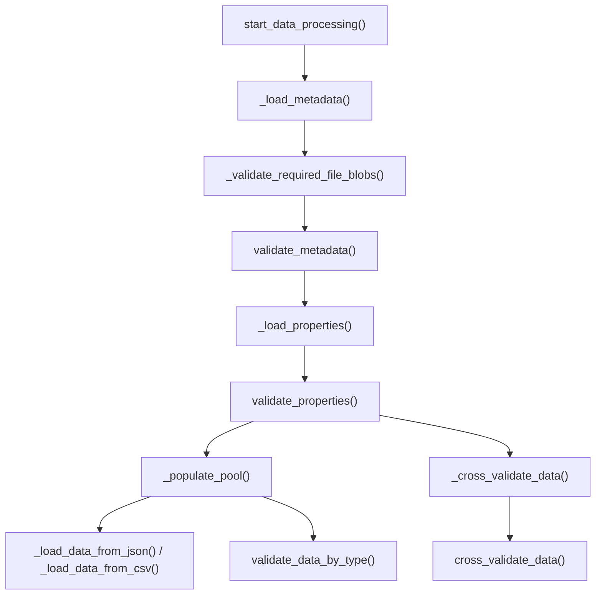

# Input/Output and Validation

# Input/Output and Validation Module

## Overview

The Input/Output and Validation module is the data backbone of the RuFaS simulation framework. It is responsible for:

- Loading and validating simulation input data against metadata-defined schemas
- Storing validated inputs in a central, singleton-managed pool
- Providing dot-notation access to input data and metadata throughout the simulation
- Collecting simulation outputs (variables, logs, warnings, errors) into structured pools
- Controlling console verbosity and persisting outputs to files

The module is implemented primarily by two singleton classes:

- **`InputManager`** (`RUFAS/input_manager.py`) — owns the input data lifecycle: metadata loading, properties resolution, file ingestion, validation, runtime updates, and data access.
- **`OutputManager`** (`RUFAS/output_manager.py`) — owns the output data lifecycle: variable reporting, log/warning/error collection, verbosity control, pool overflow management, and output serialization.

Validation logic itself lives in `RUFAS/data_validator.py`, which provides `DataValidator`, `CrossValidator`, `ElementsCounter`, and the `Modifiability` enum. The `InputManager` delegates all value-level and cross-variable validation to these components.

## Architecture

The input pipeline is orchestrated by `InputManager.start_data_processing()`, which chains metadata loading, structural validation, properties loading, pool population, and cross-validation:

Once the pool is populated, model components read inputs via `InputManager.get_data()` and report outputs via `OutputManager.add_variable()`. Both managers are singletons, so all components share the same pools throughout a simulation run.

## InputManager

### Singleton lifecycle

`InputManager` is a singleton. The first call to `InputManager()` creates the instance and initializes all internal state; subsequent calls return the existing instance. The `__init__` method guards state initialization with `if InputManager.__instance is None`, so re-invocation only updates `metadata_depth_limit` (defaulting to `7`).

Key internal state:

| Attribute | Purpose |
|---|---|
| `__metadata` | The loaded metadata document (JSON-derived dict). |
| `__pool` | Validated input data, keyed by file blob name. |
| `__get_data_logs_pool` | Timestamped log entries for every `get_data()` call. |
| `__delete_data_logs_pool` | Timestamped log entries for every deletion event. |
| `elements_counter` | `ElementsCounter` tracking validation element counts. |
| `data_validator` | `DataValidator` instance for value-level validation. |
| `cross_validator` | `CrossValidator` instance for cross-variable validation. |
| `csv_report_generation_list` | File blob keys to include in CSV export. |

### Data processing pipeline

The main entry point is `start_data_processing(metadata_path, input_root, task_id, cross_validation_file_paths, eager_termination)`. It performs the following steps:

1. **Load metadata** — `_load_metadata()` reads the JSON metadata document from `input_root / metadata_path` into `__metadata`.
2. **Validate required file blobs** — `_validate_required_file_blobs()` checks that every entry in `REQUIRED_FILE_BLOBS` is present under the metadata's `files` key (`ADDRESS_TO_INPUTS`). Missing blobs raise `ValueError`. This step is skipped when `task_id == "TASK MANAGER"`.
3. **Validate metadata structure** — `data_validator.validate_metadata()` checks that each file entry has a valid `type` (one of `VALID_INPUT_TYPES`) and a resolvable `path` or `paths`.
4. **Load properties** — `_load_properties()` reads the three property files in `PROPERTIES_FILE_PATHS` (default, tasks, commodity) and merges them into `__metadata["properties"]`.
5. **Validate properties** — `data_validator.validate_properties()` recursively validates the merged properties against the metadata, bounded by `metadata_depth_limit`.
6. **Populate the pool** — `_populate_pool()` loads every input file referenced in `metadata["files"]`, validates each variable against its metadata properties, attempts to fix invalid values, and stores validated data in `__pool`.
7. **Cross-validate** — `_cross_validate_data()` loads cross-validation rule files and runs `cross_validator.cross_validate_data()` on each rule block.

The `eager_termination` flag controls failure behavior throughout: when `True`, processing halts at the first invalid element that cannot be fixed; when `False`, all data is validated and all failures are collected before returning `False`.

### Metadata and properties loading

- `_load_metadata(metadata_path)` — loads a JSON file into `__metadata`. Any exception is re-raised with an `"Input Manager Error: "` prefix.
- `_load_properties()` — merges the three property files into a single `properties` blob. Raises `FileNotFoundError` if a properties file is missing, `json.JSONDecodeError` on malformed JSON.
- `_load_data_from_json(file_path)` / `_load_data_from_csv(file_path)` — file loaders used both during initial pool population and runtime metadata processing. CSV files are converted to column-oriented dicts (`{column: [values...]}`) via `pandas.read_csv`.

### Pool population and validation

`_populate_pool()` iterates over `metadata["files"]`. For each file blob:

1. Resolves the file path relative to `input_root` (stored as `self.input_root` for later runtime metadata validation).
2. Selects the loader based on `file_details["type"]` (`"json"` or `"csv"`). An unknown type raises `KeyError`.
3. Checks the `exclude_from_pool` flag — if the loaded data contains it set to `True`, the blob is skipped.
4. Looks up the properties blob via `file_details["properties"]`.
5. For each property in the properties blob (excluding `data_collection_app_compatible`), calls `data_validator.validate_data_by_type()` with `called_during_initialization=True` and `fixable_data_types=FIXABLE_INPUT_DATA_TYPES`.
6. Validated properties are collected into `validated_data` and stored in `__pool[file_blob_key]`.

JSON file blobs are also appended to `csv_report_generation_list` so they can be exported later via `export_pool_to_csv()`.

### Runtime metadata and variables

The `InputManager` supports loading additional metadata and data after the initial pipeline has completed:

- `load_runtime_metadata(metadata_key, eager_termination)` — resolves a runtime metadata entry from the active metadata's `runtime_metadata` section, loads the referenced metadata document without disturbing the active metadata state (via `_load_runtime_metadata_document`, which uses `deepcopy` to snapshot and restore `__metadata`), validates it, and processes each referenced file.
- `_process_runtime_file()` — for each runtime file definition, verifies the `properties` reference, confirms the file `type` is supported, loads the file, and calls `add_runtime_variable_to_pool()`.
- `add_runtime_variable_to_pool(variable_name, data, properties_blob_key, eager_termination, input_path)` — the public API for adding a variable at runtime. It:
  1. Raises `TypeError` if `data` is not a dict.
  2. Verifies metadata properties exist via `_metadata_properties_exist()`.
  3. Delegates to `_add_variable_to_pool()`, which prepares the data, checks modifiability, validates each property, and stores the validated subset.

Modifiability is enforced at runtime: `_check_modifiability()` uses `_is_modifiable_during_runtime()` to determine whether the variable's `Modifiability` status permits updates. Non-modifiable variables raise `PermissionError` under eager termination, or log a warning and return `False` otherwise.

### Data access and retrieval

- `get_data(data_address, required=True)` — retrieves data from the pool using dot notation (e.g., `"animal.herd_information.calf_num"`). Returns a `deepcopy` to prevent callers from mutating internal state. When `required=False`, missing data logs an info-level message and returns `None`; when `required=True`, missing data logs an error and returns `None`.
- `get_metadata(metadata_address)` — retrieves metadata using the same dot-notation pattern. Raises `KeyError` with a descriptive message if the address is invalid.
- `check_property_exists_in_pool(data_address)` — returns a boolean indicating whether the address resolves in the pool.
- `get_data_keys_by_properties(target_properties)` — returns all file blob keys whose `properties` reference matches `target_properties`.

Every `get_data()` call is recorded in `__get_data_logs_pool` with a millisecond timestamp; `dump_get_data_logs(path)` serializes these to JSON.

### Data deletion

`__delete_input_and_metadata(data_address)` (name-mangled to `_InputManager__delete_input_and_metadata`) removes both the input value and its associated metadata properties. It returns a `(removed_data, removed_metadata)` tuple. Deletion events are recorded in `__delete_data_logs_pool` and can be dumped via `dump_delete_data_logs(path)`.

### Export utilities

- `export_pool_to_csv(output_prefix, output_path)` — flattens each property group in `csv_report_generation_list` (skipping `animal_population`) and writes a CSV with columns `property_group`, `variable_name`, and `<output_prefix>_value`.
- `save_metadata_properties(output_dir)` — flattens the metadata properties into a CSV via `_parse_metadata_properties()` and `_create_record()`.
- `compare_metadata_properties(properties_file_path, comparison_properties_file_path, output_directory)` — uses `DeepDiff` to compare two properties files and writes a human-readable diff report.

## OutputManager

`OutputManager` is the singleton output collector for the simulation. It maintains four pools:

| Pool | Populated by | Purpose |
|---|---|---|
| `variables_pool` | `add_variable()` | Simulation output values with metadata. |
| `warnings_pool` | `add_warning()` | Non-fatal issues. |
| `errors_pool` | `add_error()` | Fatal or significant failures. |
| `logs_pool` | `add_log()` | Informational messages. |

### Adding variables

`add_variable(name, value, info_map, ...)` is the primary reporting API. The `info_map` must contain:

- `class` and `function` — provenance for the call site.
- `units` — a `MeasurementUnits` enum member or a (possibly nested) dict of enum members. `_stringify_units()` validates and converts these to strings, raising `TypeError` for invalid unit types.

Optional `info_map` keys include `prefix`, `suffix`, `suppress_prefix`, and `is_daily_variable`. The key under which the variable is stored is produced by `_generate_key()`, which applies prefix/suffix logic.

`add_variable()` also:

- Injects `simulation_day` into the `info_map` via `_add_simulation_day_to_info_map()` when a simulation time source is available.
- Pre-seeds `_filtered_variable_key_counter` with subkeys for dict-valued variables, enabling post-processing filter diagnostics.
- Triggers pool chunkification when enabled (see below).

`add_variable_bulk()` accepts a list of `(variable_dict, info_map)` tuples and calls `add_variable()` for each.

### Adding logs, warnings, and errors

`add_log()`, `add_warning()`, and `add_error()` share the same pattern:

1. Stamp the `info_map` with a timestamp from `Utility.get_timestamp(include_millis=True)`.
2. Generate a pool key via `_generate_key()`.
3. Store the message in the corresponding pool via `_add_to_pool()`.
4. Conditionally write to stdout via `_handle_log_output()` based on the configured `LogVerbosity`.

`_add_to_pool()` stores each entry as a pool element with `info_maps` and `values` lists. Values are `deepcopy`-ed to prevent external mutation. The `first_info_map_only` flag limits recorded provenance to the first call site.

### Log verbosity

`LogVerbosity` is an enum with `NONE`, `CREDITS`, `ERRORS`, `WARNINGS`, and `LOGS` levels. `set_log_verbose()` controls the threshold; `_handle_log_output()` compares the message level against the threshold using the enum's `__le__` operator and writes colorized output to stdout.

### Pool overflow control

For long simulations with large output volumes, `setup_pool_overflow_control()` enables chunkification:

- `output_dir` — where chunk files are saved.
- `max_memory_usage_percent` — maximum pool size as a percentage of available system memory.
- `max_memory_usage` — explicit byte budget (overrides the percentage).
- `save_chunk_threshold_call_count` — save a chunk every N `add_variable()` calls.

When the threshold is reached, `_save_current_variable_pool()` serializes `variables_pool` to a minified JSON file, resets the pool via `_set_variables_pool({})`, and increments `saved_pool_chunks_num`. Saved chunks can be reloaded later via `load_saved_pools()`.

### Post-processing and export

The `OutputManager` provides filtering and serialization utilities, including:

- `filter_variables_pool()` — applies configured filters to the variables pool, using `Utility.filter_dictionary()` and `Utility.expand_data_temporally()`.
- `_parse_filtered_variables()` — converts filtered results into report-ready structures.
- `_route_save_functions()` — dispatches filtered variables to the appropriate output channel (CSV, JSON, graph, report).
- `report_variables_usage_counts()` — writes diagnostic CSVs (`variables_usage_counts`, `variables_reported_daily`, `variables_not_reported_daily`) describing how often variables were selected by filters.

## Validation components

The validation subsystem lives in `RUFAS/data_validator.py` and is used exclusively through the `InputManager`:

- **`DataValidator`** — validates individual values against metadata property definitions. Key methods used by `InputManager`:
  - `validate_metadata()` — structural validation of the metadata document.
  - `validate_properties()` — recursive validation of property definitions.
  - `validate_data_by_type()` — validates (and optionally fixes) input values against a property's type, constraints, and modifiability.
  - `extract_value_by_key_list()` — resolves a key path through a nested dict.
- **`CrossValidator`** — validates relationships between variables. `cross_validate_data()` evaluates rule blocks containing conditions, expressions, and aggregation blocks. `check_target_and_save_block()` validates the alias resolution section of a rule.
- **`ElementsCounter`** — tracks the number of valid, invalid, and total elements encountered during validation.
- **`Modifiability`** — enum (`REQUIRED_LOCKED`, `REQUIRED_UNLOCKED`, `UNREQUIRED_LOCKED`, `UNREQUIRED_UNLOCKED`) that determines whether a variable requires an input at initialization and whether it can be modified at runtime. `InputManager._get_variable_modifiability()` maps string values from metadata to enum members, defaulting to `UNREQUIRED_UNLOCKED` for unknown or missing values.

The `FIXABLE_INPUT_DATA_TYPES` constant (`{"string", "number", "bool"}`) tells the validator which data types it may attempt to coerce into valid values during validation.

## Integration with the rest of the codebase

- **Simulation entry point** — `start_data_processing()` is called once at startup (from the task manager or main driver) with the metadata path, input root, task ID, and optional cross-validation files.
- **Model components** — throughout the simulation, model code calls `InputManager.get_data()` to read inputs and `OutputManager.add_variable()` to report outputs. The singleton pattern ensures all components share the same pools.
- **Task manager** — the `"TASK MANAGER"` task ID bypasses required-file-blob validation, allowing task-level metadata to omit simulation blobs.
- **Runtime updates** — components that need to inject data mid-simulation (e.g., user-supplied feeds, tractor datasets) use `add_runtime_variable_to_pool()` or `load_runtime_metadata()`.
- **Reporting** — `OutputManager` feeds the `ReportGenerator` and `GraphGenerator` through its filtering and routing methods. `InputManager.export_pool_to_csv()` provides input data snapshots for reproducibility.
- **End-to-end testing** — `OutputManager` supports an end-to-end testing mode (`is_end_to_end_testing_run`) that swaps filter prefixes to `e2e_json_` / `e2e_comparison_`, and `is_first_post_processing` tracks which filters apply during successive post-processing runs.

## Error handling patterns

The module consistently uses the `OutputManager` as the logging sink:

- Every public method builds an `info_map` with `class` and `function` keys for provenance.
- Errors are logged via `om.add_error()` before exceptions are raised, so the error pool contains a complete record even when an exception propagates.
- `data_validator.event_logs` are routed to the `OutputManager` via `om.route_logs()` after validation phases.
- File loading methods (`_load_data_from_json`, `_load_data_from_csv`, `_load_cross_validation`, `_load_properties`) catch `FileNotFoundError`, `json.JSONDecodeError`, and `pd.errors` variants, log them, and re-raise.