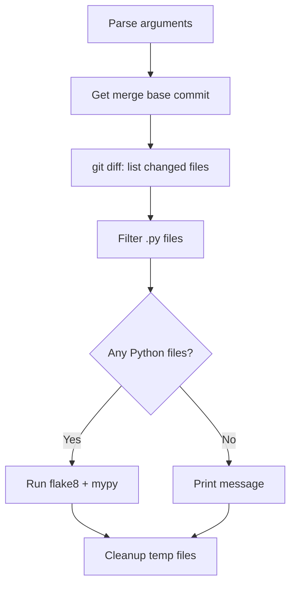

# Other — check_changes.bat

# check_changes.bat — Branch Change Linter

## Overview

`check_changes.bat` is a Windows batch script that lints Python files modified on the current Git branch relative to a base branch. It identifies changed files via Git, filters for Python files, and runs **Flake8** (style/lint checker) and **MyPy** (static type checker) on them.

The script is designed for developer workflows where code quality checks should run only on files actually touched in a feature branch, rather than the entire codebase.

## Usage

```
check_changes.bat [BASEBRANCH]
```

- **`BASEBRANCH`** (optional) — the branch to compare against. Defaults to `dev` if omitted.
- If more than one argument is provided, the script prints usage instructions and exits with code `1`.

**Example:**

```bat
check_changes.bat            :: compares against dev
check_changes.bat main       :: compares against main
```

## How It Works

The script executes a linear pipeline of operations:

1. **Resolve base branch** — Determines the comparison branch from arguments or defaults to `dev`.
2. **Find merge base** — Uses `git merge-base` to locate the common ancestor commit between the base branch and `HEAD`.
3. **Collect changed files** — Runs `git diff --name-only --diff-filter=AM` to list files added or modified since the merge base.
4. **Filter Python files** — Uses `findstr` to keep only files ending in `.py`.
5. **Run linters** — Executes `flake8` and `mypy` on the filtered Python file list.
6. **Cleanup** — Deletes temporary files used during execution.



## Key Components

### Argument Parsing

The script accepts zero or one argument. The logic uses nested `IF` checks:

- No arguments → `base_branch = dev`
- One argument → `base_branch = <arg>`
- Two or more → display usage and exit with code `1`

### Git Integration

Two Git commands drive the change detection:

- **`git merge-base <base_branch> HEAD`** — finds the common ancestor commit. The result is stored in `BASEBRANCHHEAD`.
- **`git diff --name-only --diff-filter=AM %BASEBRANCHHEAD%`** — lists files that were **A**dded or **M**odified relative to the merge base. The `--diff-filter=AM` excludes deleted files, which is important because deleted files cannot be linted.

### Temporary Files

The script uses two temporary files in the current directory:

| File | Purpose |
|------|---------|
| `.changed_files.txt` | Full list of changed files (all extensions) |
| `.changed_python_files.txt` | Space-separated list of changed `.py` files |

These are created at the start (after removing stale copies) and deleted at the end, both on success and on the "no Python files" path.

### Linting Execution

The Python file list is read into the `changed_python_files` variable, then passed to both tools:

```bat
flake8 %changed_python_files%
mypy %changed_python_files%
```

If no Python files were changed, the script prints `No Python files modified on this branch yet.` and skips the linting step.

## Dependencies

The script assumes the following are available on the system:

- **Git** — for branch comparison and diff operations
- **Flake8** — Python style guide enforcement
- **MyPy** — Python static type checker

These tools must be installed and accessible via the system `PATH`.

## Integration with the Codebase

This script is a standalone developer utility. It has no internal dependencies on other modules and is not called by any other code. It is intended to be run manually by developers, typically as part of a pre-commit workflow or before pushing a branch.

The script is Windows-specific (uses `.bat` extension, `@echo off`, and Windows-style file paths). A Unix equivalent would need to use `#!/bin/sh` syntax and different path separators.

## Exit Codes

| Code | Meaning |
|------|---------|
| `0` | Success (including the "no Python files" case) |
| `1` | Invalid usage (more than one argument) |

Note: The exit code does **not** reflect the results of Flake8 or MyPy. If those tools report linting errors, the script still exits with `0`. The linting output is printed to stdout/stderr for the developer to review.