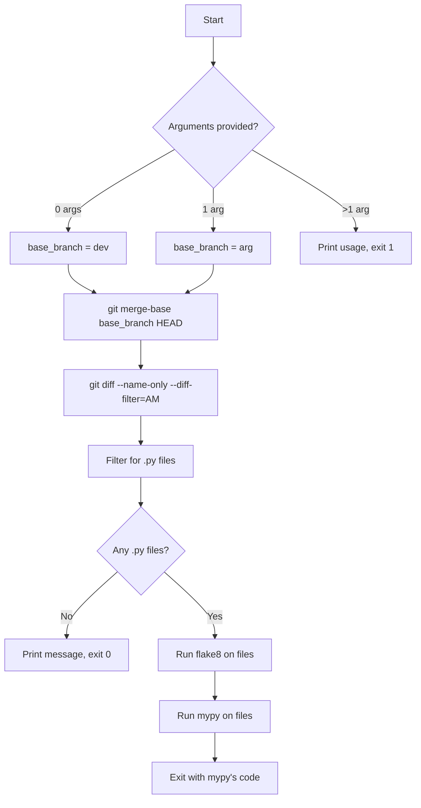

# Other — check_changes.sh

# check_changes.sh — Lint and Type-Check Modified Python Files

## Overview

`check_changes.sh` is a lightweight shell script that runs **Flake8** (linting) and **MyPy** (type checking) on all Python files that have been added or modified on the current Git branch, relative to a base branch. It is designed to give developers fast, targeted feedback on only the code they have actually changed, rather than running checks against the entire codebase.

The script is intended to be run manually or as part of a pre-commit / CI workflow.

## Usage

```
./check_changes.sh [BASEBRANCH]
```

- `BASEBRANCH` — the branch to compare against. Defaults to `dev` if omitted.
- If more than one argument is provided, the script prints usage information and exits with code `1`.

### Examples

```sh
# Compare against dev (default)
./check_changes.sh

# Compare against main
./check_changes.sh main
```

## How It Works

The script performs three steps:

1. **Determine the base branch** — uses the provided argument, or defaults to `dev`.
2. **Find changed Python files** — uses `git diff` to list files that were added or modified between the merge base of the current branch and the base branch, then filters for `.py` files.
3. **Run linting and type checking** — executes `flake8` and `mypy` on the resulting file list.

### Step-by-Step Breakdown

#### 1. Base Branch Resolution

```sh
if [ $# -eq 0 ]; then
    base_branch="dev"
elif [ $# -gt 1 ]; then
    display_usage
    exit 1
else
    base_branch=$1
fi
```

The script accepts zero or one argument. With zero arguments, it compares against `dev`. With more than one, it prints usage and exits.

#### 2. Finding Changed Python Files

```sh
changed_files=$(git diff --name-only --diff-filter=AM "$(git merge-base ${base_branch} HEAD)" | grep -E '\.py$')
```

This is the core of the script. It works as follows:

- `git merge-base <base_branch> HEAD` — finds the common ancestor commit between the base branch and the current branch. This is the point where the current branch diverged.
- `git diff --name-only --diff-filter=AM <merge_base>` — lists the names of files that differ between the merge base and the current working tree. The `--diff-filter=AM` restricts the output to files that were **A**dded or **M**odified. Deleted files are excluded because they cannot be linted.
- `grep -E '\.py$'` — filters the list to only files ending in `.py`.

The result is stored in the `changed_files` variable as a newline-separated list.

#### 3. Early Exit for No Changes

```sh
if [ -z "$changed_files" ]; then
    echo "No Python files modified on this branch yet."
    exit 0
fi
```

If no Python files were changed, the script prints a message and exits successfully. This avoids invoking `flake8` and `mypy` with an empty argument list.

#### 4. Running the Checks

```sh
flake8 $changed_files
mypy $changed_files
```

Both tools are invoked with the full list of changed Python files. The script does not capture or suppress their output — it simply passes the file list through. The exit code of the script is the exit code of the last tool run (`mypy`), which means the script will report failure if either tool reports issues (since `mypy` runs last, its exit code takes precedence).

## Flow Diagram



## Integration with the Codebase

This script is a developer tool rather than a runtime component. It is intended to be invoked:

- **Manually** by developers before pushing a branch, to catch lint and type errors early.
- **In a pre-commit hook** or CI pipeline, to enforce code quality on a per-branch basis.

Because it only checks changed files, it is significantly faster than running `flake8` and `mypy` on the entire repository, making it suitable for frequent use during development.

## Edge Cases and Limitations

- **Deleted files** are excluded via `--diff-filter=AM`, so a file that was removed on the current branch will not be checked. This is intentional — there is nothing to lint.
- **Renamed files** are treated as add/delete pairs by Git. The added file will be included in the diff and checked.
- **Non-Python files** are filtered out by the `.py` extension check.
- **The script uses `sh`**, not `bash`, so it relies on standard shell features only. It does not use any bash-specific syntax.
- **Exit code behavior**: The script's exit code is that of the last command (`mypy`). If `flake8` fails but `mypy` succeeds, the script will still exit with code `0`. If this is undesirable, the script would need to be modified to aggregate exit codes explicitly.
- **The `changed_files` variable** is a single string containing newline-separated paths. When passed to `flake8` and `mypy`, the shell splits it on whitespace, which works correctly for paths without spaces. Paths containing spaces would break this behavior.