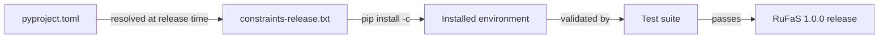

# Other — constraints-release.txt

# constraints-release.txt — RuFaS 1.0.0 Release Dependency Constraints

## Overview

`constraints-release.txt` is a fully pinned dependency manifest for the RuFaS 1.0.0 release. It records the exact versions of every third-party package that were resolved from `pyproject.toml`, installed, and validated through the test suite at release time. The file serves as a known-good environment snapshot: any developer or CI pipeline that installs from this file gets byte-for-byte the same dependency set that shipped with the release.

This is a **constraints file**, not a conventional `requirements.txt`. It is consumed by pip's `-c` flag, which applies the pinned versions as constraints on top of a package's declared dependencies.

## How It Works

The file is a plain-text list of `package==version` entries. Each line is a hard equality constraint — pip will refuse to install a version that does not match exactly. This is stricter than `>=` or `~=` constraints and guarantees reproducibility.

The intended usage is:

```bash
pip install -c constraints-release.txt -e ".[dev]"
```

This command does two things simultaneously:

1. **Installs the RuFaS package** with its development extras (the `.[dev]` extra), pulling in the dependency graph declared in `pyproject.toml`.
2. **Applies the constraints file** so that every dependency in that graph is forced to the exact version listed here.

If a dependency in `pyproject.toml` is not present in the constraints file, it is installed at whatever version pip resolves — but for the RuFaS 1.0.0 release, all direct dependencies are covered.

## Dependency Inventory

The 20 pinned packages fall into four functional groups:

### Scientific Computing Stack

| Package | Version | Role |
|---|---|---|
| `numpy` | 2.2.0 | Core array and numerical primitives |
| `scipy` | 1.16.2 | Scientific algorithms, optimization, statistics |
| `pandas` | 2.3.2 | Tabular data structures and analysis |
| `matplotlib` | 3.10.5 | Plotting and visualization |
| `numba` | 0.61.2 | JIT compilation for performance-critical paths |
| `SALib` | 1.5.1 | Sensitivity analysis (likely used for parameter studies) |
| `psutil` | 7.0.0 | System and process monitoring |

### Testing & Quality Tooling

| Package | Version | Role |
|---|---|---|
| `pytest` | 7.4.4 | Test framework |
| `pytest-mock` | 3.14.1 | Mocking utilities for pytest |
| `pytest-lazy-fixture` | 0.6.3 | Lazy fixture evaluation |
| `freezegun` | 1.5.5 | Time-travel for tests (freezing `datetime`/`time`) |
| `coverage` | 7.10.4 | Code coverage measurement |
| `deepdiff` | 8.6.1 | Deep comparison of nested structures in test assertions |

### Code Quality & Static Analysis

| Package | Version | Role |
|---|---|---|
| `black` | 25.1.0 | Code formatter |
| `flake8` | 7.3.0 | Style guide enforcement |
| `mypy` | 1.17.1 | Static type checking |

### Documentation & Utilities

| Package | Version | Role |
|---|---|---|
| `Sphinx` | 9.1.0 | Documentation generator |
| `sphinxawesome-theme` | 5.3.2 | Sphinx theme |
| `tqdm` | 4.67.1 | Progress bars for long-running operations |
| `typing_extensions` | 4.14.1 | Backported typing features |

## Relationship to the Codebase

The file sits at the boundary between the project's declared dependencies and its validated release state:

```
pyproject.toml  (declared dependency ranges)
       │
       ▼
constraints-release.txt  (exact versions, validated)
       │
       ▼
pip install -c constraints-release.txt -e ".[dev]"
       │
       ▼
Test suite runs against pinned environment
```



The file is **generated**, not hand-maintained. It was produced on 2026-03-30 by resolving the dependency graph from `pyproject.toml`, installing the resulting versions, and running the full test suite to confirm compatibility. The header comment explicitly warns that newer versions may exist but are not guaranteed to work — the file is a frozen contract, not a recommendation of latest versions.

## Maintenance Notes

- **Do not edit this file casually.** It represents a validated state. If a dependency must be bumped, the change should go through `pyproject.toml` first, followed by a fresh resolution, installation, and test run.
- **The file is release-specific.** A future release (e.g., 1.1.0) will have its own constraints file with a different set of pinned versions.
- **The `-c` flag is pip-specific.** If you are using a different package manager (e.g., `uv`), you will need to translate these constraints into that tool's format.

## Limitations

- The file pins **direct dependencies only**. It does not enumerate transitive dependencies (packages pulled in by these packages). For full reproducibility, a complete environment snapshot (e.g., a `requirements.txt` with all transitive deps, or a container image) would be needed.
- The file is **platform-agnostic** — it does not record platform-specific wheels or build flags. If a dependency ships different binaries per platform, the exact binary is determined by the platform at install time, not by this file.