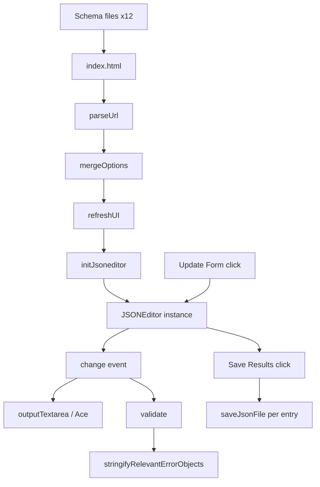

# Other — DataCollectionApp

# DataCollectionApp Module

## Overview

The DataCollectionApp is a client-side, single-page web application for structured agricultural data collection in the RuFaS (Rural Farm Sustainability) project. It renders dynamic JSON-schema-driven forms, validates user input in real time, and exports completed entries as individual JSON files.

The application is entirely self-contained in a single HTML file (`index.html`) with no build step or server-side component. All logic runs in the browser, and all data persists only through user-initiated file downloads or URL-encoded state.

## Architecture

The application is built around the [JSON Editor](https://github.com/json-editor/json-editor) library, which generates HTML forms from JSON Schema definitions. The app layers the following on top:

- **Schema aggregation** — twelve domain-specific schemas are combined into a single `oneOf` array, letting users create heterogeneous data entries (e.g., a field record followed by a crop schedule record) within one session.
- **Ace editor integration** — the JSON output pane is an Ace editor instance configured for JSON mode, allowing users to inspect and directly edit the generated JSON.
- **URL state loading** — a compressed, base64-encoded JSON payload can be passed via the `?data=` query parameter to pre-populate the form.
- **Per-entry file export** — the "Save Results" button writes each data entry to its own JSON file, using a `fileName` property from the entry as the filename.

### Component Diagram



## Key Components

### Schema Loading

The page loads twelve schema files from the `./schema/` directory via `<script>` tags. Each file defines a global variable (e.g., `config_schema`, `animal_schema`, `field_schema`) containing a JSON Schema object. The schemas cover:

| Schema | Purpose |
|---|---|
| `config_schema` | General configuration data |
| `animal_schema` | Animal/livestock records |
| `crop_schedule_schema` | Crop planting/harvest timing |
| `crop_configuration_schema` | Crop setup parameters |
| `fertilizer_schedule_schema` | Fertilizer application timing |
| `manure_schedule_schema` | Manure application timing |
| `tillage_schedule_schema` | Tillage operations |
| `feed_schema` | Feed composition/ration data |
| `manure_management_schema` | Manure handling/storage |
| `field_schema` | Field geometry and properties |
| `tractor_dataset_schema` | Tractor/machinery data |
| `tasks_schema` | General task records |

These are combined into the root `mySchema` object:

```javascript
var mySchema = {
    "title": "Data Collection Schema",
    "type": "array",
    "format": "tabs-top",
    "items": {
        "type": "object",
        "title": "Data Entry",
        "oneOf": [config_schema, animal_schema, /* ... */ tasks_schema]
    }
}
```

The `format: "tabs-top"` renders each data entry as a tab, and the `oneOf` construct lets the user pick which schema type each entry should conform to.

### Initialization Flow

The page bootstraps through a chain of function calls:

1. **`parseUrl()`** — parses `window.location.search` for a `data` parameter. If present, it decompresses the value with `LZString.decompressFromBase64()` and parses it as JSON into the `data` variable. Any parse failure is silently swallowed.
2. **`mergeOptions()`** — merges the default editor options with any options provided in the URL-loaded data. It forces `show_opt_in` and `required_by_default` to `true`, then calls `refreshUI()`.
3. **`refreshUI()`** — sets the theme and icon library CSS links (Bootstrap 4 and Font Awesome 4), then calls `initJsoneditor()`.
4. **`initJsoneditor()`** — destroys any existing editor instance, creates a new `JSONEditor` bound to the `#json-editor-form` div, and attaches the change handler.

### Editor Change Handling

The `change` event fires on every form mutation. The handler:

1. Retrieves the current form value via `jsoneditor.getValue()`.
2. Writes it, pretty-printed, into the Ace editor (`outputTextarea`).
3. Runs `jsoneditor.validate()`.
4. If validation errors exist, maps them to human-readable strings via `stringifyRelevantErrorObjects()` and writes them to the validation textarea. Otherwise, writes `"valid"`.

The `keep_oneof_values` option is set to `false` after editor creation, which prevents stale values from persisting when the user switches a data entry between schema types.

### JSON Output and Update Form

The Ace editor (`#output-textarea`) is initialized with:

```javascript
var aceConfig = {
    mode: 'ace/mode/json',
    selection: false,
    maxLines: Infinity,
    minLines: 5
}
```

Users can edit the JSON directly. Clicking **Update Form** (`#setvalue`) parses the textarea content and pushes it back into the form via `jsoneditor.setValue()`. This round-trip is useful for bulk edits or for loading data from an external source.

### Save Results

The **Save Results** button (`#save_results`) iterates over the array of data entries. For each entry:

1. Extracts the `fileName` property.
2. Destructures it out of the entry so it is not included in the exported JSON.
3. Stringifies the remaining data with 2-space indentation.
4. Triggers a browser download via `saveJsonFile()`.

If the top-level value is not an array, the entire object is saved as `data.json` and the user is alerted. Otherwise, an alert reports how many files were saved.

```javascript
function saveJsonFile(content, fileName, contentType) {
    var a = document.createElement("a");
    var file = new Blob([content], { type: contentType });
    a.href = URL.createObjectURL(file);
    a.download = fileName;
    a.click();
}
```

### Validation Error Formatting

Raw JSON Editor validation errors are verbose and reference schema paths like `root.0.oneOf[3].cropName`. Two helper functions transform these into readable messages:

- **`mapSchemaIndexToPropertyNames(schema)`** — builds a lookup object mapping each schema's index in the `oneOf` array to its `title`.
- **`stringifyRelevantErrorObjects(errors, schemaIndexesToNames)`** — filters out two classes of noise:
  - Errors with message `"Property must be set"` (generic required-field noise).
  - Errors whose path matches `/^root\.(\d+)$/` (whole-entry errors).

  Remaining errors are matched against `/^root\.(\d+)\.oneOf\[(\d+)\]\.(.+)$/` to extract the data entry index, schema index, and offending property name. The output format is:

  ```
  Data Entry 2 has invalid value for "cropName" against "Crop Schedule": ...
  ```

  Duplicate `fileName` errors for the same data entry are collapsed into a single message.

## URL Parameter Loading

The app supports pre-population via a compressed URL parameter. The expected format is:

```
?data=<LZString-base64-encoded-JSON>
```

The JSON payload can contain:

- `options` — overrides for the JSON Editor options (merged over `defaultOptions`).
- Any data entries — the actual form values.

This mechanism is useful for sharing partially completed forms or for deep-linking from other RuFaS tools.

## Template File

The repository also contains a `template` file — a copy of `index.html` with two placeholders:

- `<!-- Schema imports go here-->` — where additional `<script>` tags for new schemas are inserted.
- `// List of available schema goes here` — where new schema variables are added to the `oneOf` array.

This template is intended for generating new versions of the app when the schema set changes.

## Integration with the Broader Codebase

The DataCollectionApp is a standalone front-end tool. It has no internal or external function calls beyond the libraries it loads (`jsoneditor.min.js`, `ace.js`, `assign.js`, `lz-string.min.js`). Its integration points with the rest of the RuFaS system are:

- **Schema files** — the `./schema/` directory is shared with other RuFaS components; the schemas define the canonical data shapes for the domain.
- **URL state** — the `?data=` parameter allows other RuFaS tools to launch the app with pre-filled data.
- **File output** — the exported JSON files are consumed downstream by RuFaS simulation or analysis pipelines.

## Development Notes

- The app uses global variables throughout (e.g., `data`, `jsoneditor`, `mySchema`) — there is no module system or bundler.
- The `assign.js` script is loaded but not referenced in the visible code; it may be a polyfill for `Object.assign` for older browsers.
- The `directLink`, `head`, and `setSchema` variables are declared but unused in the current version.
- Error handling in `parseUrl()` silently ignores malformed URL data, which means a bad `data` parameter results in an empty form rather than a user-facing error.