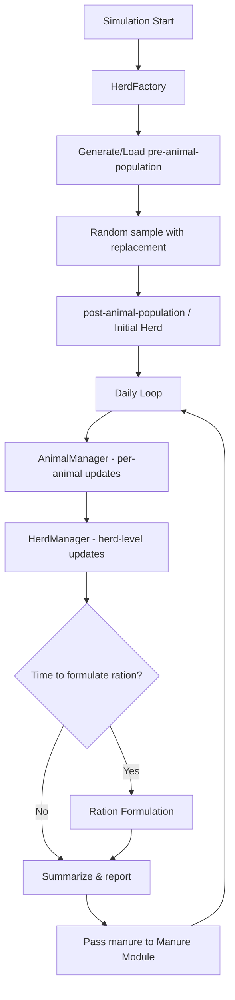
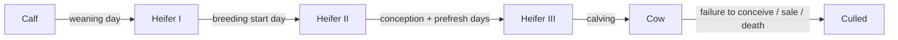

# Other — docs-scientific

# Animal Module — Scientific Documentation

## Overview

The Animal Module is the core biological simulation component of the RuFaS (Ruminant Farm Systems) model. It simulates individual dairy cattle on a daily basis from birth until removal from the herd, using a hybrid approach that combines **Monte Carlo stochastic event simulation** with **process-based, dynamic models** for growth, reproduction, nutrition, and environmental outputs.

The module is responsible for:

- Individual animal growth and bodyweight dynamics
- Gestation, reproduction, and milk production
- Estimation of nutrient requirements and feed intake
- Ration formulation (least-cost or user-defined)
- Enteric methane emission and manure excretion
- Herd-level management: pen assignment, culling, and replacement purchasing

## Architecture

The Animal Module is organized into two management layers that execute in sequence each simulation day:

**HerdManager** handles herd-level daily routines: cycling through all animals to invoke their daily update functions, changing life stages, moving animals between pens, removing sold/dead animals, purchasing replacements, and triggering ration formulation at user-specified intervals.

**AnimalManager** handles per-animal daily routines: growth, reproduction, lactation, and nutrient requirement calculations.

## Herd Initialization

Herd initialization is a two-step process, distinguished in the code as *Generation* and *Selection*.

### Generation (pre-animal-population)

The `HerdFactory` class generates a large pool of animals (default 10,000) via the `_generate_animals()` method. This is a stand-alone simulation that runs for a user-specified number of days (default 5,000), during which animals progress through growth, reproduction, and life-stage transitions. Two notable behaviors during generation:

- After 3,000 days, a copy of each heifer III is saved to the replacement herd on the day she is ready to calve, so purchased replacements give birth the day after entering the herd.
- Cows reaching parity six are removed; the maximum parity in the generated herd is five.

Alternatively, a pre-existing animal population file can be loaded instead of generating a new one.

### Selection (post-animal-population)

The `_random_sample_with_replacement()` method selects animals from the pre-animal-population to form the initial herd. Sampling is stratified by group — calf, heifer I, heifer II, heifer III, replacement, and lactating/dry cows by parity 1–5 — using user-specified counts, parity fractions, and lactating-cow fraction.

Key user inputs for initialization:

| Input | Description | Default |
|---|---|---|
| `Initial_animal_num` | Starting population size for generation | 10,000 |
| `Simulation_days` | Duration of generation simulation | 5,000 |
| `Calf_num` / `HeiferI_num` / `HeiferII_num` / `HeiferIII_num_springers` / `Cow_num` | Initial head counts per class | 8 / 44 / 38 / 5 / 100 |
| `Replace_num` | Replacement animals available in market | 5,000 |
| `Lactating_fraction` | Fraction of cows lactating at start | 0.8356 |
| `Parity_fractions` | Distribution of parity 1–5+ (must sum to 1.0) | 0.36, 0.26, 0.18, 0.11, 0.09 |

Population statistics for both the pre- and post-selection pools are reported via `AnimalModuleReporter.report_animal_population_statistics`, producing `.population_*` and `.initial_*` output variables covering breed, class counts, age/bodyweight distributions, days in milk, days pregnant, and calving interval.

## Pens and Animal Grouping

Every animal is assigned to a pen, which aggregates nutrient requirements for diet formulation, tracks stocking density, and collects manure and methane outputs for reporting to the Manure Module.

### AnimalCombination mapping

Animals are grouped into pens using an `AnimalCombination` enum (defined in `enums.py`) that maps life-stage `AnimalTypes` to pen-compatible groups:

| AnimalCombination | AnimalTypes |
|---|---|
| `CALF` | Calves |
| `GROWING` | Heifer I, Heifer II |
| `CLOSE_UP` | Heifer III, non-lactating cows |
| `LAC_COW` | Lactating cows |

Two pen configurations are supported: one pen per combination (4 pens minimum), or a combined `GROWING_AND_CLOSE_UP` pen for small farms (3 pens minimum).

### Pen class

Pens are instantiated by the HerdManager at simulation start. Key per-pen inputs include pen type (freestall, tiestall, open lot, compost bedded pack barn), number of stalls, maximum stocking density, distances to the milking parlor, and the manure management scenario ID.

Noteworthy methods:

- **`Remove_animals_by_ids`** — removes an animal from the pen and its ID from the pen's ID map; called via `HerdManager.remove_animal_from_pen_and_id_map`.
- **`_add_new_animals`** — executes pen-level addition of animals; called via `Pen.update_animals`, which is invoked by `HerdManager._add_animal_to_pen_and_id_map`.
- **`Set_animal_nutritional_requirements`** — updates the pen's aggregate nutrient requirement state.

## Ration Formulation

Rations are either formulated through least-cost optimization or provided directly by the user, for each of four animal categories: calves, growing heifers, dry/close-up cows, and lactating cows. The feed library is adapted from the NASEM 2021 feed composition tables.

### Nutrient Requirements

Requirements are calculated for energy, protein, minerals (calcium and phosphorus), dry matter intake, and (NASEM only) amino acids. Two standards are implemented:

**NRC 2001** — Energy requirements are partitioned into maintenance, activity, growth, pregnancy, and lactation. Maintenance is based on metabolic body weight (BW^0.75) with adjustments for conceptus weight and body condition score. Protein requirements are expressed in metabolizable protein (MP) with components for maintenance, growth, pregnancy, and lactation. DMI estimation differs for lactating cows (based on fat-corrected milk and week of lactation), dry cows (based on days pregnant), and heifers (based on age and diet NE concentration).

**NASEM 2021** — Uses a similar partitioning but with updated coefficients and additional adjustments: maintenance energy accounts for gravid uterine weight and uterine involution; growth distinguishes frame growth from body-reserve change; protein requirements are expressed in true protein with explicit scurf, endogenous urinary, and metabolic fecal protein components. Amino acid requirements are calculated per essential amino acid (arginine, histidine, isoleucine, leucine, lysine, methionine, phenylalanine, threonine, tryptophan, valine) using fixed AA composition tables from NASEM Table 6-2 and target efficiencies from Table 6-4. The AA calculations live in `amino_acid.py`.

### Energy and Nutrient Supply

Feed energy values are corrected from standard book values. The NRC 2001 supply calculation applies a discount factor to TDN and DE based on intake level relative to maintenance, then converts to ME and NE (maintenance, lactation, growth) with feed-type-specific equations. The NASEM 2021 supply follows a similar structure with updated coefficients.

### Formulation Methods

- **Least-cost formulation** — RuFaS uses all available ingredients (subject to cost and homegrown inventory) to meet animal class requirements at minimum cost. Requires feed costs in $/kg DM.
- **User-defined ration** — The user provides ingredient lists and relative % dry matter intake per animal class in the `user_defined_ration_percentages` section of the feed input file.

Currently, only one diet per animal category is supported, even if multiple pens of that category exist.

## Animal Life Cycle

Animals progress through five life stages plus a culling stage:

Transitions are driven by Monte Carlo processes:

- **Event-based** — a uniform random draw U(0,1) is compared to an event probability (e.g., conception, sale).
- **Population-based** — attribute values (e.g., birthweight, mature body weight) are drawn from Normal or Empirical distributions at instantiation.

At calving, a new calf object is created with a birthweight drawn from a user-informed distribution. Male calves are removed on day 1; female calves are kept or sold based on a user-defined retention fraction.

### Bodyweight and Growth

Growth is simulated with parity-specific equations. Parity 1 and 2 animals continue growing toward mature body weight; parity 2+ animals have growth requirements that taper to zero. The growth model feeds into energy and protein requirement calculations.

### Reproduction

Reproduction is simulated separately for heifers and cows:

- **Heifers** — breeding begins at a user-defined breeding start day. Conception is an event-based Monte Carlo draw. Successful conception transitions the heifer to Heifer III when days-left-in-pregnancy equals the prefresh days input (default 21).
- **Cows** — cows cycle through lactating and non-lactating phases. Conception rate can be modulated by parity and rebreeding attempt number via user inputs. Failure to conceive within the breeding window triggers culling.

Key functions for the reproduction section are summarized in the documentation's Table 27.

### Milk Production

Milk yield is estimated from a customized herd-level lactation curve (Wood's curve) with parameters derived from Li et al. (2022) and adjusted by geographical, temporal, management, and parity factors. Farm-specific 305-day milk production targets tailor the curve to the modeled herd.

Milk fat and protein percentages are determined per lactating cow from user inputs. If the formulated ration is inadequate, daily milk production is reduced according to constraint inputs; the reduction logic flows from ration formulation back into the milk production estimate.

### Culling

Culling is driven by:

- Failure to conceive within the breeding window
- User-provided sale and death probabilities per parity
- A cumulative distribution function (CDF) over time, defined by `cull_day_count` segments and per-reason probability values in the animal input JSON

The CDF determines the conditional probability that a sold animal is removed for each issue group, and the conditional probability of death over time.

## Environmental Outputs

### Manure Excretion

Manure excretion is calculated from nutrient intake and diet properties, with outputs for total manure, manure nutrient composition (including phosphorus), and class-specific excretion rates. Inputs include basic animal and diet properties, with additional inputs for lactating cows. Outputs are aggregated by pen and passed to the Manure Module.

### Enteric Methane Emission

Three methane emission models are implemented:

- **Mutian model** — a process-based model
- **Mills model** — an empirical model
- **IPCC model** — the Intergovernmental Panel on Climate Change tiered approach

Inputs include animal and diet properties, plus model-specific parameters. Mitigation strategies are supported via feed-based additives (e.g., dosage inputs for methane-mitigating feed additives) and dietary fiber/fat concentration adjustments.

## Connection to the Rest of the Codebase

The Animal Module interfaces with other RuFaS components as follows:

- **Manure Module** — receives daily aggregated manure excretion data from the HerdManager.
- **Task Manager** — orchestrates animal population generation as a stand-alone task or as the first step of a full simulation.
- **Output Manager** — receives reports at multiple scales: individual animal event histories, animal-class averages (e.g., DMI for Heifer II), pen-level summaries (e.g., average net energy requirement), and herd-level counts (e.g., animals sold per day).
- **Feed Library** — supplies ingredient composition data (NASEM/NRC) used by the ration formulation logic.

## Key Implementation Notes

- The term "herd initialization" in code refers to both population generation and herd selection; the documentation distinguishes these as *Generation* and *Selection*.
- "pre_animal_population" and "post_animal_population" in code refer to the animal pool before and after random selection, respectively.
- Only calcium and phosphorus mineral requirements are currently implemented.
- The NASEM growth energy calculation (equations AN.NSM.11–17) is retained as reference but not used in the current model version.
- Amino acid requirements are implemented for essential amino acids only; non-essential AA requirements are not yet included.