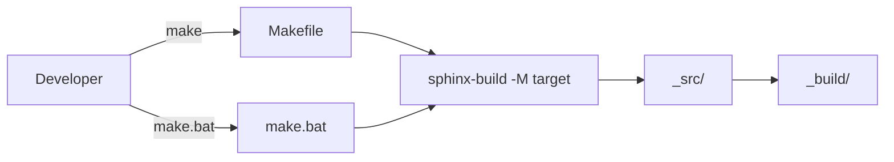

# Other — docs

# Documentation — Sphinx Build Wrappers (`docs/`)

## Overview

The `docs/` module contains the build tooling for the project's documentation. It consists of two thin wrapper scripts around Sphinx — the standard Python documentation generator:

- `Makefile` — the POSIX/macOS entry point
- `make.bat` — the Windows entry point

Both wrappers delegate every real operation to the `sphinx-build` command, as specified by the project's `SPHINXBUILD` environment variable (defaulting to `sphinx-build`). The actual documentation content is not in this module; it lives in the `_src/` source directory that these scripts operate on.

## Purpose

The module exists to give developers a uniform, platform-independent way to build the documentation without having to invoke `sphinx-build` manually. Both scripts expose Sphinx's standard command set (`html`, `latexpdf`, `doctest`, `clean`, …) so the same workflow works on any operating system.

There is no logic of its own beyond argument routing — the scripts intentionally stay thin wrappers so that Sphinx remains the single source of truth for build behavior.

## How It Works

Both scripts define the same set of variables:

| Variable      | Default         | Purpose |
|---------------|-----------------|---------|
| `SPHINXOPTS`  | *(empty)*       | Extra flags passed to every `sphinx-build` invocation. Can be supplied on the command line or via the environment. |
| `SPHINXBUILD` | `sphinx-build`  | The Sphinx executable to use. Set this if Sphinx is not on `PATH`. |
| `SOURCEDIR`   | `_src`          | Directory containing the RST/Markdown sources and `conf.py`. |
| `BUILDDIR`    | `_build`        | Directory where Sphinx writes generated output. Safe to delete. |

Both scripts invoke Sphinx using its "make mode" (`sphinx-build -M <TARGET>`), which lets Sphinx's own machinery resolve the target-specific build steps.

### The Catch-All Rule (Makefile)

```make
%: Makefile
	@$(SPHINXBUILD) -M $@ "$(SOURCEDIR)" "$(BUILDDIR)" $(SPHINXOPTS) $(O)
```

Every target that doesn't match an explicit rule is forwarded verbatim to `sphinx-build`. This is what makes arbitrary Sphinx targets such as `singlehtml` or `linkcheck` work without this module needing to know them in advance.

The two `help` targets — one explicit in the Makefile, one only defined in `make.bat` for the Windows fallback — delegate to `sphinx-build -M help` so the developer navigates Sphinx's own target list.

### Windows-Specific Behavior

The `make.bat` scripts first checks whether `sphinx-build` is available by running it and inspecting the error level:

```batch
%SPHINXBUILD% >NUL 2>NUL
if errorlevel 9009 (
	echo.The 'sphinx-build' command was not found. ...
	exit /b 1
)
```

If the CLI cannot be found (errorlevel 9009 means `command not found` on Windows), it prints a friendly message with installation instructions and exits — rather than letting Sphinx error out silently later.

### Flow



Both entry points converge on the identical `sphinx-build` invocation; there is no divergence between the operating systems' available options.

## Typical Build Targets

All targets are provided by Sphinx itself — this module only forwards them:

| Target | Purpose |
|--------|---------|
| `<none>` | Build HTML output (default). |
| `clean` | Remove everything under `_build/`. |
| `html` | Generate HTML in `_build/html/`. |
| `doctest` | Run code snippets in docstrings/documents. |
| `linkcheck` | Check all external links. |
| `latexpdf` | Build the PDF via LaTeX. |

Because of the catch-all forwarding, any future Sphinx target works without editing the wrapper.

## Extending the Module

When adding new documentation, work stays inside the source directory and requires no change to these files:

1. Create `.rst` — or if configured, `.md` — files under `_src/`.
2. Add them at the appropriate points in the index's toc to tree.
3. Run `make` html and verify the output in `_build/`.

Changing the Sphinx build configuration (themes, extensions, project metadata) is done in `_src/conf.py`, another no change to the wrappers is required unless the default `_src` / `_build` layout is changed.

## Requirements

- Sphinx must be installed on the system (`pip install sphinx`), and a proper virtualenv active.
- If Sphinx is not on `PATH`, set `SPHINXBUILD` to the full path to the executable — the both scripts honor overrides on the command line, notably:

  ```sh
  make SPHINXBUILD=/path/to/sphinx-build html
  ```

- This module has no runtime dependencies and no internal/external call graph in the codebase — it is an entry-point-only module used by human developers and CI workflows invoked from the repository root or directly within `docs/`.