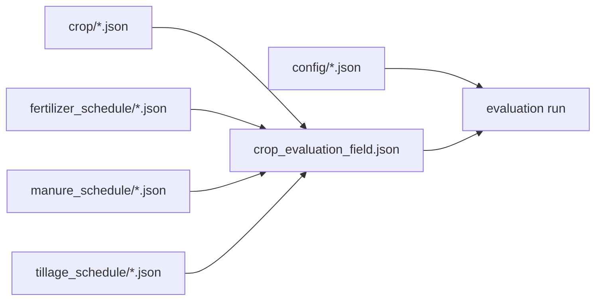

# Other — helpful_scripts-soil_crop_evaluation

# helpful_scripts/soil_crop_evaluation

## Overview

`helpful_scripts/soil_crop_evaluation` is a data-only module that supplies the evaluation scenarios for a field-level soil–crop simulation. It contains no executable code and no call graph edges of its own; instead, it provides the JSON inputs that a crop-evaluation runner consumes to simulate multi‑year cropping systems, nutrient management, and tillage regimes.

The module is organized under `eval_inputs/` and is composed of:

- one shared field definition,
- three simulation-configuration files,
- eight crop-schedule definitions,
- eleven manure schedules,
- seven tillage schedules,
- six fertilizer schedules.

The fixtures are agronomically realistic: 25–28 year runs staring in January 1980, crop rotations built from corn silage, corn grain, soybean, alfalfa, cover crops, and perennial grass, and management options that contrast synthetic fertilizer, broadcast/injected manure, conventional/conservation tillage, and several crop cover treatments. A new scenario in this module is essentially a new combination of one file from each directory.

## Directory layout

```
eval_inputs/
├── config/                 # simulation control (dates, options, county)
├── crop/                   # crop planting/harvest schedule definitions
├── fertilizer_schedule/    # synthetic fertilizer application events
├── field/                  # shared field and soil/management spec
├── manure_schedule/        # organic nutrient application events
└── tillage_schedule/       # tillage operation events
```

| Directory | Purpose |
|---|---|
| `config/` | Per-scenario simulation settings: timeframe, RNG seeding, simulation type, nutrient standard, county. |
| `crop/` | How often a species is planted and harvested, the day-of-year of each event, whether harvest kills the crop, and how the pattern repeats. |
| `fertilizer_schedule/` | The available fertilizer mixes and the date, depth, and mass of each synthetic application. |
| `manure_schedule/` | Application date, mass, depth, coverage, and form (liquid) of each manure application. |
| `tillage_schedule/` | Date, depth, mixing fraction, and incorporation fraction of each tillage pass. |
| `field/` | Location, field size, watering parameters, and named references to the soil/crop/management specifications used in the run. |

## How a scenario is assembled

A scenario is assembled from the five directories:



The shared `field/crop_evaluation_field.json` declares the overall environment (location, field size) and the names of the specifications that the runner will resolve. The crop, fertilizer, manure, and tillage files are the concrete schedule definitions. The `config` file supplies the run-level controls (start/end, nutrient standard, county). A comparison experiment is formatted by choosing a different crop schedule, or by substituting an alternative fertilizer/manure/tillage file under the same config.

## Simulation config files

Each file in `config/` is a JSON object with the following keys:

| Key | Type | Meaning |
|---|---|---|
| `start_date` | string | Simulation start as `"YEAR:DOY"` (day-of-year). |
| `end_date` | string | Simulation end as `"YEAR:DOY"`. |
| `set_seed` | boolean | Whether to seed the random-number generator deterministically. |
| `simulation_type` | string | Type of simulation to execute; all scenarios use `"field_and_feed"`. |
| `nutrient_standard` | string | Nutrient requirement model; all scenarios use `"NASEM"`. |
| `FIPS_county_code` | integer | U.S. FIPS county code used for location-derived inputs (e.g., weather); all scenarios use `55021`. |

The three configs differ only in the simulation window:

| Config file | Window |
|---|---|
| `con_corn_config.json` | 1980:1 – 2004:365 |
| `corn_cover_crop_config.json` | 1980:1 – 2005:365 |
| `corn_alfalfa_config.json` | 1980:1 – 2007:365 |

Example:

```json
{
    "start_date": "1980:1",
    "end_date": "2004:365",
    "set_seed": false,
    "simulation_type": "field_and_feed",
    "nutrient_standard": "NASEM",
    "FIPS_county_code": 55021
}
```

## Field definition

`field/crop_evaluation_field.json` is shared by all scenarios. It defines the physical environment and names the specifications that must be resolved externally:

| Key | Value / meaning |
|---|---|
| `soil_specification` | Name of the soil specification to load (here `"soil"`). |
| `crop_specification` | Name of the crop specification to load (here `"crop"`). |
| `fertilizer_management_specification` | Name of the fertilizer schedule to use (`"fertilizer_schedule"`). |
| `manure_management_specification` | Name of the manure schedule (`"manure_schedule"`). |
| `tillage_management_specification` | Name of the tillage schedule (`"tillage_schedule"`). |
| `field_size` | Field area (here `1.0`). |
| `absolute_latitude` / `longitude` | Geographic location of the field. |
| `minimum_daylength` | Minimum daylength used for photoperiod-aware crop processes. |
| `seasonal_high_water_table` | Whether a seasonal high water table is simulated. |
| `watering_amount_in_liters` / `watering_interval` | Irrigation settings (zero/disabled in these scenarios). |
| `supplement_manure_nutrient_deficiencies` | Whether the model may supplement nutrient deficiencies beyond the manure schedule. |

## Crop schedules

Files: `eval_inputs/crop/*.json`

A crop schedule defines **one or more crop species** with **planting dates** and **harvest dates** as parallel arrays of explicit events. Because a seedable rotation can involve multiple `crop_schedules` entries, each entry is one species and its associated events.

Key fields:

| Key | Type | Meaning |
|---|---|---|
| `crop_species` | string | Species/model crop name, e.g. `"corn_silage"`, `"corn_grain"`, `"alfalfa_silage"`, `"soybean_grain"`, `"cereal_rye_silage"`, `"triticale_silage"`, `"winter_wheat_silage"`, `"tall_fescue_hay"`. |
| `planting_years` / `planting_days` | array | Base planting events as year/day pairs. |
| `harvest_years` / `harvest_days` | array | Harvest events as year/day pairs. For perennial/multi-cut systems, this lists every event within the base cycle, e.g. an alfalfa season is four events `1980:166`, `1980:198`, `1980:230`, `1980:245` etc. |
| `harvest_operations` | array | One operation for each harvest event. The vocabulary used is:
- `"harvest_only"` — remove biomass without terminating the crop (multi-cut hay/alfalfa);
- `"harvest_kill"` — harvest and terminate the stand (silage corn, final alfalfa cut);
- `"kill_only"` — terminate the crop without a biomass harvest (cover crops, rye/wheat/triticale in spring). |
| `harvest_type` | string | All scenarios use `"scheduled"`; i.e., harvest is exactly the date data, not event-driven by crop state. |
| `pattern_repeat` | integer | Number of times the pattern is repeated to extend the schedule over the scenario horizon. |
| `planting_skip` / `harvesting_skip` | integer | Year offset/advance applied to the next repeat of planting (or harvesting) occurrences. These let rotations be interleaved — for example, to plant a cereal cover in fall of one year and harvest it in spring of the following year. |

### How a fixed season composes

Repeated stop, multi-entry rotations are expressed by listing all base event years/days and by setting the repeat and skip fields so the engine can stretch the pattern across the window.

- **Continuous corn silage** — one annual event per year (`corn_silage`, planted at DOY 136, harvested at DOY 259 with `harvest_kill`), `pattern_repeat: 24`, `planting_skip: 0`, `harvesting_skip: 0`.
- **Corn + winter cover crop** — the same corn silage cycle is alternated with a second schedule: `cereal_rye_silage` (or `triticale_silage`, `winter_wheat_silage`) planted at DOY 263 and killed at DOY 120 of the following year with `"kill_only"`. The planting/harvest year shift (planting in year N, harvest in year N+1) is expressed directly in the arrays: `planting_years: [1980]`, `harvest_years: [1981]`.
- **Corn–alfalfa rotation** — two schedule strings: an alfalfa silage block planted in 1980 with 15 cuts across four years (ending with `harvest_kill` and year 1983), and a corn block (`corn_silage` or `corn_grain`) planted in 1984–1986. Skip values (`planting_skip: 6` / `4`, `harvesting_skip: 3` / `4`) distribute the repeating blocks across the 28-year window.
- **Corn–soybean** — 4-year cycles of soybean (1980–1981) and corn (1982–1984) interleaved by the skip parameters of each species block.
- **Tall fescue hay** — A single persistent `tall_fescue_hay` stand: planted in 1980, three or four cuttings per year (via the full harvest-year/day lists), with `harvest_only` majority allowances and a single final `harvest_operations` value (`"harvest_kill"`), killed only at the end. `pattern_repeat: 0` (no replication; all events are enumerated explicitly).

## Fertilizer schedules

Files in `eval_inputs/fertilizer_schedule/` describe synthetic fertilizer applications as parallel arrays: for each application event, one entry in each of `years`, `count`, `days`, `mix_names`, `nitrogen_masses`, `phosphorus_masses`, `potassium_masses`, `application_depths`, and `surface_remainder_fractions`. The number of events in `years`/`days`/`mix_names` equals the number of applications.

Structure:

| Field | Meaning |
|---|---|
| `available_fertilizer_mixes` | A mix list, each with a `name` and dry composition stored in the object: `"N"`, `"P"`, `"K"` fractions. Example mixes: `"15-15-15"` (0.15/0.15/0.15) and `"100-0-0"` (1.0/0/0). |
| `mix_names` | Per-event name of the mix, matching lists in `available_fertilizer_mixes`. |
| `years` / `days` | Application dates (start-of-year + day-of-year). |
| `nitrogen_masses`, `phosphorus_masses`, `potassium_masses` | Per-event application mass in simulation units. `potassium_masses` is frequently a single `0.0` entry in these data for scenarios that do not use potassium. |
| `application_depths` | Depth of placement; `0.0` means a surface application, nonzero values are injections (e.g. `25.4`, `101.6`). |
| `surface_remainder_fractions` | Fraction of the nutrient left on the soil surface (`1.0` = broadcast; `0.0` = fully banded below surface). |
| `pattern_repeat` / `pattern_skip` | Number of times the event list is repeated, and the number of years offset between repetitions. |

Example from `continuous_corn_25_year_fert.json`: two events per year (starter 15-15-15 at DOY 136 and side-dressed N at DOY 183), repeated over 24 years.

## Manure schedules

`eval_inputs/manure_schedule/*.json` uses the same repeated event-array design:

| Field | Meaning |
|---|---|
| `years` / `days` | Dates of each manure application. |
| `nitrogen_masses`, `phosphorus_masses`, `potassium_masses` | Nutrient mass applied per event. |
| `coverage_fractions` | Fraction of the field surface that the manure covers (typically `0.95`). |
| `application_depths` | `0.0` for broadcast; `101.6` for injection. |
| `surface_remainder_fractions` | `1.0` for broadcast (all remaining on the surface), `0.05` for injections (the rest is incorporated). |
| `manure_types` | always `"liquid"` in these inputs. |
| `pattern_repeat` / `pattern_skip` | Repeats the whole event list over the run window, skipping years as configured. |

The directory contains targeted experiments:

| File | Treatment |
|---|---|
| `continuous_corn_25_year_manure_broadcast.json` | Annual manure, surface-applied, 196 N mass. |
| `continuous_corn_25_year_manure_injection.json` | Same mass injected at depth. |
| `continuous_corn_double_manure_broadcast.json` | Double the N/P mass of the standard broadcast. |
| `continuous_corn_double_manure_injection.json` | Double mass, injected. |
| `corn_grain_soy_grain_manure.json` | Manure on the corn years of the corn–soybean rotation. |
| `double_corn_grain_soy_grain_manure.json` | The same crop rotation at double the corn manure mass. |
| `corn_alfalfa_28year_manure_schedule.json` | Manure after alfalfa cuts and before corn blocks. |
| `corn_cover_crop_manure.json` | Manure in the spring of the corn year and again after corn harvest for the cover crop. |
| `tall_fescue_manure.json` | Periodic manure for the long-term grass hay stand. |

## Tillage schedules

Tillage files are also event-array strings, but with tillage-specific parallel values:

| Field | Meaning |
|---|---|
| `years` / `days` | Date of each tillage pass |
| `tillage_depths` | Tool depth (e.g. `150`, `100`, `40`; units are model depth units) |
| `mixing_fractions` | Fraction of the soil mixing in that layer |
| `incorporation_fractions` | Fraction of surface residue or manure incorporation in that pass |
| `pattern_repeat` / `pattern_skip` | Repetition / year offset |

Multiple passes are expressed as multiple entries on the same date or consecutive dates:

- `continuous_corn_25_year_conven_till.json` — a two-pass conventional tillage each year (deep pass DOY 123, shallow pass DOY 124).
- `continuous_corn_25_year_conserv_till.json` — a single pass, lower mixing.
- `corn_alfalfa_28year_tillage_schedule.json` — pre-seeding seedbed passes plus primary + secondary tillage for corn block cycles.
- `corn_cover_crop_tillage.json` — spring tillage before corn plus fall tillage after harvest before the cover crop.
- `tall_fescue_tillage.json` — three final passes at establishment only (`pattern_repeat: 0`).

## Scenarios

The following treatments can be assembled from the files in this module.

| Scenario | Config | Crop file(s) | Management files |
|---|---|---|---|
| Continuous corn silage, 25 years | `con_corn_config.json` | `continuous_corn_25_year.json` | Fertilizer: `continuous_corn_25_year_fert.json` or `con_corn_supplemental_n.json`<br>Manure: one of `continuous_corn_25_year_manure_broadcast_*`, `*_injection`, `*_double_*`<br>Tillage: `continuous_corn_25_year_conven_till.json` or `..._conserv_till.json` |
| Corn silage + winter cover crop | `corn_cover_crop_config.json` | `corn_rye.json` (cereal rye), `corn_triticale.json` (triticale), or `corn_winter_wheat_cover.json` | Manure: `corn_cover_crop_manure.json`<br>Tillage: `corn_cover_crop_tillage.json` |
| Corn–alfalfa rotations, 28 years | `corn_alfalfa_config.json` | `corn_alfalfa_rotation_28year.json` (corn silage) or `corn_grain_alfalfa_rotation_28year.json` (corn grain) | Fertilizer: `corn_alfalfa_28year_fertilizer_schedule.json`<br>Manure: `corn_alfalfa_28year_manure_schedule.json`<br>Tillage: `corn_alfalfa_28year_tillage_schedule.json` |
| Corn grain–soybean rotation | any config covering the planted years (e.g. the 1980–2004 window) | `corn_grain_soy_grain.json` | Manure: `corn_grain_soy_grain_manure.json` or `double_corn_grain_soy_grain_manure.json`<br>Tillage: `corn_grain_soy_grain_tillage.json` |
| Perennial tall fescue hay | any config covering 1980–2004 | `tall_fescue_eval.json` | Manure: `tall_fescue_manure.json`<br>Tillage: `tall_fescue_tillage.json` |

No dedicated config file is provided for the corn–soybean or tall-fescue cases; they are intended to be run under the window offered by `con_corn_config.json` (or another config whose dates match the schedule length).

## Conventions to be aware of

- **All arrays in a schedule are parallel.** To add a cutting, fertilizer event, or tillage pass, add one entry to every event array, rather than a separate rule.
- **Dates are `"YEAR:DOY"`** for the config window and plain integers in `years`/`days` arrays within the schedules.
- **Repeated vs. enumerated**: a heavily repeated crop (e.g., continuous corn) uses `pattern_repeat` to stretch a few base events over the whole window; a highly specified long-term forage like tall fescue instead enumerates every event in the arrays and uses `pattern_repeat: 0`.
- **Cover-crop kill operations** are `"kill_only"` (a kill event with no harvest), while silage/grain termination events are `"harvest_kill"`.
- **Perennial multi-cut harvests** are ordered as arrays of `harvest_days` per year and each event has an entry in `harvest_operations`; only the last cut uses `"harvest_kill"`.
- **Single-value potassium arrays**: several fertilizer/manure files leave `potassium_masses` as `[0.0]`, a valid measure that no potassium is applied by the treatment.

## Integration with the codebase

Because the module contains only static data, the integration boundary is simple:

- The JSON files are read by the evaluation runner, by specification name (e.g. `field.json` resolves `fertilizer_management_specification: "fertilizer_schedule"` to the schedules below that directory).
- No module code, functions, or classes exist here — adding a scenario is done by adding a new JSON file (or file combination) and referring to it — or by altering the specification names through the field file.

All numbers (masses, depths, fractions) are in the units used by the downstream model; where they represent agronomic material (masses of N/P/K), the levels are designed to be internally comparable (e.g., standard vs. double manure, broadcast vs. injected, synthetic vs. manure-only) across the same crop and config.