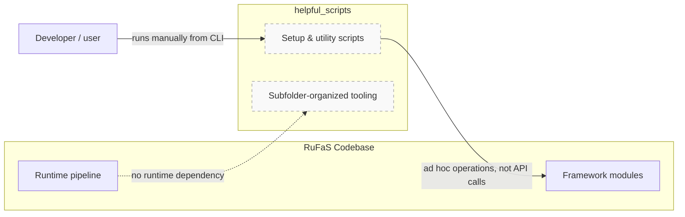

# Other — helpful_scripts

# Other — helpful_scripts

## Overview

The `helpful_scripts` module is a loose collection of utility scripts and support files used when working with the RuFaS codebase. Where the rest of RuFaS is structured as a cohesive framework, this folder exists as a scratch drawer: it holds one-off tooling, convenience scripts, and manual setup files that developers use during day-to-day work.

The module is deliberately kept separate from the main codebase. It is not imported by RuFaS modules, and none of its files are part of the runtime or core build. It exists purely as developer-facing tooling.

## Purpose

These scripts solve practical, recurring problems that come up when working with RuFaS:

- Setup and configuration tasks
- Data preparation or conversion tools
- Development-environment conveniences
- Scripts for inspecting or exercising parts of the codebase manually

The folder is organized into subfolders, where each subfolder groups scripts/files around a specific task or workflow area.

## Important Caveats

The README is explicit about the maintenance status of this module:

- **Not held to the same standard** — These files do not follow the same quality guidelines, testing practices, or code-review rigor as the rest of the RuFaS codebase.
- **Not regularly updated** — The scripts may lag behind changes to RuFaS. They are not continuously validated against the current codebase.
- **Use with care** — Many scripts will require manual adjustment to work with your current environment, your local configuration, or the current state of the RuFaS source tree.

Treat these scripts as **starting points**, not as reliable, maintained tools. Before using one, read it, understand it, and expect to alter it.

## How It Fits Into the Codebase

From an integration standpoint, `helpful_scripts` is entirely standalone:

- **No incoming calls** — no RuFaS module or package imports from this folder.
- **No outgoing calls** — these scripts do not call into RuFaS modules through a stable API; any interaction with the codebase is ad hoc and script-specific.
- **No execution flows** — since the module is not part of the application's runtime path, there is no execution flow that passes through it during builds or normal operation.

Additionally these are run by a developer from the command line, not by the application.

The scripts may touch files, invoke commands, or manipulate configuration in the RuFaS workspace, but they do so as external tooling rather than as an integrated component of the system.

## Working With This Module

When contributing to or using `helpful_scripts`, keep the following in mind:

- **Don't expect it to work as-is.** Read each script and adapt it to your setup.
- **Don't assume current correctness.** If you are using a script with the current RuFaS codebase, be prepared to update it. Verify it reflects the current configuration formats, file paths, and command interfaces.
- **Don't let quality drift in.** If you add a script here, you are not required to meet the framework's QA bar — but you should still leave the script in a working state and documented in the comments.
- **Improve the module.** The best contributions are scripts that solve a real, repeated problem and save future developers time. If you fix or modernize an existing script, note it so the next person benefits.

## Key Components

The module has no exposed APIs or named entry points. Its only guaranteed structure is:

| Component | Description |
|---|---|
| `readme.md` | Module overview and usage warning (this source you are reading) |
| Subfolders | Each contains a set of related helper scripts/files. There is no guaranteed naming convention or shared interface between subfolders; each subfolder is self-contained. |

There is no formal registration, packaging, or test coverage for this module. It is automatically present in the repository but is invisible to the RuFaS build — a good thing, because this is exactly the kind of tooling that should stay out of the production pipeline.