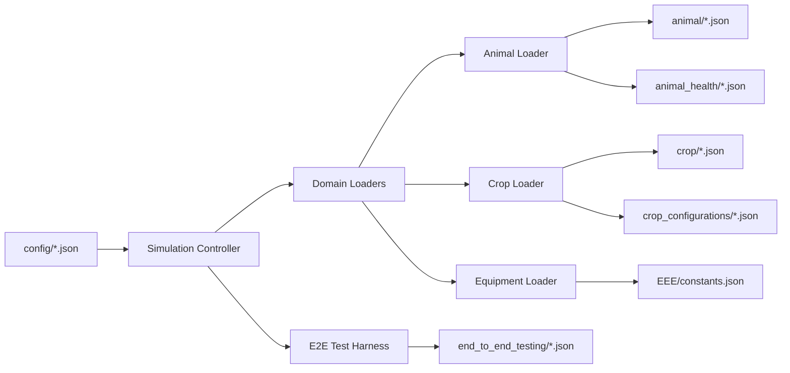

# Other — input-data

# Other — input-data Module

## Overview

The `input/data` directory is the static data backbone of the dairy farm simulation. It contains all JSON parameter files that define simulation scenarios, animal herd configurations, crop rotations, equipment constants, and end-to-end test expectations. This module contains no executable code — it is consumed by the simulation's input-loading layer at startup.

The data is organized into seven subdirectories, each serving a distinct domain:

```
input/data/
├── EEE/                    # Equipment & energy constants
├── animal/                 # Herd, reproduction, and lactation parameters
├── animal_health/          # Disease incidence and effect definitions
├── config/                 # Simulation run configuration
├── crop/                   # Crop rotation schedules
├── crop_configurations/    # Crop species growth and harvest parameters
└── end_to_end_testing/     # Expected results for regression testing
```

## Directory Breakdown

### EEE/constants.json

Equipment and energy efficiency constants used by the field operations and machinery modules. Each entry is a named constant with an ID, value, unit, and optional notes.

Key constants include:

| Constant | Value | Unit | Purpose |
|---|---|---|---|
| Field Speed | 10 | km/hr | Default field operation speed |
| Field Efficiency | 0.9 | unitless | Proportion of field time spent working |
| Small/Medium/Large Tractor PTO | 55.93 / 208.42 / 328.11 | kW | Tractor power ratings |
| Small/Medium/Large Tractor Power Available | 39.95 / 148.87 / 234.36 | kW | PTO ÷ 1.4 |
| Small/Medium/Large Tractor Mass | 8400 / 12700 / 20856 | kg | Tractor weights |
| Tractor Speed | 10 | km/hr | Default tractor speed |
| Conversion to kWh | 0.75 | — | Energy conversion factor |

The `Notes and remarks` field documents derivation rules (e.g., "power available is PTO/1.4").

### animal/

Contains herd-level configuration files. Two full example configurations are provided — one for freestall housing and one for open-lot housing — plus supporting parameter files.

#### example_freestall_animal.json / example_open_lot_animal.json

These are the primary herd configuration files. Both share the same top-level schema:

- **`herd_information`** — herd composition (calf, heifer, cow counts), breed (`"HO"` for Holstein), parity fractions, milking cow fraction, and optional `annual_milk_yield`. The `herd_size_adjustment_period`, `herd_size_sell_threshold`, and `herd_size_buy_threshold` fields control dynamic herd-size management during simulation.
- **`herd_initialization`** — `initial_animal_num` and `simulation_days` for the animal population warm-up.
- **`animal_config`** — three nested blocks:
  - **`management_decisions`** — breeding start day, reproduction method (`"SynchED"`, `"TAI"`, `"ED"`, `"ED-TAI"`), semen type, culling criteria, milking frequency, and milk composition targets.
  - **`farm_level`** — calf management (sexed semen rates, weaning), reproduction protocols (voluntary waiting period, estrus detection rates, OvSynch programs, gestation parameters), and bodyweight distributions (birth weight by breed, mature weight).
  - **`from_literature`** — literature-derived parameters: pregnancy check timing and loss rates, estrus cycle statistics, culling probability curves by day-in-milk, parity-specific death/cull probabilities, and stillbirth rate.
- **`methane_mitigation`** — mitigation method (`"None"` or additive types) and additive amounts (3-NOP, monensin, essential oils, seaweed).
- **`housing`** — `"barn"` or open-lot indicator.
- **`methane_model`** — which methane estimation model to use per animal class (`"Pattanaik"` for calves, `"IPCC"` for heifers and cows).
- **`ration`** — ration formulation settings: phosphorus buffer, user-input flag, formulation interval, and max reformulation attempts.
- **`pen_information`** — array of pen definitions. Each pen specifies:
  - `animal_combination` (`"CALF"`, `"GROWING"`, `"CLOSE_UP"`, `"LAC_COW"`)
  - `housing_type` and `pen_type` (`"freestall"` vs `"open lot"`)
  - `number_of_stalls`, `max_stocking_density`
  - Distance to milking parlor (vertical/horizontal)
  - `manure_streams` — array linking the pen to manure processing streams, each with a `stream_name`, `bedding_name`, `stream_proportion`, and `first_processor`
  - For lactating pens: `minutes_away_for_milking`, `first_parlor_processor`, and `parlor_stream_name`
- **`bedding_configs`** — reusable bedding definitions referenced by `manure_streams`. Each entry defines `bedding_type`, `bedding_mass_per_day`, `bedding_density`, `bedding_dry_matter_content`, `bedding_carbon_fraction`, `bedding_phosphorus_content`, and `sand_removal_efficiency`. The `"none (no bedding)"` entry is the zero-mass default for open-lot pens.

The freestall and open-lot examples differ primarily in herd scale, pen layout, and manure stream routing. Open-lot pens split manure across multiple streams (e.g., lot vs. feed alley) with different proportions.

#### lactation_curve_adjustment_inputs.json

Adjustment coefficients for the lactation curve model. The `adjustments` object contains correction factors (`l`, `m`, `n`) keyed by:

- **`parity`** — parity 1, 2, 3
- **`year`** — 2006 through 2016
- **`month`** — 1 through 12
- **`region`** — USDA production regions plus `"None"` (zero adjustment)
- **`milking_frequency`** — `twice_daily` / `thrice_daily`

The `state_to_region_mapping` maps FIPS state codes (1–56) to the region names used above. Additional fields provide parity-based 305-day milk yield multipliers (`parity_2_305_day_milk_yield_adjustment`, `parity_3_305_day_milk_yield_adjustment`), and the mean/standard deviation of the Wood curve parameters (`parameter_l_mean`, `parameter_m_mean`, `parameter_n_mean`, plus per-parity standard deviations).

#### no_animal.json

A sentinel file: `{"exclude_from_pool": true}`. When present, it signals the input loader to exclude the animal domain entirely from the simulation (used for field-only runs).

### animal_health/example_animal_health.json

Defines the disease model schema. Each disease key (`disease1`, `disease2`, ...) contains:

- **`incidence`** — `baseline_incidence_rate`
- **`immediate_effects`** — short-term effects, each with a `name` (e.g., `"milk_production_decrease"`, `"miscarriage_likelihood_increase"`) and a `percent` magnitude
- **`intermediate_effects`** — medium-term effects (e.g., `"weightloss"`)
- **`lasting_effects`** — long-term effects (empty object in the example)
- **`risk_factors`** — list of risk factor identifiers

The example file is a template; empty disease objects (`{}`) are valid and represent diseases with no modeled effects.

### config/

Simulation run configuration files. Each config specifies:

| Field | Example Value | Purpose |
|---|---|---|
| `start_date` / `end_date` | `"2013:1"` / `"2019:365"` | Simulation window as `year:day` |
| `set_seed` | `true` | Whether to use a fixed RNG seed |
| `simulation_type` | `"full_farm"`, `"animals_only"`, `"field_only"`, `"field_and_feed"` | Which domains to simulate |
| `nutrient_standard` | `"NASEM"` | Ration nutrient standard |
| `FIPS_county_code` | `55025` | County for weather/soil data |
| `include_detailed_values` | `false` | Output verbosity flag |

The `end_to_end_testing_*` configs are short-duration runs (one year) used by the regression test suite.

### crop/

Crop rotation schedule files. Each file contains a `crop_schedules` array. A schedule entry defines:

- **`crop_species`** — e.g., `"corn_grain"`, `"corn_silage"`, `"alfalfa_silage"`, `"alfalfa_hay"`, `"triticale_silage"`
- **`planting_years`** / **`planting_days`** — parallel arrays of planting dates
- **`harvest_years`** / **`harvest_days`** — parallel arrays of harvest dates (multiple harvests per year for alfalfa)
- **`harvest_operations`** — per-harvest operation type: `"harvest_kill"` (harvest then terminate crop), `"harvest_only"`, or `"kill_only"`
- **`harvest_type`** — `"scheduled"` (the only supported value in these files)
- **`pattern_repeat`** — number of times to repeat the rotation pattern
- **`planting_skip`** / **`harvesting_skip`** — skip counts for staggered rotations

Example rotations included:

- `corn_rotation.json` — single-crop corn grain with `pattern_repeat: 10`
- `example_alf_corn_silage_rotation.json` — 2-year corn silage / alfalfa silage rotation
- `example_alf_hay_corn_grain_rotation.json` — 2-year corn grain / alfalfa hay rotation
- `example_corn_silage_trit_cover_crop.json` — corn silage followed by triticale cover crop, repeated 7 times

`no_crop.json` is the sentinel that excludes the crop domain.

### crop_configurations/default_crop_configs.json

Species-level growth and harvest parameters for every crop the model supports. Each crop configuration includes:

- **Plant category** — `"warm_annual"`, `"cool_annual"`, `"perennial"`, `"perennial_legume"`, `"warm_annual_legume"`
- **`is_nitrogen_fixer`** — legume flag
- **Temperature and heat unit parameters** — `minimum_temperature`, `optimal_temperature`, `potential_heat_units`
- **Growth curve points** — `first_heat_fraction_point`, `first_leaf_fraction_point`, `second_heat_fraction_point`, `second_leaf_fraction_point`, `senescent_heat_fraction`, `max_leaf_area_index`, `light_use_efficiency`
- **Nutrient fractions** — nitrogen and phosphorus fractions at emergence, half-maturity, and maturity; plus `yield_nitrogen_fraction` and `yield_phosphorus_fraction`
- **Root parameters** — `max_root_depth`, `root_distribution_param_da`, `root_distribution_param_c`
- **Harvest indices** — `optimal_harvest_index`, `minimum_harvest_index`
- **Forage quality at harvest** — `dry_matter_percentage`, `lignin_dry_matter_percentage`, `crude_protein_percent_at_harvest`, `non_protein_nitrogen_at_harvest`, `starch_at_harvest`, `adf_at_harvest`, `ndf_at_harvest`, `sugar_at_harvest`, `ash_at_harvest`

Supported species: alfalfa (silage, baleage, hay), cereal rye (grain, silage, baleage, hay), corn (grain, silage), soybean (grain, hay), tall fescue (silage, baleage, hay), pasture, triticale (grain, silage, baleage, hay), and winter wheat (grain, silage, baleage, hay).

`no_crop_configs.json` is the sentinel for excluding crop configurations.

### end_to_end_testing/

Regression test infrastructure. Contains:

- **`end_to_end_testing_result_paths.json`** — maps each test scenario (`freestall_e2e`, `open_lot_e2e`, `field_and_feed_e2e`, `animals_only_e2e`) to a list of domain-level comparisons. Each comparison specifies:
  - `domain` — `"CropAndSoil"`, `"Animal"`, `"Manure"`, or `"Feed"`
  - `expected_results_path` — path to the JSON file with expected values
  - `actual_results_path` — prefix of the saved-variables file produced by the run
  - `tolerance` — acceptable relative difference (0.1 in all entries)
- **`e2e_json_*_filter.json`** — expected results files. Each contains a `name`, a `filters` array (regex patterns like `"Feed.*"`, `"Animal.*"`, `"CropAndSoil.*"`), and an `expected_results` object mapping fully-qualified output variable paths to arrays of expected values. The feed filter file also includes `expected_results_last_updated` timestamps.
- **`e2e_comparison_*_differences.json`** — comparison descriptors with a `name` and `filters` array used to select which output variables to diff.

## How the Data Is Consumed

The input-loading layer reads these files at simulation startup. The general flow:



1. A **config file** selects the `simulation_type`, which determines which domain loaders are invoked.
2. Each domain loader reads its corresponding data files. The `exclude_from_pool` sentinel in `no_animal.json`, `no_crop.json`, and `no_crop_configs.json` tells the loader to skip that domain entirely.
3. **Animal data** is cross-referenced: `example_*_animal.json` provides herd and pen structure, `lactation_curve_adjustment_inputs.json` provides milk curve coefficients, and `animal_health/*.json` provides disease parameters.
4. **Crop data** pairs rotation schedules (`crop/*.json`) with species parameters (`crop_configurations/*.json`). The `crop_species` string in a schedule must match a `name` in the configurations file.
5. **Pen manure streams** reference `bedding_name` values that must exist in the same file's `bedding_configs` array, and `first_processor` names that must be defined in the manure processing module.
6. **EEE constants** are referenced by field operation and machinery calculations by their `Name` field.

## Key Design Patterns

### Sentinel Files

Files named `no_*.json` with `{"exclude_from_pool": true}` act as domain exclusion flags. Their presence tells the loader to skip that domain, enabling partial simulations (`field_only`, `animals_only`, `field_and_feed`).

### Cross-File Referencing

Several files reference each other by string keys:

- `crop_species` in rotation schedules → `name` in crop configurations
- `bedding_name` in pen manure streams → `name` in `bedding_configs`
- `first_processor` in manure streams → processor names defined in the manure module
- `state_to_region_mapping` in lactation adjustments → region keys in the `adjustments.region` object

A mismatch in any of these references will fail at load time, so new scenarios must keep these keys consistent.

### Parallel Arrays for Schedules

Crop schedules use parallel arrays (`planting_years` / `planting_days`, `harvest_years` / `harvest_days`, `harvest_operations`) rather than objects. The index position links the entries — e.g., the third harvest of an alfalfa crop is `harvest_days[2]`, `harvest_years[2]`, `harvest_operations[2]`.

### E2E Test Tolerance

Expected results are compared against actual simulation output with a relative tolerance of 0.1. The `filters` arrays use regex patterns to select output variables by domain prefix, so new output variables matching an existing prefix are automatically included in the comparison.

## Adding a New Scenario

To add a new simulation scenario:

1. Create a config file in `config/` specifying the simulation window and type.
2. If the scenario uses animals, create an animal JSON file (or reuse an example) with matching `pen_information` and `bedding_configs`.
3. If the scenario uses crops, create a rotation schedule in `crop/` whose `crop_species` values exist in `crop_configurations/default_crop_configs.json`.
4. If the scenario is a new housing type (e.g., a different open-lot layout), ensure the `first_processor` names in `manure_streams` are registered in the manure processing module.
5. For regression testing, add an entry to `end_to_end_testing_result_paths.json` and generate expected results files.