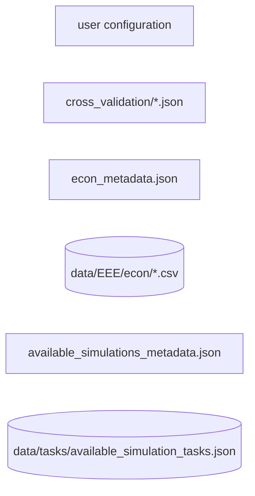
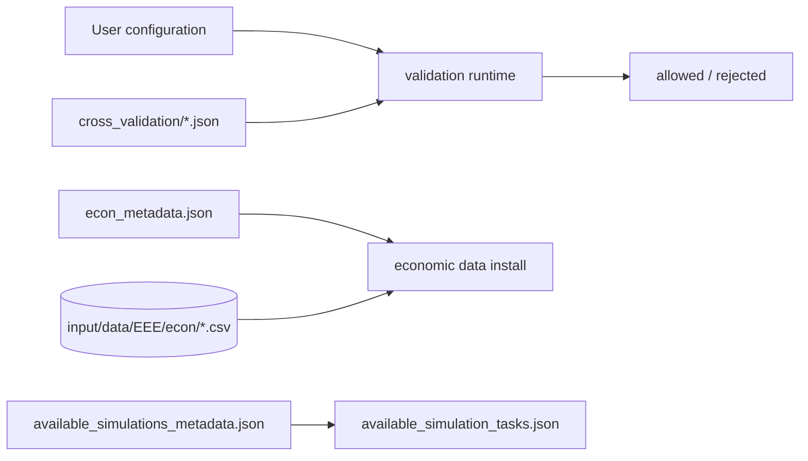

# Other — input-metadata

# Input Metadata

## Overview

The `input-metadata` module is a static, declarative metadata corpus. It contains no executable code; instead it publishes machine-readable descriptions that other parts of the pipeline consume. The module covers two distinct responsibilities:

1. **Data cataloging** — mapping logical input names to physical files. Economic time series and simulation task configuration are described in `econ_metadata.json` and `available_simulations_metadata.json`.
2. **Cross-field validation** — encoding the input configuration rules, expressed as a small rule DSL, for the animal, crop/soil, and feed-storage subsystems. The rule files describe *what* must be true of a valid run; a consumer evaluates them against the user configuration.

Because the module is data rather than code, the documentation below is a contract for the runtime that interprets it.

## Module Layout

```text
input/metadata/
├── EEE/
│   └── econ_metadata.json                    # economic CSV definitions
├── available_simulations_metadata.json       # simulation task definition
└── cross_validation/
    ├── animal_cross_validation.json
    ├── corn_alf_silage_cross_validation.json
    ├── corn_cross_validation.json
    ├── corn_grain_alf_hay_cross_validation.json
    ├── corn_silage_cover_crop_cross_validation.json
    ├── crop_and_soil_cross_validation.json
    └── feed_storage_cross_validation.json
```

None of these files make calls to other modules, and no execution flow originates here. They are ingested at configuration or validation time.

## Economic Data Catalog

**File:** `input/metadata/EEE/econ_metadata.json`

The file is a single `files` map. Each key is a logical identifier for an economic input series; each value describes that series.

```json
{
  "files": {
    "commodity_prices.milk_class_3.dollar_per_liter": {
      "title": "Commodity prices",
      "description": "Class 3 Milk (Used for cheese production)",
      "path": "input/data/EEE/econ/commodity_prices.milk_class_3.dollar_per_liter.csv",
      "type": "csv",
      "properties": "commodity_prices_milk_class_3_dollar_per_liter_csv_properties"
    }
  }
}
```

### Entry fields

| Field | Purpose |
|---|---|
| `title` | Human-readable grouping label (e.g., `"Feed prices"`, `"Cattle"`). For a few entries the title is intentionally empty `""`. |
| `description` | Unambiguous semantics — a price for the same commodity with a different unit appears twice, so the description is the authority on meaning. |
| `path` | Location of the data file, relative to the repository root. |
| `type` | Format of the data file; all econ entries are `"csv"`. |
| `properties` | Take the identifier of the column/parsing specification for this CSV (e.g., `"commodity_prices_milk_class_3_dollar_per_liter_csv_properties"`). The actual property definitions live outside this file. |

### Logical identifier conventions

Identifiers follow a dotted `<domain>.<item>.<unit>` form so the unit is part of the key:

| Domain | Examples |
|---|---|
| `commodity_prices.*` | crop, feed, bedding, cattle, milk, fertilizer, energy, semen, water prices |
| `capital_costs.*` | land value per hectare |
| `farm_services.*` | labor, machinery, land-rent, grain transport |

Important distinctions encoded in the identifiers and descriptions:

- Price basis: `dollar_per_kilogram`, `dollar_per_liter`, `dollar_per_head`, `dollar_per_square_meter`, `dollar_per_animal`, `dollar_per_straw`, `dollar_per_tonne_CO2e`, `dollar_per_megajoule`, `dollar_per_cubic_meter`, `dollar_per_kwh`, `dollar_per_hour`, `dollar_per_hectare`, `dollars_per_tonne_km` — always preserve these units.
- Milk classes: `milk_all`, `milk_class_2`, `milk_class_3`, `milk_class_4`, `milk_nonfat_dry`, `milk_retail`.
- Fertilizer nutrient series are prefixed `net_fertilizer_`, and the duplicate `anhydrous-ammonia`/`anhydrous_ammonia` files both exist.
- `_default_values` is special: it is the fallback series for "localized economic data is unavailable.

Identifiers are manually curated; the catalog contains an entry `commodity_prices.calf_ heifer_2.dollar_per_kilogram` (with a space between `calf_` and `heifer`), so consumers should treat identifiers as opaque.

## Simulation Task Metadata

**File:** `input/metadata/available_simulations_metadata.json`

A one-entry catalog defining the general simulation parameter file:

```json
{
  "files": {
    "tasks": {
      "title": "Task manager data",
      "description": "Configuration file for general simulation parameters.",
      "path": "input/data/tasks/available_simulation_tasks.json",
      "type": "json",
      "properties": "tasks_properties"
    }
  }
}
```

The schema mirrors the econ catalog entry, except `"type": "json"`. The `path` points to the actual tasks configuration consumed at run time.

## Cross-Validation Metadata

The files under `cross_validation/` define **cross-field invariants** of a correct simulation configuration. They matter because individual configuration keys may be locally valid; its combination can be impossible or contradictory (e.g., a gestation shorter than the dry period, or a crop schedule where planting and harvest arrays are not the same length). Each file scopes its rules to a subsystem:

| File | Scope |
|---|---|
| `animal_cross_validation.json` | herd, reproduction, bodyweight, culling, and parity |
| `crop_and_soil_cross_validation.json` | crop configs, field watering, soil layers, manure daily spreading |
| `corn_cross_validation.json` | corn schedule |
| `corn_alf_silage_cross_validation.json` | corn-alfalfa-silage schedules |
| `corn_grain_alf_hay_cross_validation.json` | corn-grain/alfalfa-hay schedules |
| `corn_silage_cover_crop_cross_validation.json` | corn-silage/cover-crop schedules |
| `feed_storage_cross_validation.json` | feed storage configuration |

### Rule File Shape

```json
{
  "cross_validation": [
    {
      "description": "…",
      "aliases": { "variables": { "…": "…" }, "constants": { "…": … } },
      "apply_when": [ "…condition…" ],
      "rules": [
        {
          "left_hand": { "…" },
          "right_hand": { "…" },
          "relationship": "…"
        }
      ]
    }
  ]
}
```

### Aliases

Each validation entry aliases short variable names to configuration paths. A value such as:

```json
"avg_gestation_len": "animal.animal_config.farm_level.repro.avg_gestation_len"
```

resolves `avg_gestation_len` against the user configuration at the dotted path. Constant aliases also exist in the same `aliases` object:

```json
"constants": { "one": 1.0, "ED": "ED", "true_constant": true }
```

Numeric `boolean` constants are used in rules like `"is_null"` / `"is_not_null"` checks, where the right-hand side is only a marker and isn't compared numerically (e.g., `relationship: "is_not_null"` with `operands: ["true_constant"]`).

### Expressions

Expressions appear as `left_hand` and `right_hand` of a rule.

**Aggregation expressions** wrap one or more operands:

```json
{
  "aggregation": {
    "operation": "no_op",
    "operands": ["avg_gestation_len"]
  }
}
{
  "aggregation": {
    "operation": "sum",
    "operands": ["p1", "p2", "p3", "p4", "p5"]
  }
}
{
  "aggregation": {
    "operation": "product",
    "operands": ["twenty_percent", "birth_weight_avg_ho"]
  }
}
{
  "aggregation": {
    "operation": "difference",
    "operands": ["avg_gestation_len", "days_in_preg_when_dry"]
  }
}
```

Supported operations: `no_op`, `sum`, `product`, `difference`.

**Element-wise mode.** When fields are arrays (for example, yearly planting/harvest arrays shared across a crop schedule, or per-day culling distributions), the expression often uses:

```json
"aggregation": { "operation": "no_op", "mode": "element_wise", "operands": ["planting_years"] }
```

The same mode appears on both sides consistently; the relationship should then read as an element-wise or length check (e.g., `is_equal_length`).

**`for_each` expressions.** Two modes are used:

- `"mode": "enforce"` — iterate over a collection and assert a pair of fields in each element satisfies the given relationship. Used for constraint ordering across soil layers and crop configs, e.g. field capacity ≥ wilting point.
- `"mode": "filter"` — select a collection subset and assert membership. Used by the daily-spread rule to require a `DailySpread` processor in `manure_management.storage`.

### Conditions

`apply_when` is an optional list of conditions. If present, the rule gets applied only when *all* conditions hold. Conditions reuse the same expression/relationship structure (e.g., the repro method with `"ED", "ED-TAI"`).

### Relationships

| Relationship | Meaning |
|---|---|
| `equal` | operands (or aggregate of operands) equal |
| `greater` | left > right |
| `greater_or_equal_to` | left ≥ right |
| `is_in` | arrays/values containment |
| `is_null`, `is_not_null` | null-marker check |
| `is_equal_length` | array/vector equality of lengths |

### Two Representative Rules

**1. Cull-assignment distributions must be the same length as cull day count** — ensures that uniform probabilities distributed across cull days:

```json
{
  "relationship": "is_equal_length",
  "left_hand": { "aggregation": { "operation": "no_op", "mode": "element_wise", "operands": ["cull_day_count"] } },
  "right_hand": { "aggregation": { "operation": "no_op", "mode": "element_wise", "operands": ["death_day_prob"] } }
}
```

**2. Repro method selects sub-protocol options** — condition on the chosen method, then require a matching sub-protocol:

```json
{
  "description": "When heifer repro method is SynchED, repro_sub_protocol must be in [2P, CP]",
  "apply_when": [ { "…": "heifer_repro_method == SynchED" } ],
  "rules": [ { "…": "heifer_repro_sub_protocol in ['2P','CP']" } ]
}
```

### Cross-Validation Coverage by Example

The rule catalog encodes domain statements such as:

- Sum of parity fractions for animals must equal `1.0`.
- `days_in_preg_when_dry < avg_gestation_len`.
- For an Ear Detection (ED) protocol, the `do_not_breed_time` must be greater than the voluntary waiting period.
- Holstein birth-weight standard deviation may not exceed 20% of the mean birth weight.
- Pregnancy check days must be strictly ascending, and the final check must occur before both calving and dry-off.
- Culling reason probabilities sum to `1.0`.
- Corn and alfalfa scheduling groups: planting_years / planting_days and harvest_years / harvest_days arrays must have equal length for each schedule index.
- On every crop config: `optimal_temperature ≥ minimum_temperature`, `optimal_harvest_index ≥ minimum_harvest_index`.
- Fields involved in irrigation: either everything is zero (no irrigation) or both interval and amount are positive.
- Each soil layer ordering: `wilting_point ≤ field capacity ≤ saturation`.
- With no direct animals, `tractor_size` must be introduced for each field.
- Daily spreading requires a `DailySpread` manure storage entry.

## How The Module Connects To The Codebase



- `cross_validation/*.json` rules are evaluated **against a complete user configuration**. The dotted variable paths are all config paths: `config.simulation_type`, `animal.herd_information.parity_fractions`, `field_1.tractor_size`, `soil_2.soil_layers`, `manure_management.storage`, and the stationary crop schedule stores co-located like `Corn.crop_schedules.0.*`. A validator consumes the rule prescription, replaces every alias with slider... (convert my thinking to text).

Hmm, I should not invent "citizen rule context"; dot path evaluation. Let's write:

A consumer loads a file from `cross_validation/`, resolves the variable aliases against the configuration tree, populating the `aliases.constants` values, evaluates `apply_when` conditions, and then evaluates `rules`. Each rule failing produces a message with `description`.

Similarly, the economic catalog maps every logical price/input ID used at runtime to a concrete CSV path and unit. The physical CSV files themselves live under `input/data/EEE/econ/` — the catalog doesn't own the data.

And the tasks metadata points to the JSON used for config parameters.

I'll end with "Adding/consuming" tips — under "working with this module" maybe directive.

Also note: "This module itself contains *no* executable code and no execution flows were detected. It is one of the module categories in the repository that is a 'static data' module. Do not look for a computed return; instead treat it as a serialized contract for validation and data-load layers."

Good — this is accurate from the source ranges.

Let's for file paths: `input/data/EEE/econ/` — from the JSON paths. Yes.

Now let's finalize. Need to be careful: The user says "Output ONLY the documentation content — no meta-commentary". So I will not write "I've included". The doc begins "Input metadata" with the title. Page title separated in English — fine.

I'll ensure English throughout. Diagram labels in English.

Possible issue: Mermaid diagram is mostly ros; Is that "genuinely helps"? It shows catalog relationship modest. I think it's small enough and clarifies - a diagram of the module's relationships. It references no invented nodes.

Let me finalize.

One more idea: include a table for Econ catalog group counts? Not needed.

Also — "input-metadata" is "Other" category; probably one of many modules. Mention "Other" can be excluded. Title "Input metadata" is fine.

Need to ensure the code names are correct: e.g., `commodity_prices.calf_ heifer_2.dollar_per_kilogram` includes the space. I'll mention that to be accurate. Good.

Also the `_default_values` path is alongside `input/data/EEE/econ/_default_values.csv`. Good.

Write now# Input Metadata

## Overview

This module is a **static, declarative metadata catalog**. It defines no executable code or runtime calls; instead it describes the data and rules other components rely on. It has two distinct responsibilities:

1. **File cataloging** — mapping logical data names to physical files (economic CSV inputs, simulation task configuration).
2. **Cross-field validation** — a rule-based description of valid input configurations, used to validate the user-supplied configuration before a simulation run proceeds.

The files are designed to be consumed at configuration time and validation time. Consumers must be tolerant of manually authored identifiers and should treat each file as a contract, not as an implementation.

## Module Layout

```
input/metadata/
├── EEE/
│   └── econ_metadata.json                  # Economic CSV definitions
├── available_simulations_metadata.json     # Task/simulation configuration file
└── cross_validation/
    ├── animal_cross_validation.json
    ├── corn_alf_silage_cross_validation.json
    ├── corn_cross_validation.json
    ├── corn_grain_alf_hay_cross_validation.json
    ├── corn_silage_cover_crop_cross_validation.json
    ├── crop_and_soil_cross_validation.json
    └── feed_storage_cross_validation.json
```

---

## Economic Data Catalog

**File:** `input/metadata/EEE/econ_metadata.json`

This file is a map of logical data identifiers to CSV file descriptions. Each entry describes one economic input series; the CSV files themselves are used to look up values (e.g., prices, labor, land rent) at runtime.

Each key in `files` is a dotted identifier, such as `commodity_prices.milk_class_3.dollar_per_liter`. The value is an object:

```json
{
  "files": {
    "commodity_prices.milk_class_3.dollar_per_liter": {
      "title": "Commodity prices",
      "description": "Class 3 Milk (Used for cheese production)",
      "path": "input/data/EEE/econ/commodity_prices.milk_class_3.dollar_per_liter.csv",
      "type": "csv",
      "properties": "commodity_prices_milk_class_3_dollar_per_liter_csv_properties"
    }
  }
}
```

### Entry Fields

| Field | Purpose |
|---|---|
| `title` | Human-readable grouping label (e.g., `"Feed prices"`, `"Cattle"`, `"Fertilizer"`, `"Machinery"`). Some entries have an intentionally empty title (`""`). |
| `description` | The authoritative semantic explanation of the series, including units and meaning. |
| `path` | Physical path to the CSV file, relative to the repository root. |
| `type` | File format. All entries are CSV. |
| `properties` | Identifier of the column/parsing schema for this CSV. The definition itself lives in a CSV properties registry, referenced by this key (e.g., `commodity_prices_cartesian_..._csv_properties`). |

### Identifier Conventions

Identifiers encode the **measure** in their suffix:

- `dollar_per_kilogram` — mass-based commodity/feed prices
- `dollar_per_liter` — milk, water, gasoline, propane
- `dollar_per_head` — bedding and animal-labor costs
- `dollar_per_animal` — purchased/sold animal values
- `dollar_per_tonne_CO2e` — carbon credit prices
- `dollar_per_kwh` / `dollar_per_megajoule` — energy
- `dollar_per_square_meter` — seed prices
- `dollar_per_hour`, `dollar_per_hectare`, `dollars_per_tonne_km`, `dollars_per_kg_bedding`, `hours_per_head_per_year` — farm services

### Notable Details

- `_default_values` is a fallback series used when localized data is unavailable.
- Cattle prices are divided by category: calves, heifers, steers (by weight class), cows, dairy bred, milk cows.
- Milk is broken out into classes (`milk_class_2`, `milk_class_3`, `milk_class_4`) as well as `milk_all` and `milk_retail`.
- Fertilizer entries use the `net_fertilizer_` prefix and include both hyphenated and underscore variants for anhydrous ammonia (e.g., `anhydrous-ammonia` and `anhydrous_ammonia`).
- The identical identifier-in-whitespace is not accidental; `commodity_prices.calf_ heifer_2.dollar_per_kilogram` has a space after `calf_`. Consumers should treat identifiers as opaque strings.

---

## Simulation Task Metadata

**File:** `input/metadata/available_simulations_metadata.json`

A minimal catalog describing the general simulation parameters file:

```json
{
  "files": {
    "tasks": {
      "title": "Task manager data",
      "description": "Configuration file for general simulation parameters.",
      "path": "input/data/tasks/available_simulation_tasks.json",
      "type": "json",
      "properties": "tasks_properties"
    }
  }
}
```

The structure is identical to the econ catalog, except the `type` is `json` and the path points to the runtime task configuration.

---

## Cross-Validation Rules

The files under `cross_validation/` define **rules about the user's configuration data** — not implementation logic. They describe which configurations are internally consistent, and would be consumed by a validation engine after the configuration is loaded but before a simulation is run.

### Scope of Each File

| File | Validates |
|---|---|
| `animal_cross_validation.json` | Animal reproduction, body weight, animal culling, parity, and pregnancy-timing constraints |
| `crop_and_soil_cross_validation.json` | Crop temperature/harvest settings, watering, soil-layer ordering, field equipment, and manure-spreading schedules |
| `corn_cross_validation.json` | Corn schedule consistency (planting and harvest arrays) |
| `corn_alf_silage_cross_validation.json` | All crop schedules for the corn-and-alfalfa-silage system |
| `corn_grain_alf_hay_cross_validation.json` | All crop schedules for the corn-grain-and-alfalfa-hay system |
| `corn_silage_cover_crop_cross_validation.json` | All crop schedules for the corn-silage and cover-crop system |
| `feed_storage_cross_validation.json` | Feed-storage invariants (e.g., hay dry-matter targets) |

### Rule File Schema

Each file has a top-level key, `cross_validation`, which is an array of rule entries.

```json
{
  "cross_validation": [
    {
      "description": "…",
      "aliases": {
        "variables": {
          "p1": "animal.herd_information.parity_fractions.1"
        },
        "constants": {
          "one": 1.0
        }
      },
      "apply_when": [
        {
          "left_hand": { "aggregation": { "operation": "no_op", "operands": ["…"] } },
          "right_hand": { "aggregation": { "operation": "no_op", "operands": ["…"] } },
          "relationship": "is_in"
        }
      ],
      "rules": [
        {
          "left_hand": {
            "aggregation": {
              "operation": "sum",
              "operands": ["p1", "p2", "p3", "p4", "p5"]
            }
          },
          "right_hand": {
            "aggregation": {
              "operation": "no_op",
              "operands": ["one"]
            }
          },
          "relationship": "equal"
        }
      ]
    }
  ]
}
```

### Rule Entry Structure

- **`description`** — Human-readable explanation of the invariant. Used for diagnostics and auditability.
- **`aliases`** — Two sub-maps:
  - `variables`: maps a short name to a dotted path in the user’s configuration tree (e.g., `"animal.animal_config.farm_level.repro.avg_gestation_len"`).
  - `constants`: maps a short name to a literal comparison value (number, string, array, or boolean). Several rules use `true_constant` as a sentinel for null-checks.
- **`apply_when`** — An optional list of conditions. The rule is *active* only when all conditions evaluate. This allows method/protocol-specific validation.
- **`rules`** — A list of assertions. Each rule contains `left_hand`, `right_hand`, and a `relationship` operator. A rule passes when the left-hand side relates to the right-hand side in the specified way.

### Expressions

Expressions appear in `left_hand` or `right_hand`. Three expression forms exist:

#### 1. Aggregation

```json
{
  "aggregation": {
    "operation": "no_op",
    "operands": ["avg_gestation_len"]
  }
}
```

Supported operations include:

- `no_op` — a direct operand value (possibly a list)
- `sum` — sum of all operands
- `product` — product of all operands
- `difference` — first operand minus the second

#### 2. Element-Wise Aggregation

When an operand is an array (e.g., a schedule of planting years), the expression may be marked `"element_wise"`:

```json
{
  "aggregation": {
    "operation": "no_op",
    "mode": "element_wise",
    "operands": ["planting_years"]
  }
}
```

With `element_wise`, relationships compare corresponding elements or — when paired with `is_equal_length` — compare only the lengths of the operand arrays.

#### 3. `for_each` (Collection Validation)

```json
{
  "for_each": {
    "mode": "enforce",
    "in": "crop_configurations",
    "field": "optimal_temperature",
    "field_to_compare": "minimum_temperature",
    "relationship": "greater_or_equal_to"
  }
}
```

Two modes are used:

- `enforce` — assert that inside collection, for every element, `field`’s relationship to `field_to_compare` holds.
- `filter` — filter the collection, then assert membership. For example, select all manure storage elements whose `processor_type` equals `DailySpread`, then require that a `DailySpread` processor exists (`is_in`).

### Relationship Operators

| Operator | Meaning |
|---|---|
| `equal` | left == right |
| `greater` | left > right |
| `greater_or_equal_to` | left >= right |
| `is_in` | left is contained in the right-hand set |
| `is_null` | left is null |
| `is_not_null` | left is not null |
| `is_equal_length` | left and right arrays have equal length |

### Condition Gate (`apply_when`)

`apply_when` can be used to make a rule dependent on another part of the config. For example:

- When `cow_repro_method` is `ED` or `ED-TAI`
- When `simulation_type` is `field_only` or `field_and_feed`
- When a certain manure management flag is `true`

Only if all `apply_when` conditions pass should the validator apply the entries’ `rules`. Note that `apply_when` entries reuse the same expression structure.

### Rules in Practice

The `animal_cross_validation.json` file shows rules like:

- Sum of parity fractions equals `1.0`.
- Dry-off before calving: `days_in_preg_when_dry < calving_gestation_interval`.
- Heifer culling must start after breeding starts.
- Estrus-detection (`ED`) protocols require the waiting period and detection rate to be positive; timed-AI (`TAI`) protocols require an ovsynch program.
- Pregnancy check days are increasing and occur before both calving and dry-off.
- Sum of all cull reason probabilities equals `1.0`.
- The lengths of `cull_day_prob` arrays must equal the length of `cull_day_count` arrays.

Similarly, the crop/soil rules include checks that:

- Watering amount must be `0` if watering interval is `0`, and `interval > 0` if the amount is positive.
- Soil layers obey `wilting_point ≤ field_capacity_vertical ≤ saturation`.
- When simulating a field-only or field-and-feed system, `tractor_size` is required on each field.
- Daily spreading requires a `DailySpread` manure storage; `spread_all_available_manure` requires daily spreading.

The crop-schedule files uniformly enforce **equal length of year/day arrays** for planting and harvest.

---

## How This Module Fits Into the Codebase



- **The validation runtime** is the consumer of `cross_validation/*.json`. It reads the `aliases`, resolves them against the user-config tree, evaluates the `rules`, and reports failures using the entry descriptions.
- **The economic loader** is the consumer of `econ_metadata.json`. It uses `path` to find the CSV and its `properties` reference to interpret the columns.
- **The simulation renderer task** stays separate: `available_simulations_metadata.json` points to the actual JSON parameters it uses for a task run.

Because this module is data-only, modifying it does not affect runtime logic by itself — but it does change the contract that downstream loaders and validators must honor.

## Contributing a New Entry

When adding a new rule or catalog entry:

1. Ensure the `description` is self-explanatory; it will be used directly in diagnostics.
2. Prefer unique identifiers; do not rely on whitespace in identifiers.
3. For cross-validation entries, expose the configuration path(s) via `aliases.variables` and all constants via `aliases.constants`.
4. Use `apply_when` only when the rule is conditional on another configuration value; adding it affects “default” rules.
5. For new feed or crop schedule, list the rule in the corresponding crop-schedule metadata file.
6. For new econ series, use the existing `domain.item.unit` naming convention and set the `title` to an existing group whenever possible, since it is used for aggregation.