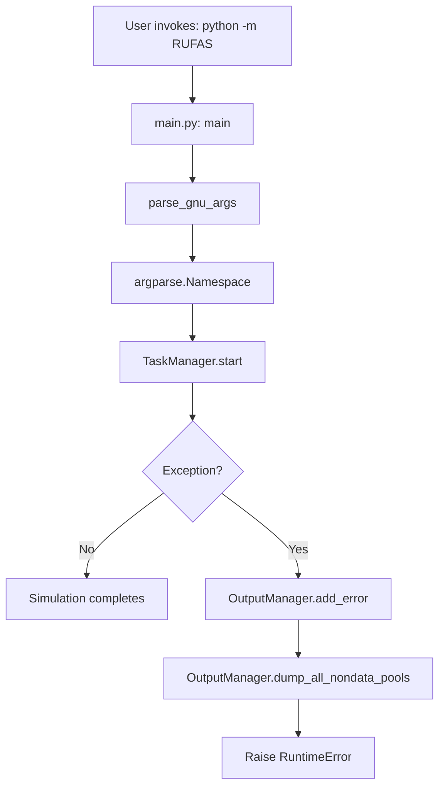

# Other — RUFAS

# Module: `RUFAS/main.py`

## Overview

`main.py` is the command-line entry point for the RuFaS (Ruminal Farm Simulation) application. It is responsible for:

- Parsing user-supplied command-line arguments
- Constructing a `TaskManager` and delegating the simulation run to it
- Capturing and logging any fatal exceptions that occur during the run

The module is intentionally thin: it contains no simulation logic itself, but instead wires together the `TaskManager` (which orchestrates tasks) and the `OutputManager` (which handles logging and diagnostics).

---

## Entry Point: `main()`

```python
def main() -> None:
```

`main()` is the sole public function. It performs the following steps:

1. Calls `parse_gnu_args(sys.argv[1:])` to obtain an `argparse.Namespace` of validated options.
2. Instantiates a `TaskManager`.
3. Invokes `task_manager.start(...)`, passing every relevant option through.
4. On any unhandled exception, it:
   - Creates an `OutputManager`
   - Logs the traceback via `add_error()`
   - Dumps all non-data pools via `dump_all_nondata_pools()`
   - Re-raises the error as a `RuntimeError` with a descriptive message.

### Parameters passed to `TaskManager.start()`

| Parameter                  | Source CLI option          | Type      | Notes                                        |
|----------------------------|----------------------------|-----------|----------------------------------------------|
| `metadata_path`            | `-p` / `--path-to-metadata`| `Path`    | Defaults to `input/task_manager_metadata.json` |
| `verbosity`                | `-v` / `--verbosity`       | `LogVerbosity` or `None` | Converted from string via `LogVerbosity(...)` |
| `exclude_info_maps`        | `-i` / `--exclude-info-maps`| `bool`    |                                              |
| `output_directory`         | `-o` / `--output-dir`      | `Path`    | Defaults to `output/`                        |
| `logs_directory`           | `-l` / `--logs-dir`        | `Path`    | Defaults to `output/logs`                    |
| `clear_output_directory`   | `-c` / `--clear-output`    | `bool`    |                                              |
| `produce_graphics`         | `-g` / `--no-graphics`     | `bool`    | Inverted: `not cmd_arguments.no_graphics`    |
| `suppress_log_files`       | `-s` / `--suppress-log-files`| `bool`  |                                              |
| `metadata_depth_limit`     | `-m` / `--metadata-depth-limit`| `int`  | Optional override                            |

---

## Command-Line Interface: `parse_gnu_args()`

```python
def parse_gnu_args(args: Any | None = None) -> argparse.Namespace:
```

Builds an `argparse.ArgumentParser` with the description *"RuFaS: Whole dairy farm simulation"* and registers the following options:

| Short | Long                     | Action      | Default                          | Help text                                        |
|-------|--------------------------|-------------|----------------------------------|--------------------------------------------------|
| `-g`  | `--no-graphics`          | `store_true`| `False`                          | Prevents graphics from generating                |
| `-v`  | `--verbosity`            | `store`     | `None`                           | Sets the log verbosity level (choices: `errors`, `warnings`, `logs`, `credits`, `none`) |
| `-c`  | `--clear-output`         | `store_true`| `False`                          | Clears output directory before running           |
| `-i`  | `--exclude-info-maps`    | `store_true`| `False`                          | Exclude info_maps from the output                |
| `-o`  | `--output-dir`           | `store`     | `"output/"`                      | The saving directory for output                  |
| `-s`  | `--suppress-log-files`   | `store_true`| `False`                          | Prevents logs from the Task Manager being written to files |
| `-l`  | `--logs-dir`             | `store`     | `"output/logs"`                  | The directory for saving log files               |
| `-m`  | `--metadata-depth-limit` | `store`     | `None`                           | Overrides the default metadata depth limit       |
| `-p`  | `--path-to-metadata`     | `store`     | `"input/task_manager_metadata.json"` | Path to the task manager metadata that determines the tasks run |

### `CaseInsensitiveArgumentAction`

A custom `argparse.Action` subclass is defined and registered with the parser via `parser.register("action", "ci_action", CaseInsensitiveArgumentAction)`. Its `__call__` method sets the attribute for each option string in `self.option_strings`.

> **Note:** Although registered, no argument in the current parser configuration actually uses `action="ci_action"`. The class is effectively dead code at present.

---

## Error Handling

The error-handling path in `main()` is defensive and explicit:

1. **Catch-all**: Any `Exception` (not just `SystemExit` or `KeyboardInterrupt`) is caught.
2. **Logging**: An `OutputManager` is created and `add_error()` is called with:
   - A message containing the original exception text
   - The full traceback via `traceback.format_exc()`
   - An `info_map` identifying the caller as `{"class": "No caller class", "function": "main"}`
3. **Pool dump**: `dump_all_nondata_pools()` is invoked to persist any in-memory state that is not part of the core data.
4. **Re-raise**: The original exception is wrapped in a `RuntimeError` with a message pointing the user to the log files.

This ensures that even a catastrophic failure leaves behind diagnostic artifacts in the logs directory.

---

## Dependencies & Connections

| Import                    | Module                  | Purpose                                                        |
|---------------------------|-------------------------|----------------------------------------------------------------|
| `TaskManager`             | `RUFAS.task_manager`    | Orchestrates the simulation tasks; `start()` is the main entry |
| `OutputManager`           | `RUFAS.output_manager`  | Handles logging, error reporting, and pool dumping             |
| `LogVerbosity`            | `RUFAS.output_manager`  | Enum used to convert the `--verbosity` string to a typed value |
| `Path`                    | `pathlib`               | Type-safe filesystem paths for all directory arguments         |
| `argparse`, `sys`, `traceback`, `Any` | Standard library | CLI parsing, process arguments, traceback formatting, typing   |

### Execution flow



---

## Code Quality Notes

The source file contains **duplicate definitions** of `main()`, `CaseInsensitiveArgumentAction`, `parse_gnu_args()`, and the `if __name__ == "__main__"` guard. In Python, the later definitions silently override the earlier ones, so the module behaves as if only the second set exists. This is harmless at runtime but should be cleaned up to avoid confusion.

Additionally, the `CaseInsensitiveArgumentAction` class is registered but never used by any argument definition — it can be removed along with the `parser.register(...)` call unless future CLI options are planned to use it.

---

## Usage Example

```bash
# Run with default settings
python -m RUFAS

# Run with custom metadata, verbose logging, and no graphics
python -m RUFAS \
  --path-to-metadata config/my_farm.json \
  --verbosity logs \
  --no-graphics \
  --output-dir results/ \
  --logs-dir results/logs/
```