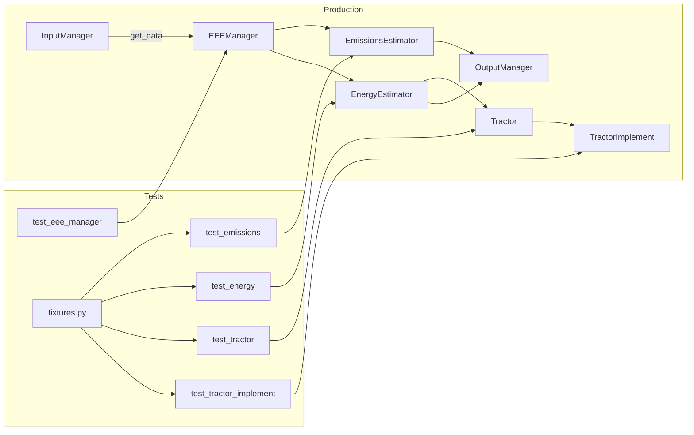

# Other — tests-test_EEE

# tests/test_EEE — EEE Module Test Suite

## Overview

The `tests/test_EEE` package contains the unit test suite for the RUFAS **EEE** (Emissions, Energy, and Equipment) subsystem. The EEE module estimates greenhouse gas emissions and diesel fuel consumption from farm operations — including farm-grown feed production, purchased feed life-cycle assessment (LCA) and land-use change (LUC) emissions, and tractor/implement field operations.

The test suite is organized into five files, each targeting one production class:

| Test file | Class under test | Production module |
|---|---|---|
| `test_eee_manager.py` | `EEEManager` | `RUFAS/EEE/EEE_manager.py` |
| `test_emissions.py` | `EmissionsEstimator` | `RUFAS/EEE/emissions.py` |
| `test_energy.py` | `EnergyEstimator` | `RUFAS/EEE/energy.py` |
| `test_tractor.py` | `Tractor` | `RUFAS/EEE/tractor.py` |
| `test_tractor_implement.py` | `TractorImplement` | `RUFAS/EEE/tractor_implement.py` |

Shared test data lives in `tests/test_EEE/fixtures.py`, which provides raw input dictionaries, parsed intermediate structures, and expected outputs used across the suite.

## Test Infrastructure

### Shared Fixtures

The `fixtures.py` module supplies parametrized data for the emissions and energy tests. The most important fixtures are:

- **Raw input data** — `raw_nitrous_oxide_emissions_data`, `raw_ammonia_emissions_data`, `raw_fertilizer_application_data`, `raw_manure_application_data`, `raw_received_crop_data`, `raw_harvest_data`, `raw_farmgrown_feed_deductions_data`
- **Parsed/expected outputs** — `parsed_emissions_data`, `parsed_fertilizer_and_manure_application_data`, `expected_crop_to_feed_id_mapping`, `expected_harvest_yield_data`, `expected_farmgrown_feed_deductions_data`, `expected_daily_farmgrown_feed_emissions_and_resources`, `expected_daily_farmgrown_feed_fed_emissions_and_resources_by_feed_id`
- **Energy/equipment data** — `parsed_diesel_consumption_inputs`, `EEE_constants`, `tractor_dataset`, `filtered_variable_pool`
- **Factory helpers** — `mock_tractor` and `mock_tractor_implement` construct fully-initialized instances with mocked `InputManager.get_data` calls

Each test file begins with `assert <fixture> is not None` statements. This is a deliberate guard: if a fixture is missing or fails to load, the test module fails at import time rather than producing confusing `None`-related errors mid-test.

### Mocking Strategy

The suite relies heavily on `pytest-mock` (`MockerFixture`) and follows consistent patterns:

- **`InputManager` and `OutputManager` are mocked at the class level** — e.g., `mocker.patch("RUFAS.EEE.emissions.InputManager")` — so tests can control `get_data` responses and capture `add_variable`, `add_variable_bulk`, `add_log`, `add_warning`, and `add_error` calls.
- **`OutputManager.filter_variables_pool` is mocked with `side_effect` lists** to simulate sequential reads of different variable pools (e.g., nitrous oxide data followed by ammonia data).
- **Private methods are patched with `mocker.patch.object`** to isolate a single method under test. For example, `test_estimate_emissions` patches all ten internal parsing/calculation methods of `EmissionsEstimator` and asserts each is called exactly once.
- **`__init__` is sometimes patched to return `None`** (e.g., `mocker.patch.object(EmissionsEstimator, "__init__", return_value=None)`) so tests can construct an instance and then manually set attributes like `em.im`, `em.om`, and `em.crop_species_to_purchased_feed_id` without triggering real initialization logic.

## test_eee_manager.py — EEEManager Orchestration

`EEEManager.estimate_all` is the entry point that dispatches to the emissions and energy estimators. The tests verify two things:

1. **Conditional dispatch** — emissions estimation runs only when `simulate_fields=True`; energy estimation runs unconditionally.
2. **Logging behavior** — the number of `OutputManager.add_log` calls varies by simulation flags.

The parametrized test `test_estimate_all` covers six flag combinations:

| `simulate_animals` | `simulate_feed` | `simulate_fields` | `simulate_manure` | Expected log count | Emissions run? | Energy run? |
|---|---|---|---|---|---|---|
| True | True | True | True | 4 | Yes | Yes |
| False | True | True | True | 4 | Yes | Yes |
| True | False | True | True | 4 | Yes | Yes |
| True | True | True | False | 4 | Yes | Yes |
| True | True | False | True | 1 | No | Yes |
| False | False | False | False | 1 | No | Yes |

The test asserts that `EmissionsEstimator.__init__` and `estimate_farmgrown_feed_emissions` are called **only** when `simulate_fields` is true, and that `EnergyEstimator.estimate_all` is always invoked with the same flag arguments.

## test_emissions.py — EmissionsEstimator

This is the largest test file, covering the full emissions pipeline. The `em` fixture builds an `EmissionsEstimator` with pre-populated state:

- `crop_species_to_purchased_feed_id` — maps crop species to lists of RUFAS feed IDs (e.g., `"corn_silage" → ["50", "51", "52"]`)
- `purchased_feed_emissions_by_location` and `land_use_change_emissions_by_location` — emission factors keyed by feed ID
- `_missing_purchased_ids` and `_missing_land_use_ids` — sets tracking feeds with missing data

### Initialization

`test_emissions_estimator_init` verifies that the constructor builds the `crop_species_to_purchased_feed_id` mapping from `feed_storage_configurations` filtered by `feed_storage_instances`. Only storage types present in the instances (e.g., `"freestall"`) contribute their `rufas_ids`. The companion test `test_emissions_estimator_init_without_feed_storage_data` confirms that when `simulate_feed=False`, feed storage inputs are never read and the mapping stays empty.

### Purchased Feed Emissions

`calculate_purchased_feed_emissions` multiplies feed amounts by emission factors and reports two variables via `OutputManager.add_variable`:

- `purchased_feed_emissions` — LCA emissions
- `land_use_change_emissions` — LUC emissions

Tests cover:
- **String keys** — known IDs are multiplied by their factors; unknown IDs are silently ignored
- **Integer keys** — int feed IDs are stringified for factor lookup, but the output dict preserves original key types
- **Empty input** — still logs both variables with empty dicts

`check_available_purchased_feed_data` validates that all feed IDs have emission factors. When IDs are missing, it emits warnings via `om.add_warning` and accumulates the missing IDs in `_missing_purchased_ids` / `_missing_land_use_ids`. The tests verify both the warning titles/messages and that the missing-ID sets accumulate across multiple calls (set union).

### Farm-Grown Feed Emissions Pipeline

`estimate_farmgrown_feed_emissions` orchestrates the full pipeline. `test_estimate_emissions` mocks all ten internal methods and asserts the call order and single invocation of each:

```
estimate_farmgrown_feed_emissions
├── im.get_data("config")                    # get simulation date range
├── _parse_farmgrown_feeds_emission_data     # N2O + NH3 emission factors
├── _parse_manure_and_fertilizer_application_data
├── _parse_crop_to_feed_id_mapping
├── _parse_harvest_data
├── _parse_farmgrown_feed_deductions_data
├── _calculate_daily_farmgrown_feed_emissions_and_resources
├── _calculate_daily_farmgrown_feed_fed_emissions_and_resources
├── _report_daily_farmgrown_feed_fed_emissions_and_resources
└── _calculate_and_report_lca_emissions
```

The individual parsing methods are tested against the shared fixtures:

- **`_parse_farmgrown_feeds_emission_data`** — calls `filter_variables_pool` twice (N2O then ammonia) and returns a nested dict keyed by emission type → crop → day
- **`_parse_manure_and_fertilizer_application_data`** — same pattern; returns `defaultdict(dict)` when both pools are empty
- **`_parse_crop_to_feed_id_mapping`** — maps `(crop_name, year)` tuples to `RUFAS_ID` values
- **`_parse_harvest_data`** — combines raw harvest data with the crop-to-feed mapping
- **`_parse_farmgrown_feed_deductions_data`** — returns `defaultdict(dict)` on empty input

The calculation methods are verified against expected outputs with `pytest.approx(..., rel=1e-3)`:

- **`_calculate_daily_farmgrown_feed_emissions_and_resources`** — computes per-feed, per-day emissions and resource use from emission factors, application data, and harvest yields
- **`_calculate_daily_farmgrown_feed_fed_emissions_and_resources`** — applies feed deductions to get actual fed amounts
- **`_report_daily_farmgrown_feed_fed_emissions_and_resources`** — asserts `add_variable_bulk` is called `2 * 6` times (two variable types × six feeds)
- **`_calculate_and_report_lca_emissions`** — asserts `add_variable_bulk` is called `2 * 2` times

### Farm-Grown Feed Inventory

`_gather_farmgrown_feed_inventory_data` reads daily storage levels from the variable pool and builds a `{dry_matter_percent: {day: amount}}` structure, zero-filling all simulation days. Two tests cover:

- **Success** — storage levels for DM 12% and 7% are merged into the zero-filled day range
- **Bad key** — a variable name that doesn't match the expected `stored_feed_<id>_dm.daily_storage_levels` pattern triggers `om.add_error` with title `"Farmgrown Feed Data Parsing Error"` and then raises `ValueError` with a message pointing to `emissions.py` filters

### Data Lookup

`_get_feed_emissions_data` selects the emission factor row matching the county code. Tests cover a valid match and a `ValueError` for an unknown county code, which also logs an error via `om.add_error` (note: the test message contains a typo — "country code" — that is asserted verbatim).

## test_energy.py — EnergyEstimator

### estimate_all

`test_estimate_all` verifies the orchestration of diesel consumption estimation. It parametrizes over `tractor_size` being a valid `TractorSize` value or `None`. The test mocks `parse_inputs_for_diesel_consumption_calculation`, `calculate_diesel_consumption`, `report_diesel_consumption`, and the `Tractor` class, then asserts:

- `parse_inputs_for_diesel_consumption_calculation` is called once
- `calculate_diesel_consumption`, `report_diesel_consumption`, and `Tractor` are each called once **per operation** in the parsed inputs
- Each `Tractor` call receives `herd_size=10` and the expected `tractor_size` (or `None` when no size is configured)
- `om.add_variable` is called once per unique `(field_name, operation_year)` pair plus once per unique `operation_year` (field-level and year-level aggregation)

### report_diesel_consumption

Parametrized over five `FieldOperationEvent` types (HARVEST, PLANTING, MANURE_APPLICATION, FERTILIZER_APPLICATION, TILLING), this test verifies the number of `add_variable` calls. The expected count is `5 + N` where 5 is the base variable count and `N` depends on the operation type (1 for planting, 2 for the others).

### parse_inputs_for_diesel_consumption_calculation

Mocks `filter_variables_pool` with a `side_effect` list and asserts the parsed result matches `parsed_diesel_consumption_inputs`.

### calculate_diesel_consumption

Uses `MagicMock(auto_spec=Tractor)` and two `MagicMock(auto_spec=TractorImplement)` instances. The test patches `calculate_operation_time_hr` to return 1.8 for both implements and `_calculate_total_power_needed` to return 18, then verifies the diesel consumption formula produces the expected value. The expected results scale with `crop_yield / field_production_size` and `clay_percent`, and the test confirms `_calculate_total_power_needed` is called once per implement.

### _calculate_total_power_needed

Verifies that total power is the sum of three components:

- `tractor.calculate_axel_power(implement)`
- `implement.calculate_drawbar_power(...)`
- `implement.calculate_needed_PTO(...)`

Each mocked component returns a fixed value, and the test asserts the sum and that each sub-method received the expected arguments.

## test_tractor.py — Tractor

### Tractor Size Selection

`test_herd_size_to_tractor_size` verifies the herd-size → tractor-size mapping:

| Herd size | Expected `TractorSize` |
|---|---|
| 100 | SMALL |
| 500 | MEDIUM |
| 1500 | MEDIUM |
| 2000 | LARGE |
| 3000 | LARGE |

`test_tractor_size_initialization` confirms the size is preserved when explicitly passed. `test_raises_value_error_for_missing_parameters` and `test_herd_size_negative_value_error` verify validation: a `ValueError` is raised when required parameters are missing or herd size is negative.

### Operation Type Determination

`test_determine_operation_type` parametrizes over operation events and crop types, verifying the `operation_types` list:

- **HARVEST** — forage crops (alfalfa, tall fescue in hay/silage/baleage forms) get `[MOWING, WINDROWING, COLLECTION]`; grain crops get `[COLLECTION]`
- **FERTILIZER_APPLICATION** — depth 0 → `FERTILIZER_APPLICATION_SURFACE`; depth > 0 → `FERTILIZER_APPLICATION_BELOW_SURFACE`
- **MANURE_APPLICATION** — same surface/below-surface split
- **PLANTING** → `[PLANTING]`
- **TILLING** → `[TILLING]`

`test_determine_harvest_operation_types` isolates the harvest logic and additionally covers `corn_silage` and `None` crop types, both mapping to `[COLLECTION]`.

Invalid application depths (`None` or negative) raise `AssertionError` in `_determine_fertilizer_application_operation_types` and `_determine_manure_application_operation_types`.

### Power and Mass Properties

Parametrized tests verify the computed properties against expected values from the tractor dataset:

- **`PTO_kW`** — 55.93 / 208.42 / 328.11 for SMALL / MEDIUM / LARGE
- **`power_available_kW`** — `PTO_kW / 1.4`
- **`mass_kg`** — 8400 / 12700 / 20856
- **`speed_km_hr`** — always 10.0

`test_calculate_axel_power` verifies the formula `(tractor_mass + implement_mass) * speed * 0.00022039111111`, covering edge cases like zero speed, zero implement mass, and all-zero inputs.

## test_tractor_implement.py — TractorImplement

### Initialization

`test_init` verifies that the constructor stores the operation event, operation type, crop type, tractor size, and tillage implement, and that it reads `EEE_constants.constants` via `InputManager.get_data` to populate `field_speed_km_per_hr` (10.0) and `field_efficiency` (0.9). It also confirms `determine_implement_parameters` is called with the application depth.

### Implement Parameter Tables

The bulk of this file is a large parametrized test (`test_determine_implement_parameters`) covering the implement parameter lookup for every combination of:

- **Operation type** — PLANTING, MOWING, WINDROWING, COLLECTION
- **Crop type** — alfalfa, cereal rye, corn, soybean, tall fescue, triticale, winter wheat (each in hay/silage/baleage/grain forms where applicable)
- **Tractor size** — SMALL, MEDIUM, LARGE

For each combination, the test asserts the full set of implement parameters: coefficients A, B, C, E, F, G, implement width, mass, throughput, application depth, whether depth is relevant, and the associated `HarvestOperation` type.

The data reveals the underlying model structure:

- **PLANTING** operations use coefficient A (e.g., 200 for small-seeded crops, 900 for corn/soybean) and have a depth-relevant parameter (1.27 for alfalfa, 3.18 for cereal rye/wheat, 4.45 for corn, 3.81 for triticale)
- **MOWING** uses coefficient E=5 and has no throughput
- **WINDROWING** uses coefficient E=1
- **COLLECTION** uses coefficients C and F, with throughput varying by crop (e.g., 6.0 for hay, 8.0 for silage, 20.0 for corn grain)
- Implement width and mass scale with tractor size (e.g., planting width 3.7 → 4.9 → 6.1 for SMALL → MEDIUM → LARGE)

## Relationship to the Production Code

The test suite exercises the EEE subsystem's interaction with the broader RUFAS architecture:



Key integration points verified by the tests:

- **`InputManager.get_data`** — the single data access point, mocked with `side_effect` functions that dispatch on data address strings (`"config.FIPS_county_code"`, `"EEE_constants.constants"`, `"tractor_dataset"`, `"feed_storage_configurations"`, etc.)
- **`OutputManager`** — the reporting sink. Tests assert on `add_variable`, `add_variable_bulk`, `add_log`, `add_warning`, and `add_error` call counts, arguments, and metadata (function name, units)
- **`RUFAS.data_structures`** — enums like `TractorSize`, `FieldOperationEvent`, `OperationType`, `TillageImplement`, and `RUFAS_ID` are used throughout the tests to construct realistic inputs
- **`RUFAS.biophysical.field.crop.harvest_operations.HarvestOperation`** — used in the implement parameter tests to verify harvest-type classification

## Running the Tests

```bash
pytest tests/test_EEE/ -v
```

The suite is designed to run in isolation — all external dependencies (`InputManager`, `OutputManager`, data files) are mocked, so no real input data or county-level datasets are required.