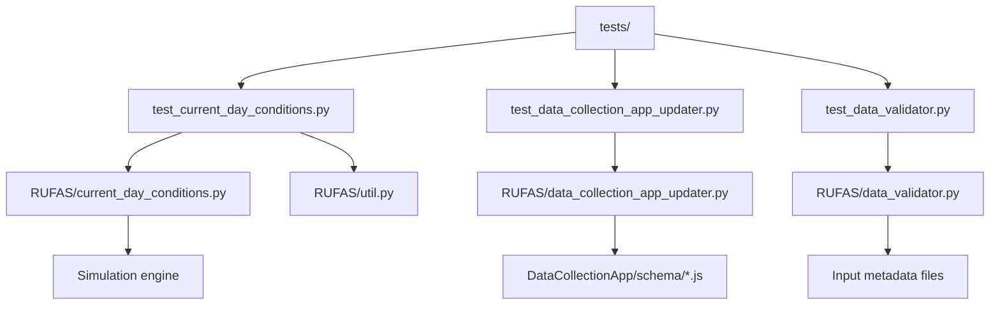

# Other — tests

# RUFAS Test Suite

## Overview

The `tests/` module contains the unit and integration test suite for the RUFAS (Ruminant Farm Systems) model. It validates the behavior of three core subsystems: environmental condition calculations, Data Collection App schema generation, and input data validation. The suite uses `pytest` with `pytest-mock` for mocking, and is organized by the production module each test file targets.

## Test Files and Coverage

| File | Production Module Under Test | Focus |
|---|---|---|
| `test_current_day_conditions.py` | `RUFAS.current_day_conditions` | Day length, solar declination, precipitation partitioning |
| `test_data_collection_app_updater.py` | `RUFAS.data_collection_app_updater` | JSON schema generation for the Data Collection App |
| `test_data_validator.py` | `RUFAS.data_validator` | Type validation, data fixing, metadata validation, cross-validation |

## Current Day Conditions Tests

`test_current_day_conditions.py` verifies the `CurrentDayConditions` class, which computes daily environmental inputs for the simulation.

### Precipitation Partitioning

The `test_current_weather_snowfall` test is parameterized with three scenarios verifying that total precipitation is correctly split into `snowfall` and `rainfall` based on `mean_air_temperature`. When the mean temperature is at or above freezing (1°C), precipitation falls as rain; when below freezing (−1°C), it falls as snow.

### Day Length Calculation

`test_determine_daylength` validates the `determine_daylength` method against known geographic cases:

- **Madison, Wisconsin** (43.073°N) — no polar day/night possible; day length ≈ 9 hours on day 15
- **Barrow, Alaska** (68°N) — polar night (0 hours) in winter, polar day (24 hours) in summer
- **Southern hemisphere** (−68°N) — inverted polar behavior

The test mocks `calculate_solar_declination_radians` and `Utility.convert_ordinal_date_to_month_date` to assert call counts. Notably, the date conversion utility is only invoked for polar locations, confirming that the polar-day/night branch requires calendar lookup while the general case uses a direct formula.

### Solar Declination

`test_calculate_solar_declination_radians` verifies the trigonometric formula:

```
sin_param = (2π / 365) × (day_number − 82)
declination = asin(0.4 × sin(sin_param))
```

## Data Collection App Updater Tests

`test_data_collection_app_updater.py` tests the `DataCollectionAppUpdater` class, which generates JSON schemas consumed by the RUFAS Data Collection App (a web-based data entry interface).

### Schema Generation by Type

The class maintains a `_type_to_schema_map` dispatching to type-specific schema builders. Tests cover each builder:

- **`_create_number_schema`** — maps `minimum`/`maximum` constraints, handles `nullable` by emitting `["number", "null"]` as the JSON type
- **`_create_bool_schema`** — maps to JSON `boolean` with a `checkbox` format
- **`_create_string_schema`** — converts regex `pattern` constraints into `enum` dropdown options via `_get_list_of_options`; falls back to a plain text input with a warning when the pattern is not a valid option list
- **`_create_array_schema`** — wraps element schemas in an `items` block with a `grid` format
- **`_create_object_schema`** — recursively builds nested property schemas

### Feed Schema Updates

The `gather_feed_data` and `update_feed_schema` methods handle the special case of feed definitions. `gather_feed_data` reads a CSV of feed types and produces `{id, name}` pairs formatted as `"Name (description) - id"`. `update_feed_schema` injects these as dropdown options into the feed schema file, preserving the `feed_schema = {...}` JavaScript assignment syntax.

### Schema Rewriting Pipeline

`test_rewrite_schemas` and `test_rewrite_index_page` verify the end-to-end schema regeneration flow:

1. Filter metadata properties by `data_collection_app_compatible: True`
2. Generate a schema for each compatible property group
3. Add a `fileName` input field to each schema
4. Write schema files to `DataCollectionApp/schema/`
5. Rewrite the app's index page to reference the new schema files

### Regex Option Extraction

`_get_list_of_options` parses anchored alternation patterns like `^(kg)$` or `^(Sand|Straw|Sawdust)$` into option lists. Tests verify both successful extraction and `ValueError` raising for malformed patterns (unanchored, invalid character classes, lookaheads).

### Title Parsing

`_parse_variable_name_into_title` converts snake_case identifiers into human-readable titles (`"snake_case"` → `"Snake Case"`), with tests covering mixed-case and already-readable inputs.

## Data Validator Tests

`test_data_validator.py` is the largest test file, covering the `DataValidator` class and its supporting types (`ElementsCounter`, `ElementState`, `CrossValidator`, `Modifiability`).

### Type Validators

Each primitive type validator is tested with parameterized valid/invalid inputs:

- **`_bool_type_validator`** — accepts only `True`/`False` (or `None` when `nullable`)
- **`_number_type_validator`** — enforces `minimum`/`maximum` bounds and type correctness
- **`_string_type_validator`** — enforces `pattern`, `minimum_length`, `maximum_length`
- **`_object_type_validator`** — recursively validates nested properties and removes extraneous keys not declared in metadata
- **`_array_type_validator`** — validates container length constraints and each element via `validate_data_by_type`

### Data Fixing

The `_fix_data` method attempts to repair invalid values using metadata defaults. Tests cover three data types (array, string, number) across two scenarios:

- **Fixable** — a `default` exists in metadata; the value is replaced and a warning pair is logged (`"Validation: invalid data found"` followed by `"Validation: data fixed"`)
- **Critical** — no default exists; an error is logged (`"Validation: invalid data not able to be fixed"`) and the data remains invalid

Tests also verify nested path traversal (e.g., `["element4", "element5"]`) and CSV array element fixing (e.g., `["element1", 4]` for a list index).

### Path Utilities

- **`extract_value_by_key_list`** — navigates nested dicts/lists by a key path; raises `KeyError` for missing keys
- **`convert_variable_path_to_str`** — renders paths as `"animal.herd_information.calf_num"` or `"manure_management_scenarios.[0].bedding_type"` for log messages

### Metadata Validation

`validate_metadata` and its helper methods enforce the structure of metadata files:

- **`_validate_metadata_keys`** — checks required and allowed keys per entry
- **`_validate_has_path_or_paths`** — ensures at least one file path is declared
- **`_validate_metadata_properties`** — rejects empty properties sections
- **`_validate_metadata_type`** — restricts file types to declared valid types (e.g., `{"json", "csv"}`)
- **`_get_paths_to_check`** — normalizes `path`/`paths` into a single list, rejecting `None`, empty lists, and non-string entries

### Metadata Property Validators

Type-specific metadata validators (`_metadata_number_validator`, `_metadata_string_validator`, `_metadata_bool_validator`, `_metadata_array_validator`, `_metadata_object_validator`) check that declared defaults, ranges, and patterns are internally consistent. Tests cover:

- Default values outside `minimum`/`maximum` bounds
- `minimum` > `maximum` (inverted ranges)
- Non-nullable defaults set to `None`
- Invalid regex patterns
- Type mismatches (e.g., string default for a number property)

### Cross-Validation

The `CrossValidator` class (tested via the `cv` fixture) evaluates conditional constraints between variables. Tests verify early termination when an `apply_when` condition fails and `eager_termination` is enabled, with mocked `_target_and_save`, `_evaluate_condition_clause_array`, and `_evaluate_condition` methods.

## Test Infrastructure Patterns

### Mocking Strategy

The suite relies heavily on `pytest-mock`'s `MockerFixture`. Common patterns:

- **`mocker.patch.object`** — replaces methods on production classes to isolate units
- **`mocker.patch("builtins.open", mock_open)`** — simulates file I/O for schema writing
- **`mocker.MagicMock(autospec=...)`** — creates typed stand-ins for collaborators like `ElementsCounter`
- **`mocker.patch.object(pd, "read_csv", ...)`** — stubs pandas I/O

### Fixture Design

Shared fixtures reduce duplication:

- `dca_updater` — a fresh `DataCollectionAppUpdater` instance
- `mock_csv_data` / `mock_user_feed` / `sample_dropdown_data` — consistent feed data shapes
- `mock_schema_content` — a sample JavaScript schema file string
- `cv` — a `CrossValidator` with all collaborator methods pre-mocked

### Parameterization

Most tests use `@pytest.mark.parametrize` to cover edge cases compactly. For example, `test_determine_daylength` encodes five geographic scenarios, and `test_validate_metadata` covers thirteen metadata structure variations.

## Relationship to the RUFAS Codebase



The test suite validates the contract between RUFAS's input handling pipeline and its downstream consumers:

- **`CurrentDayConditions`** feeds daily weather parameters into the simulation engine; tests ensure day length and precipitation partitioning are physically correct across latitudes and seasons.
- **`DataCollectionAppUpdater`** bridges RUFAS metadata to the web-based data entry app; tests guarantee generated schemas are structurally valid and preserve user-facing labels and constraints.
- **`DataValidator`** guards the integrity of user-supplied input files; tests verify that invalid data is either repaired with defaults or rejected with actionable error messages, and that metadata declarations are self-consistent before simulation runs.

## Running the Tests

```bash
# Run the full suite
pytest tests/

# Run a single test file
pytest tests/test_data_validator.py

# Run tests matching a pattern
pytest tests/ -k "schema or validator"

# Run with coverage
pytest tests/ --cov=RUFAS --cov-report=term-missing
```