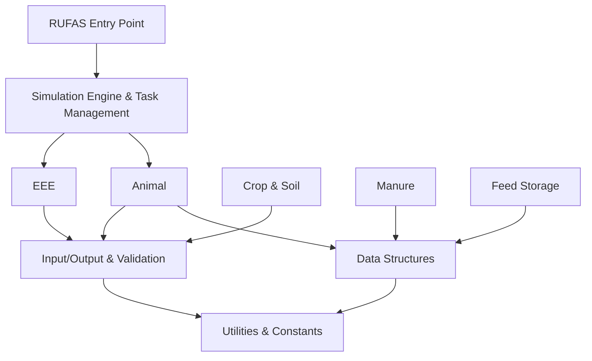

# RuFaS — Wiki

# RuFaS: Ruminant Farm Systems Model

Welcome to the RuFaS wiki! Whether you're a new contributor, a researcher extending the model, or just curious about how a whole-farm simulation is built, this page will get you oriented.

## What is RuFaS?

**RuFaS** (Ruminant Farm Systems) is an open-source, next-generation, whole-farm modeling environment that simulates dairy farm production and environmental impact. It models the full lifecycle of dairy cattle — growth, reproduction, milk production, nutrition, and mortality — alongside the crops that feed them, the manure they produce, and the energy and emissions associated with the entire operation.

The model is designed to support research, innovation, and sustainable decision-making in ruminant animal agriculture. It is written in Python (3.12–3.14) and licensed under GPL-3.0.

## Architecture at a Glance

RuFaS is organized as a set of cooperating modules, each owning one slice of the farm system. The simulation is driven by a central engine that orchestrates the biophysical modules, while shared data contracts and an input/output backbone keep everything connected.



### The Modules

- **[Animal](animal.md)** — The heart of the farm. Models individual dairy cattle from calf to cull, including growth, reproduction, lactation, nutrition, genetics, and mortality. It reports daily herd state and ration data to the rest of the system.
- **[Crop and Soil](crop-and-soil.md)** — Simulates crop growth, development, and harvest on each field, based on the plant-growth routines from the SWAT model. It consumes manure and fertilizer and produces feed for the animals.
- **[Manure](manure.md)** — Models the complete on-farm manure management system: collection from housing, processing through a configurable network of handlers, digesters, separators, and storages, and eventual application to fields as fertilizer.
- **[Feed Storage](feed-storage.md)** — Tracks feed inventories between harvest and consumption, bridging the crop and animal subsystems.
- **[EEE](eee.md)** — Estimates environmental and energy impacts: nitrous oxide and ammonia emissions from feed production, plus diesel fuel consumption for field operations.
- **[Data Structures](data-structures.md)** — The data contracts that carry information between modules. No simulation logic here — just the dataclasses, enums, and helpers that define what crosses each module boundary.
- **[Input/Output and Validation](input-output-and-validation.md)** — The data backbone. Loads and validates inputs against metadata-defined schemas, stores them in a central pool, collects outputs and warnings, and persists results to files.
- **[Simulation Engine and Task Management](simulation-engine-and-task-management.md)** — The orchestrator. Drives the daily simulation loop, dispatching work to the biophysical modules and collecting their outputs.
- **[Utilities and Constants](utilities-and-constants.md)** — Foundational infrastructure: unit definitions, physical constants, time tracking, weather data management, and generic helper functions used everywhere.
- **[Helpful Scripts](helpful-scripts.md)** — Standalone tools, such as the emissions interpolation script that fills gaps in county-level feed emissions data.

## How a Simulation Runs

At a high level, a simulation proceeds like this:

1. **Setup** — The [Input/Output and Validation](input-output-and-validation.md) module loads and validates the farm configuration, weather data, and management schedules.
2. **Daily loop** — The [Simulation Engine and Task Management](simulation-engine-and-task-management.md) module advances the simulation day by day, invoking the biophysical modules in sequence.
3. **Biophysical updates** — The [Animal](animal.md), [Crop and Soil](crop-and-soil.md), [Manure](manure.md), and [Feed Storage](feed-storage.md) modules update their state, exchanging data through the contracts defined in [Data Structures](data-structures.md).
4. **Impact estimation** — The [EEE](eee.md) module computes emissions and energy use for the simulated operations.
5. **Output collection** — All modules report variables, warnings, and errors back through the output manager in [Input/Output and Validation](input-output-and-validation.md), which persists them to files.

Throughout the loop, every module leans on [Utilities and Constants](utilities-and-constants.md) for unit conversions, physical constants, and time/weather bookkeeping.

## Getting Started

RuFaS requires **Python 3.12 or 3.13**. To set up a development environment:

```bash
# Clone the repository
git clone https://github.com/RuminantFarmSystems/RuFaS.git
cd RuFaS

# Create and activate a virtual environment
python -m venv .venv
source .venv/bin/activate   # on Windows: .venv\Scripts\activate

# Install the package with its dependencies
pip install -e .
```

The core dependencies are pinned for reproducibility: `numpy==2.2.0`, `salib==1.5.1`, plus `matplotlib`, `pandas`, `scipy`, and `typing_extensions`. The project maintains a CI pipeline that runs Flake8, Pytest (99% coverage), and Mypy on every change.

## Where to Go Next

- New to the codebase? Start with [Data Structures](data-structures.md) to understand how modules talk to each other, then read [Animal](animal.md) to see the most complex biophysical module in action.
- Interested in a specific subsystem? Jump straight to [Manure](manure.md), [Crop and Soil](crop-and-soil.md), or [EEE](eee.md).
- Want to understand how a simulation is driven end to end? Read [Simulation Engine and Task Management](simulation-engine-and-task-management.md) and [Input/Output and Validation](input-output-and-validation.md).

Happy modeling!