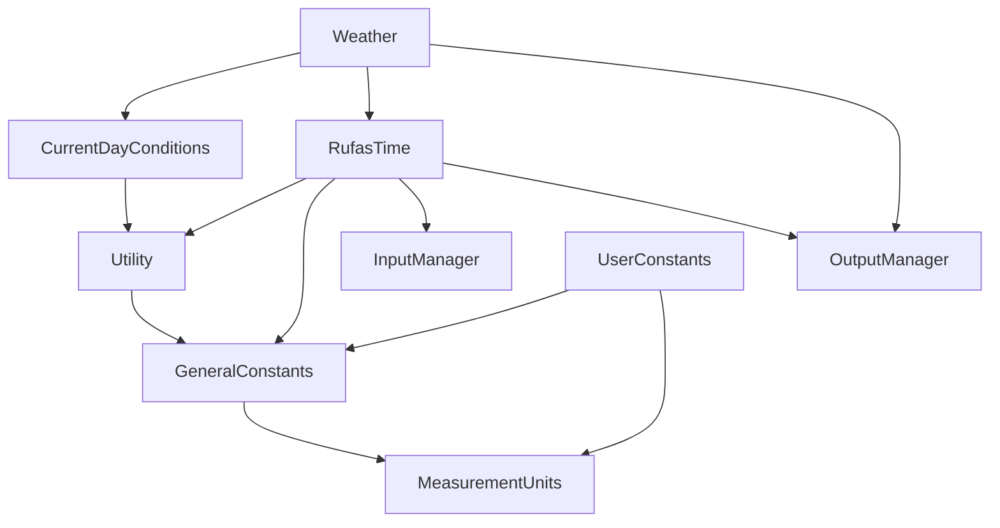

# Utilities and Constants

# Utilities and Constants Module

## Overview

This module provides the foundational infrastructure for the RUFAS (Ruminant Farm Systems) simulation framework. It contains shared utilities, unit definitions, physical constants, time tracking, and weather data management that are used across all simulation components (animal, field, manure, and emissions modules).

The module is organized into seven files:

| File | Responsibility |
|------|----------------|
| `util.py` | Generic helper functions and aggregation operations |
| `units.py` | Measurement unit definitions and unit arithmetic |
| `general_constants.py` | Physical and conversion constants (not user-overridable) |
| `user_constants.py` | Constants that users may override |
| `rufas_time.py` | Simulation time tracking and date conversion |
| `current_day_conditions.py` | Daily weather/field condition container |
| `weather.py` | Weather data loading, modeling, and access |

## Architecture



The dependency direction is strictly one-way: `weather.py` and `rufas_time.py` depend on the utility and constants layers, never the reverse. This keeps the foundation stable and reusable.

## Utility Functions (`util.py`)

The `Utility` class contains static methods grouped by purpose:

### Data Structure Conversion

- **`convert_list_of_dicts_to_dict_of_lists(list_of_dicts)`** — Transposes a list of dictionaries into a dictionary of lists, grouping values by key. Used by `OutputManager._parse_filtered_variables`.
- **`convert_dict_of_lists_to_list_of_dicts(dict_of_lists)`** — Inverse operation; produces a list of dictionaries from a dictionary of equal-length lists.
- **`flatten_dictionary(input_dictionary, parent_key="", separator=".")`** — Recursively flattens nested dictionaries. Lists of dictionaries are flattened by index, with the index appended to the key as `_{i}`. This is the inverse of `flatten_keys_to_nested_structure`.
- **`flatten_keys_to_nested_structure(input_dict)`** — Reconstructs a nested structure (dicts and lists) from flat, dot-separated keys. Numeric key segments become list indices; non-numeric segments become dictionary keys.
- **`find_group_prefixes_from_keys(data, required_suffixes=None)`** — Extracts unique group prefixes from flattened keys of the form `<group_prefix>.<suffix>`. Optionally filters to prefixes that have at least one suffix in `required_suffixes`.
- **`convert_list_to_dict_by_key(list_of_dicts, id_key)`** — Converts a list of dictionaries into a dictionary keyed by a specified identifier. The identifier key is removed from each value. Note: uses `deepcopy` internally to avoid mutating the input list.

### Temporal Data Expansion

**`expand_data_temporally(data_to_expand, simulation_length, fill_value=np.nan, ...)`** pads daily data so that values exist for every simulation day. It accepts a dictionary of variables, each with `values` and `info_maps` (metadata including `simulation_day` and `units`), and returns the expanded data plus a log of warnings.

The expansion behavior is controlled by three flags:

- `use_fill_value_before_start` — days before the first known datapoint
- `use_fill_value_in_gaps` — days between known datapoints
- `use_fill_value_at_end` — days after the last known datapoint

When a flag is `False`, the last known value is carried forward instead of the fill value. If the fill value's type does not match the data type (e.g., filling a list-valued variable with `np.nan`), a warning is logged and the last-known-value strategy is used for all regions.

The helper `_gather_data_sim_days(data_to_expand)` validates the input structure and collects all simulation days from the info maps. It raises `TypeError` if info maps are missing, and `ValueError` for length mismatches or missing `simulation_day` keys.

### Merging and Mutation

- **`deep_merge(target, updates)`** — Recursively merges `updates` into `target` in-place. Supports nested dictionaries, lists of dictionaries, and dictionaries containing lists. Lists are extended with `None` placeholders when the target is shorter than the update.
- **`remove_items_from_list_by_indices(data, indices_to_remove)`** — Removes items in-place. Indices are sorted in reverse before deletion to prevent index shifting.

### Numeric Helpers

- **`calc_average(num_values, cur_avg, new_value)`** — Incrementally updates a running average. Returns `(new_count, new_average)`.
- **`clamp(value, minimum=0.0, maximum=1.0)`** — Constrains a value to the inclusive range `[minimum, maximum]`.
- **`percent_calculator(denominator)`** — Returns a closure that computes `numerator * 100 / denominator`. The denominator is captured at creation time.
- **`generate_random_number(mean, std_dev)`** — Draws a sample from a normal distribution.
- **`generate_bivariate_random_numbers(mu_x, mu_y, sigma_x, sigma_y, rho)`** — Draws two correlated samples from a bivariate normal distribution. Validates that standard deviations are positive and `rho` is in `[-1, 1]`.
- **`compare_randomized_rate_less_than(reference_rate)`** — Returns `True` with probability `reference_rate` (uses `random.random()`).
- **`round_numeric_values_in_dict(data, significant_digits)`** — Rounds all numeric values in a dictionary. Lists of numbers are rounded element-wise.

### Validation

- **`determine_if_all_non_negative_values(values)`** — Returns `True` if all values are ≥ 0.
- **`validate_fractions(fractions)`** — Returns `True` if all fractions are in `[0.0, 1.0]`.
- **`validate_date_format(date_format)`** — Checks that a format string works for both `strftime()` and `strptime()`.

### Date and Time Helpers

- **`get_timestamp(include_millis=False)`** — Returns the current system time formatted as `%d-%b-%Y_%a_%H-%M-%S` (optionally with milliseconds). Used by `OutputManager` for error/warning timestamps.
- **`generate_time_series(date, starting_offset, ending_offset)`** — Generates a list of dates relative to a given date. Raises `ValueError` if `starting_offset > ending_offset`.
- **`convert_ordinal_date_to_month_date(year, day)`** — Converts a year and ordinal day to a `datetime.date`. Validates the day against the year length (365 or 366 for leap years).
- **`back_track_birth_date(days_born, current_date)`** — Subtracts a number of days from a date.
- **`get_date_formatter(date_format)`** — Returns a `matplotlib.dates.DateFormatter` for the requested format. Falls back to `"%d/%m/%Y"` if the format is `None` or invalid.

### Unit Conversion

- **`convert_celsius_to_kelvin(temperature)`** — Adds `GeneralConstants.CELSIUS_TO_KELVIN` (273.15) to the input.

### File and String Operations

- **`empty_dir(dir_path, keep=None)`** — Deletes all files and subdirectories in a directory, optionally preserving a list of names.
- **`remove_special_chars(input_string)`** — Removes characters that are invalid in filenames (`<`, `>`, `:`, `/`, `"`, `|`, `\`, `?`, `*`, `.`).
- **`filter_dictionary(dict_to_filter, filter_patterns, filter_by_exclusion)`** — Filters a dictionary by regex patterns, either by inclusion or exclusion.
- **`combine_saved_input_csv(saved_csv_working_folder, output_csv_path, import_csv_path)`** — Merges multiple saved input CSV files into a single `saved_input_data.csv` for side-by-side comparison. All CSVs are merged on `property_group` and `variable_name`. Duplicate column prefixes are disambiguated with numeric suffixes. The working folder is deleted after merging.

### Serialization

- **`make_serializable(obj, max_depth=3)`** — Recursively converts an object into a JSON-serializable form. Handles primitives, enums, lists, tuples, sets, dictionaries, and custom classes. At `max_depth`, objects are converted to strings via `_get_str`.
- **`_get_str(obj)`** — Returns a compact string representation. If the object has a custom `__str__`, it is used; otherwise, the format is `<Class> object at <hex_address>` (omitting the module prefix to save space).

### List Elongation

- **`elongate_list(list_to_elongate, reference_list_length)`** — If the input list has length 1, returns it repeated `reference_list_length` times. Used by Schedule-descendant classes to broadcast a single value across all years.

## Aggregator Class

The `Aggregator` class provides stateless aggregation functions used by the simulation's reporting and calculation pipelines:

| Method | Behavior |
|--------|----------|
| `average(data)` | Arithmetic mean; returns `0` for empty input |
| `sum(data)` | Sum of all values |
| `product(data)` | Product of all values; returns `1` for empty input |
| `standard_deviation(data)` | Population standard deviation; returns `0` for empty input |
| `division(data)` | Divides the first element by each subsequent element; returns `None` if fewer than 2 elements or if any divisor is zero |
| `subtraction(data)` | Subtracts each subsequent element from the first; returns `None` if fewer than 2 elements |
| `no_op(data)` | Pass-through; returns `None` for falsy input |

## Measurement Units (`units.py`)

The `MeasurementUnits` enum defines all acceptable units in the model. Each member has a string value (e.g., `MeasurementUnits.KILOGRAMS_PER_DAY` has value `"kg/day"`). The enum is `@unique`, so no two members share a value.

The enum also provides static methods for unit arithmetic:

- **`_parse_unit(unit)`** — Parses a unit string into a dictionary mapping unit names to integer exponents. Supports `*` for multiplication and `^` for exponents (e.g., `"kg*m^2"` → `{"kg": 1, "m": 2}`).
- **`extract_units(key)`** — Extracts units from a key string by finding the parenthesized portion. Returns `(numerator_units, denominator_units)` as dictionaries. If the units contain a `/`, the part before the slash is the numerator and the part after is the denominator. Returns `({}, {})` if no parenthesized units are found.
- **`adjust_unit_exponents(units1, units2)`** — Combines two unit dictionaries by adding exponents. Units with a resulting exponent of zero are removed. The special units `"unitless"` and `"1"` are ignored.
- **`simplify_units(numerator, denominator)`** — Cancels common units between numerator and denominator by subtracting exponents. Returns the simplified numerator and denominator dictionaries.
- **`units_to_string(numerator, denominator)`** — Converts unit dictionaries back to a string. Exponents of 1 are omitted; zero-exponent units are dropped. Returns `"unitless"` if both dictionaries are empty.

These methods are used by `ReportGenerator` to combine and display units in generated reports.

## Constants

### `GeneralConstants`

Contains physical constants and unit conversion factors that are fixed for the model. Key categories:

- **Memory**: `BYTES_PER_GB`
- **Length**: `MM_TO_M`, `CM_TO_MM`, `MM_TO_CM`, `M_TO_KM`, `KM_TO_M`
- **Mass**: `GRAMS_TO_KG`, `KG_TO_GRAMS`, `KG_TO_MILLIGRAMS`, `MILLIGRAMS_TO_KG`, `MEGAGRAMS_TO_KILOGRAMS`, `KILOGRAMS_TO_MEGAGRAMS`
- **Volume**: `LITERS_TO_CUBIC_METERS`, `CUBIC_METERS_TO_LITERS`, `KG_TO_CUBIC_METERS`, `LITERS_TO_CUBIC_MILLIMETERS`, `CUBIC_MILLIMETERS_TO_LITERS`, `CUBIC_METERS_TO_CUBIC_MILLIMETERS`, `CUBIC_MILLIMETERS_TO_CUBIC_METERS`
- **Time**: `YEAR_LENGTH` (365), `LEAP_YEAR_LENGTH` (366), `SECONDS_PER_DAY` (86400), `HOURS_PER_DAY` (24)
- **Biochemistry**: `MCAL_TO_MJ` (4.184), `G_CH4_TO_MJ_CH4` (0.05565)
- **Earth**: `EARTH_ANGULAR_VELOCITY` (0.2618 rad/h)
- **Temperature**: `CELSIUS_TO_KELVIN` (273.15)
- **Fractions**: `PERCENTAGE_TO_FRACTION` (0.01), `FRACTION_TO_PERCENTAGE` (100.0)
- **Area**: `HECTARES_TO_SQUARE_CENTIMETERS`, `SQUARE_CENTIMETERS_TO_HECTARES`, `HECTARES_TO_SQUARE_MILLIMETERS`, `SQUARE_MILLIMETERS_TO_HECTARES`, `SQUARE_KILOMETERS_TO_HECTARES`, `HECTARES_TO_SQUARE_KILOMETERS`, `HECTARES_PER_SQUARE_METER`, `SQUARE_METERS_TO_HECTARES`
- **Manure**: `AMBIENT_AIR_MOLE_FRACTION_OF_OXYGEN` (0.21), `GAS_CONSTANT` (8.314 J/K/mol), `IDEAL_GAS_LAW_R` (0.0821 L·atm/(mol·K))

The `CONSTANTS_TO_UNITS` dictionary maps each constant name to its corresponding `MeasurementUnits` member.

### UserConstants

Contains constants that users may override via configuration. These are defined in terms of `GeneralConstants` where applicable:

- **Density**: `WATER_DENSITY_KG_PER_LITER` (0.997), `WATER_DENSITY_KG_PER_M3` (derived)
- **Biochemistry**: `PROTEIN_TO_NITROGEN` (0.16), `NITROGEN_TO_PROTEIN` (6.25), `MILK_FAT_WEIGHT` (12.2 kg), `FRACTION_OF_HUMIC_NITROGEN_IN_ACTIVE_POOL` (0.02)
- **Methane**: `METHANE_FACTOR` (0.67 kg/m³)
- **Temperature bounds**: `GENERAL_LOWER_BOUND_TEMPERATURE` (-40.0 °C), `GENERAL_UPPER_BOUND_TEMPERATURE` (60.0 °C)
- **Energy**: `SPECIFIC_FUEL_CONSUMPTION` (0.2234 L/kWh)

Like `GeneralConstants`, it provides a `CONSTANTS_TO_UNITS` mapping.

## Time Tracking (`RufasTime`)

The `RufasTime` class tracks simulation time and provides date conversions. It is instantiated with optional `start_date`, `end_date`, and `current_date`; if not provided, these are read from the configuration via `InputManager`.

### Core State

- `start_date`, `end_date`, `current_date` — `datetime` objects
- `simulation_length_days` — total days in the simulation (inclusive)
- `simulation_length_years` — number of calendar years spanned

### Time Advancement

- **`advance()`** — Increments `current_date` by one day.

### Date Properties

| Property | Description |
|----------|-------------|
| `year_start_day` | First Julian day of the current year (accounts for partial start year) |
| `year_end_day` | Last Julian day of the current year (accounts for partial end year and leap years) |
| `current_julian_day` | Julian day of the current date |
| `current_month` | Month of the current date |
| `current_simulation_year` | Year relative to the simulation start (1-based) |
| `current_calendar_year` | Calendar year of the current date |
| `simulation_day` | Days since the simulation start (0-based) |

### Date Conversion

- **`convert_simulation_day_to_date(simulation_day)`** — Converts a 1-based simulation day to a `datetime` relative to `start_date`.
- **`convert_year_jday_to_date(year, day)`** — Static method; converts a year and ordinal day to a `datetime`.
- **`convert_slice_to_simulation_day(slice_day)`** — Converts a slice index to a simulation day. `0` maps to `1`; negative values count backward from the end of the simulation.

### Recording

- **`record_time()`** — Records the current day, simulation year, calendar year, and simulation day as daily variables in the `OutputManager`.

## Daily Conditions (`CurrentDayConditions`)

A `@dataclass` that bundles all weather and field conditions for a single day. It is the primary data structure passed to field and field-manager logic.

### Fields

| Field | Type | Default |
|-------|------|---------|
| `incoming_light` | `float` | required — MJ/m² |
| `min_air_temperature` | `float` | required — °C |
| `mean_air_temperature` | `float` | required — °C |
| `max_air_temperature` | `float` | required — °C |
| `daylength` | `Optional[float]` | `None` — hours |
| `annual_mean_air_temperature` | `Optional[float]` | `None` — °C |
| `snowfall` | `float` | `0.0` — mm |
| `rainfall` | `float` | `0.0` — mm |
| `irrigation` | `float` | `0.0` — mm |
| `precipitation` | `float` | `0.0` — mm |

### Behavior

In `__post_init__`, the `precipitation` value is assigned to either `snowfall` (if `mean_air_temperature < 0`) or `rainfall` (otherwise).

### Static Methods

- **`determine_daylength(day_number, geographic_latitude, year)`** — Calculates day length in hours using the SWAT model's solar declination approach. Handles polar day/night cases (returns 24 or 0 hours) and otherwise computes `2 * acos(-tan(declination) * tan(latitude)) / EARTH_ANGULAR_VELOCITY`.
- **`calculate_solar_declination_radians(day_number)`** — Computes solar declination in radians using the SWAT 1:1.1.2 formula.

## Weather (`Weather`)

The `Weather` class loads and manages all weather data for a simulation.

### Initialization

`Weather(weather_file, time)` takes a dictionary with keys `year`, `jday`, `Hday`, `low`, `avg`, `high`, `precip`, and `irrigation` (each a list of values). It:

1. Validates that the weather data covers the entire simulation period via `check_adequate_weather_data`.
2. Builds a `weather_data` dictionary mapping `datetime` keys to `CurrentDayConditions` instances, including only dates within the simulation period.
3. Logs a warning for duplicate weather dates.
4. Computes the long-term average annual temperature from all daily averages.
5. Fits a sinusoidal temperature model via `set_linest_temperature_factors`.

### Temperature Model

`set_linest_temperature_factors()` performs least-squares regression to fit the model:

```
T(d) = A*cos(d) + B*sin(d) + C
```

where `d` is the Julian day. The fitted parameters are stored as:

- `intercept_mean_temp` — the intercept term (mean temperature)
- `amplitude` — the amplitude of the seasonal cycle
- `phase_shift` — the day of peak temperature

Days with missing (NaN) mean temperatures are excluded from the regression.

### Daily Access

- **`get_current_day_conditions(time, latitude=None)`** — Returns the `CurrentDayConditions` for the current simulation date. If `latitude` is provided, computes the daylength; otherwise leaves it as `None`. Raises `KeyError` if the date is not in the weather data.
- **`get_conditions_series(time, starting_offset, ending_offset, latitude=None)`** — Returns a chronological list of `CurrentDayConditions` for a range of days relative to the current date.

### Recording

- **`record_weather(time)`** — Records precipitation, rainfall, snowfall, maximum/minimum/average temperature, radiation, and irrigation as daily variables in the `OutputManager`.

### Validation

- **`check_adequate_weather_data(weather_file, time)`** — Verifies that every day in the simulation period has a corresponding weather entry. Raises `ValueError` and logs an error if any day is missing.

## Integration with the Rest of the Codebase

This module is the foundation layer of RUFAS. The following patterns show how it connects to the broader simulation:

- **`OutputManager`** — `Utility.get_timestamp()` is used for error/warning timestamps; `Utility.convert_list_of_dicts_to_dict_of_lists()` is used when parsing filtered variables; `RufasTime.record_time()` and `Weather.record_weather()` write daily variables.
- **`InputManager`** — `RufasTime` reads start/end dates from the configuration.
- **`ReportGenerator`** — Uses `MeasurementUnits.extract_units()`, `adjust_unit_exponents()`, `simplify_units()`, and `units_to_string()` for unit aggregation and display.
- **Field and crop modules** — `CurrentDayConditions` is the standard weather container passed to field logic; `Utility.convert_celsius_to_kelvin()` is used in manure storage methane calculations.
- **Schedule classes** — `Utility.elongate_list()` is used to broadcast single values across multiple years.
- **Event system** — `RufasTime.convert_year_jday_to_date()` is used to parse event dates.

The module has no dependencies on simulation-specific modules (biophysical, field, manure, etc.), which keeps it reusable and testable in isolation.